# Checkpoint — Déploiement avec Dokploy

**AP 2 — En cours depuis le 26 novembre 2026, mis à jour le 27 novembre 2026 : site Checkpoint v1.1 relié à sa base, redéployé automatiquement à chaque commit ; commande avec paiement simulé et pages légales conformes ; espace client fictif avec panel de serveur et support traçable ; recette T04 à T10 réussie. HTTPS, supervision et serveur de jeu restent à faire.**

Cette procédure suit le déploiement de **Checkpoint**, le site de JCorp, sur la plateforme Dokploy installée sur `JCORP-APP01` ([procédure d'installation](../Infrastructure/Dokploy/Dokploy.md)). Le contenu attendu du site est décrit dans le [cahier des charges](Site-hebergement-jeux.md) et la recette dans le [plan de validation](Plan-de-validation.md).

## Paramètres relevés

| Élément | Valeur |
| --- | --- |
| Projet Dokploy | `Checkpoint`, environnement unique `production` |
| Base | service `checkpoint-db`, PostgreSQL **18**, base et utilisateur `checkpoint`, nom interne `checkpoint-checkpointdb-aowmfw`, aucun port publié |
| Dépôt du site | [g0shtj0sh/checkpoint](https://github.com/g0shtj0sh/checkpoint), public, branche `main` |
| Application | service `checkpoint-site`, construit par Nixpacks, **Next.js 16.4.6** sur **Node 22.14.0** |
| Version déployée | commit `4882a99` |
| Adresse | `http://checkpoint.ad.jcorp`, enregistrement A vers `10.2.101.154` dans la zone `ad.jcorp` |
| Poste de développement | Windows, Node.js 24.20.0, Git 2.55.0 |
| Date et opérateur | 26 novembre 2026, Joshua Fernandes |

## Étape 1 — Projet et environnement

Dans Dokploy, un **projet** regroupe tous les services d'une application. J'ai créé le projet `Checkpoint` ; Dokploy y crée automatiquement l'environnement `production`.

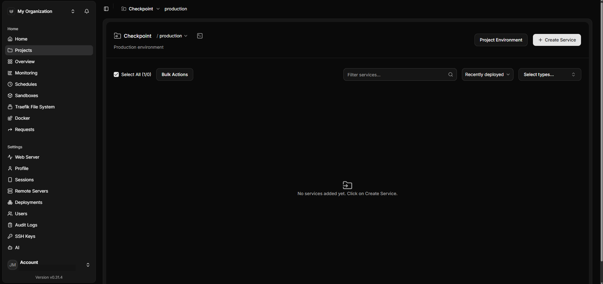

**Écart assumé : un seul environnement.** Une entreprise ajouterait un environnement `staging` pour valider une version avant la production. Ici, il doublerait la mémoire consommée par le site et la base sur une VM de 4 Go qui doit aussi accueillir le serveur de jeu. Les mises à jour et le retour arrière prévus au plan de validation sont testés directement en production, sur des modifications sans effet sur la base.

## Étape 2 — Base PostgreSQL

La base est créée avant le site, qui aura besoin de ses paramètres de connexion. *Create Service* → *Database* → *PostgreSQL* :

| Champ | Valeur | Raison |
| --- | --- | --- |
| Name | `checkpoint-db` | nom affiché |
| Database Name / User | `checkpoint` | compte dédié au site plutôt que le super-utilisateur `postgres` |
| Password | généré par Dokploy | long et aléatoire ; il n'apparaît ni ici ni sur les captures |
| Docker image | `postgres:18` | version proposée par défaut, la plus récente, maintenue jusqu'en 2030 |
| External Port | vide | base joignable uniquement depuis le réseau Docker, jamais depuis le VLAN |

J'avais d'abord proposé `postgres:16`, la version qu'utilise Dokploy pour ses propres données. La 18 est préférable pour une nouvelle base : elle sera maintenue deux ans de plus, et c'est pour elle que Dokploy a réglé le chemin du volume de données, modifié dans cette version. Les deux bases sont indépendantes.

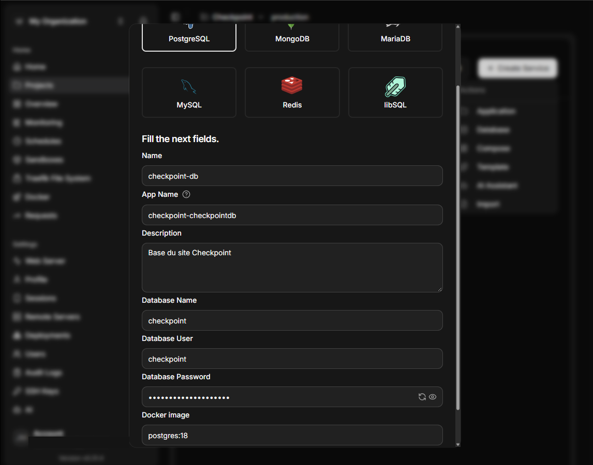

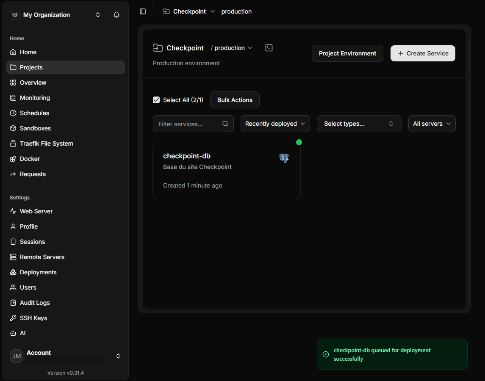

**Résultat observé :** sur la VM, le service `checkpoint-checkpointdb-aowmfw` tourne en `postgres:18`, 1/1, **sans port publié**. Dokploy ajoute un suffixe aléatoire au nom interne : c'est ce nom complet que le site utilisera pour joindre la base.

## Étape 3 — Dépôt GitHub du site

Le code du site a son propre dépôt, séparé de la documentation. Il est **public** : Dokploy peut le cloner sans identifiants, et le code ne contiendra aucun secret, les paramètres de la base restant dans Dokploy. Il est créé avec un README pour disposer immédiatement d'un premier commit et de la branche `main`.

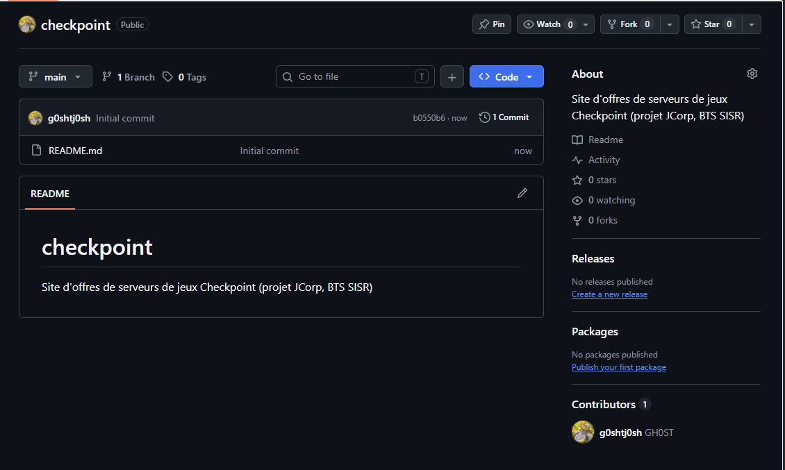

```powershell
cd "C:\Users\joshua.melgar\Desktop\Cours Pro\SISR\New AP JCorp"
git clone https://github.com/g0shtj0sh/checkpoint.git
cd checkpoint
Remove-Item README.md
```

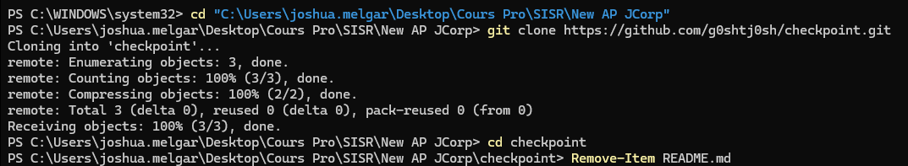

Le README est supprimé parce que l'outil de création de Next.js refuse un dossier non vide ; il en génère un nouveau.

## Étape 4 — Projet Next.js

### Incident — Exécution des scripts bloquée

**Symptôme :** `npx create-next-app@latest .` échoue : *l'exécution de scripts est désactivée sur ce système*.

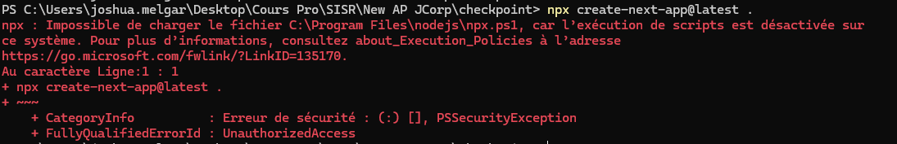

**Cause :** sous PowerShell, `npx` passe par un script `npx.ps1`, et la politique d'exécution du poste interdit les scripts `.ps1`.

**Correction :** appeler la version `npx.cmd` installée avec Node, que cette politique ne concerne pas. Aucun réglage de sécurité du poste n'est modifié.

**Leçon :** contourner une restriction en la levant n'est pas la seule option ; ici une alternative prévue par l'outil suffit.

```powershell
npx.cmd create-next-app@latest .
```

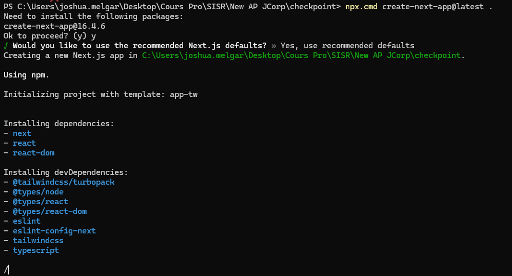

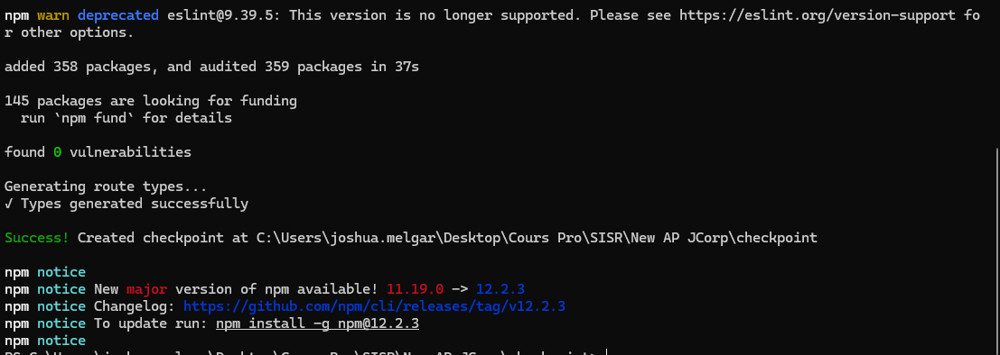

**Résultat observé :** Next.js **16.4.6**, avec TypeScript, Tailwind CSS, ESLint et l'App Router, choix recommandés par l'outil ; 358 paquets installés, aucune vulnérabilité. Le code est dans `app/` à la racine plutôt que dans `src/app/` : sans conséquence pour la suite.

```powershell
npm.cmd run dev
```

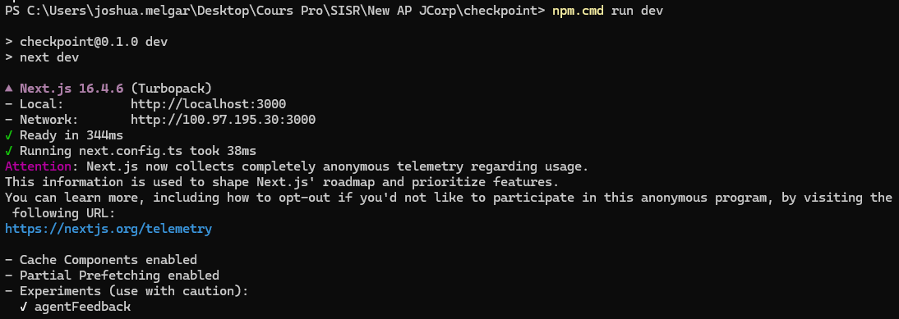

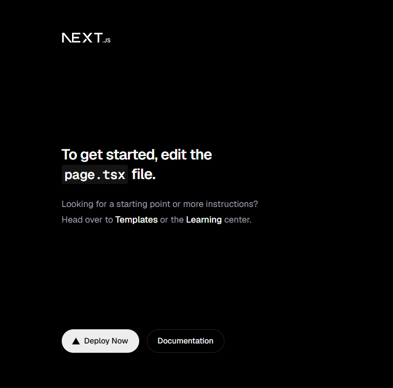

La ligne *Network* du serveur de développement affiche une adresse `100.97.x.x`, sans rapport avec le VLAN du projet : elle n'est pas utilisée.

## Étape 5 — Premier envoi

```powershell
git status
git add -A
git commit -m "Créer le projet Next.js du site Checkpoint"
git push
```

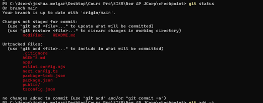

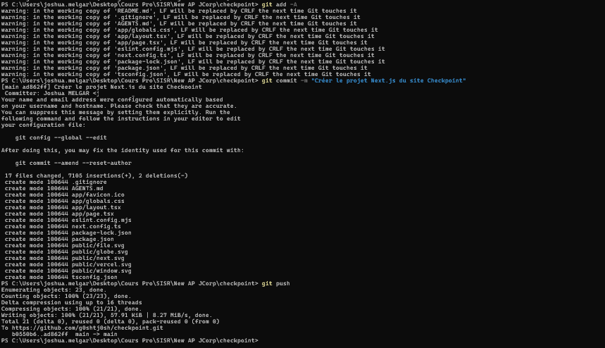

**Résultat observé :** commit `ad862ff`, 17 fichiers. Le dossier `node_modules` n'apparaît pas : le `.gitignore` fourni par Next.js l'exclut. Les avertissements *LF will be replaced by CRLF* concernent seulement les fins de ligne sous Windows.

Git avait signé ce commit avec une identité déduite du compte Windows, au domaine interne du poste. L'identité Git est désormais définie globalement avec l'adresse `noreply` fournie par GitHub, qui ne publie aucune adresse personnelle dans l'historique.

## Étape 6 — Application dans Dokploy

*Create Service* → *Application*, nom `checkpoint-site`, puis source **GitHub** : dépôt `checkpoint`, branche `main`, chemin `/`.

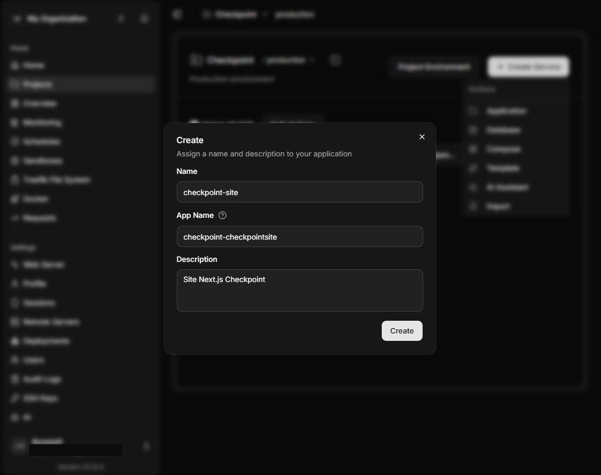

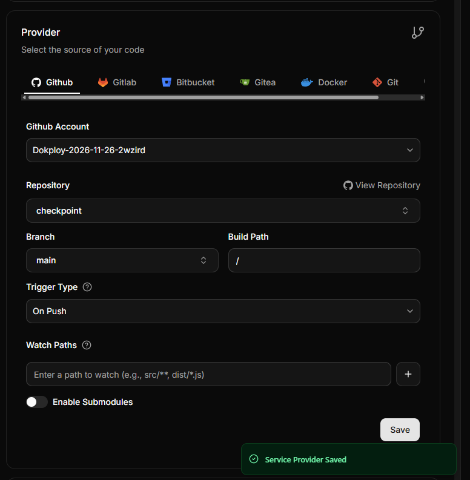

**Limite :** le déclenchement *On Push* repose sur un appel de GitHub vers Dokploy. `10.2.101.154` est une adresse privée, injoignable depuis Internet : après un `git push`, le déploiement est lancé à la main par le bouton *Deploy*. *Limite levée le 26 novembre 2026 par le déploiement automatique de l'[étape 9](#étape-9--déploiement-automatique-depuis-github).*

### Incident — Build en Node 18

**Symptôme :** pendant `npm ci`, une série d'avertissements `EBADENGINE`, dont `next@16.4.6 required: { node: '>=20.9.0' }` avec `current: { node: 'v18.20.5' }` ; le build s'arrête ensuite sur `npm run build` et Nixpacks échoue.

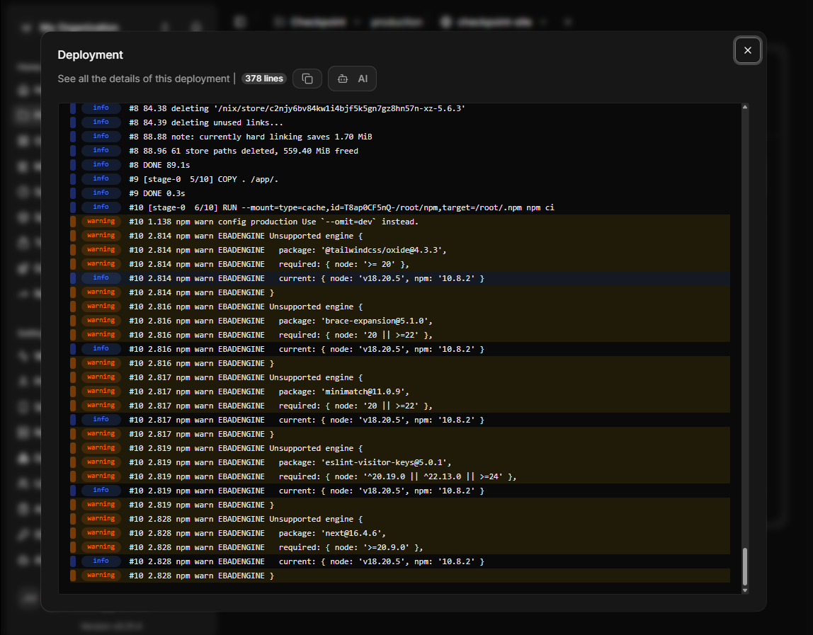

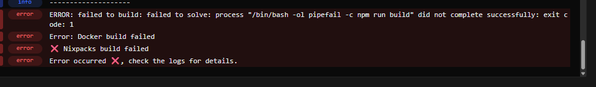

**Cause :** le projet ne précisait aucune version de Node ; Nixpacks a pris sa version par défaut, trop ancienne pour Next.js 16.

**Correction :** déclarer la version dans le code, où elle est versionnée et lue par Nixpacks, plutôt que dans un réglage de Dokploy. Node 22 est une version maintenue à long terme, compatible avec Next.js 16.

```json
  "engines": {
    "node": "22.x"
  },
```

```powershell
node -e "console.log(require('./package.json').engines)"
git add package.json
git commit -m "Fixer la version de Node à 22 pour le build"
git push
```

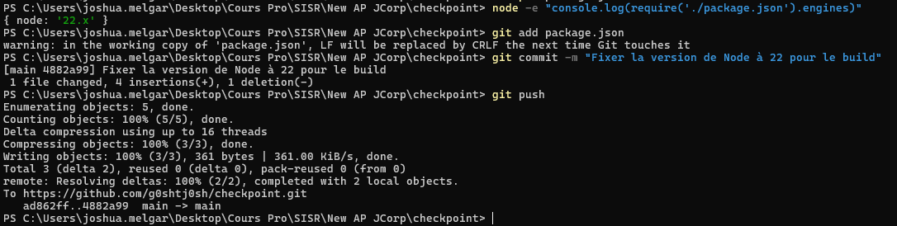

Après un nouveau *Deploy* :

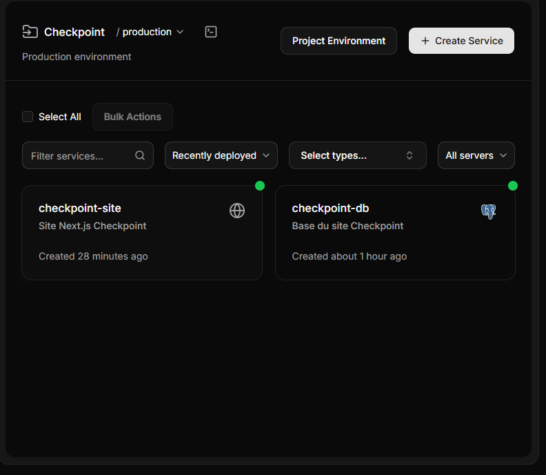

**Résultat observé :** le service `checkpoint-checkpointsite-g57dks` tourne, 1/1 ; dans le conteneur, `node --version` renvoie **v22.14.0** et Next.js 16.4.6 est prêt en 468 ms.

**Leçon :** une version d'exécution non précisée dépend de l'outil qui construit, et change sans prévenir. Elle doit être écrite dans le projet.

## Étape 7 — Nom DNS et routage

Le site tourne mais n'a pas d'adresse : Traefik, le proxy de Dokploy, aiguille les requêtes selon le nom demandé. Je crée le nom dans le DNS de l'AD, sur `JCORP-DC01` :

```powershell
Add-DnsServerResourceRecordA -ZoneName "ad.jcorp" -Name "checkpoint" -IPv4Address "10.2.101.154"
Resolve-DnsName checkpoint.ad.jcorp
```

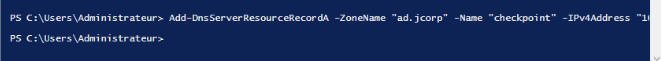

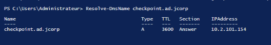

Puis, dans l'onglet *Domains* de l'application :

| Champ | Valeur | Raison |
| --- | --- | --- |
| Host | `checkpoint.ad.jcorp` | nom reconnu par Traefik |
| Path | `/` | tout le site |
| Container Port | `3000` | port d'écoute de Next.js dans le conteneur |
| HTTPS | désactivé | Let's Encrypt ne délivre pas de certificat pour un nom interne `.jcorp` ; le HTTPS fera l'objet d'une étape dédiée |

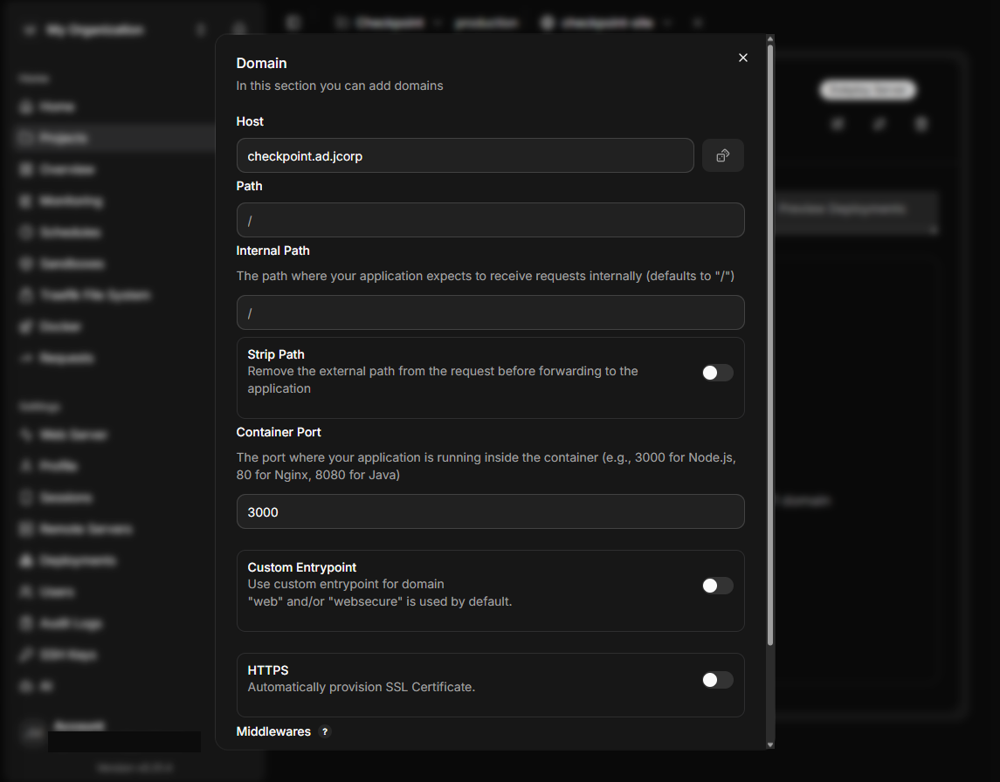

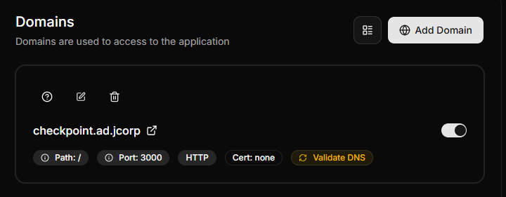

L'indication *Validate DNS* reste orange : Dokploy vérifie le nom depuis Internet, où `ad.jcorp` n'existe pas. Le test réel se fait depuis un poste du domaine.

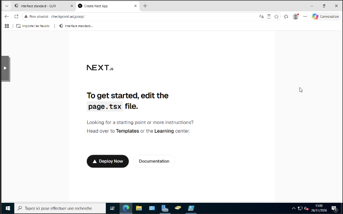

**Résultat observé :** depuis la VM 701, jointe au domaine, `http://checkpoint.ad.jcorp/` affiche la page du site. La chaîne complète fonctionne : DNS de l'AD → Traefik sur le port 80 → conteneur sur le port 3000 → Next.js. Le navigateur signale *Non sécurisé* : la connexion est en HTTP.

### Accès depuis le poste d'administration

Le poste d'administration n'est pas membre du domaine : il utilise le DNS de l'établissement, qui ignore `ad.jcorp`. Depuis ce poste, le DNS de l'AD répondait bien quand on l'interrogeait directement (`Resolve-DnsName checkpoint.ad.jcorp -Server 10.2.101.10`), et le site répondait par son adresse IP ; seule la résolution normale échouait.

Plutôt que de remplacer le DNS de toute la carte réseau, ce qui couperait la résolution Internet dès que le contrôleur est éteint, j'ajoute une **règle NRPT** : les seuls noms en `.ad.jcorp` sont envoyés au DNS de l'AD, tout le reste continue de passer par le DNS habituel. Les futurs noms du domaine fonctionneront sans nouvelle manipulation.

```powershell
Add-DnsClientNrptRule -Namespace ".ad.jcorp" -NameServers "10.2.101.10" -Comment "JCorp : noms du domaine AD"
Clear-DnsClientCache; Resolve-DnsName checkpoint.ad.jcorp -DnsOnly
```

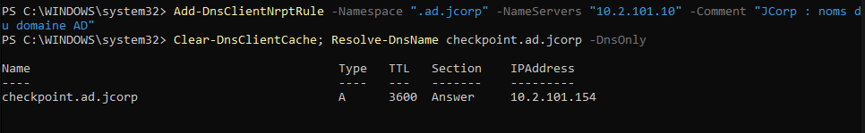

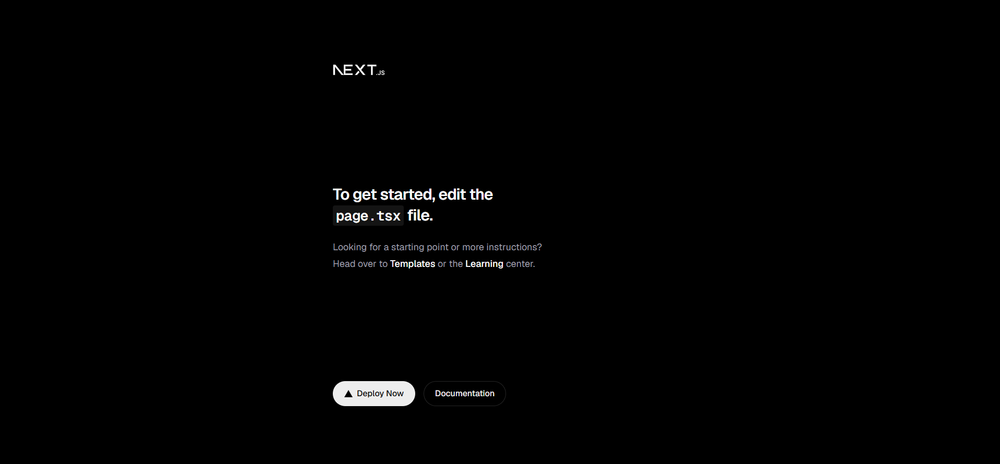

**Résultat observé :** le poste résout `checkpoint.ad.jcorp` en `10.2.101.154` et le navigateur affiche le site.

Deux essais ont échoué avant : la commande avait d'abord été lancée dans la console de `JCORP-DC01`, où elle est inutile puisque le contrôleur est lui-même le DNS de la zone (règle retirée ensuite), puis dans une fenêtre PowerShell non élevée du poste, qui a renvoyé *accès refusé*. La règle demande les droits d'administrateur.

Retrait de la règle :

```powershell
Get-DnsClientNrptRule | Where-Object Namespace -eq ".ad.jcorp" | Remove-DnsClientNrptRule -Force
```

## Étape 8 — Liaison du site à la base

Le site lit son catalogue dans PostgreSQL et y enregistre les demandes. L'adresse de connexion, mot de passe compris, est saisie uniquement dans l'onglet **Environment** de l'application Dokploy, sous la forme `DATABASE_URL=postgresql://…@checkpoint-checkpointdb-aowmfw:5432/…` : le site joint la base par son nom de service interne, sans port publié.

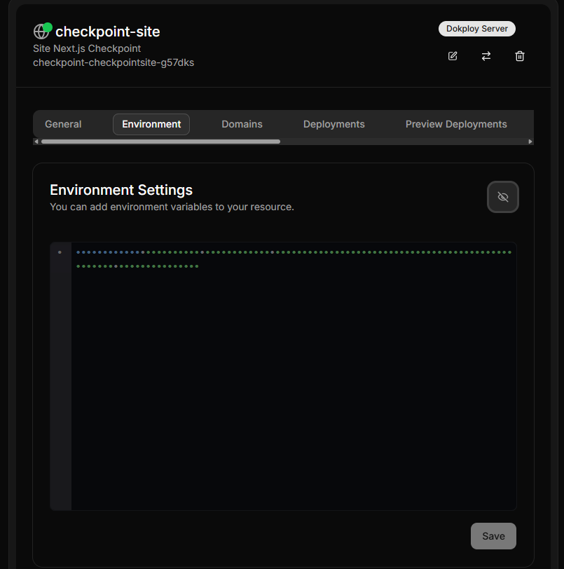

*La variable est saisie dans Dokploy et masquée à l'écran ; sa valeur n'apparaît ni ici ni dans le dépôt.*

Avant l'envoi, je vérifie qu'aucune adresse de base n'est restée dans le code :

```powershell
git grep -n "postgresql://"
```

**Résultat observé :** aucune ligne trouvée.

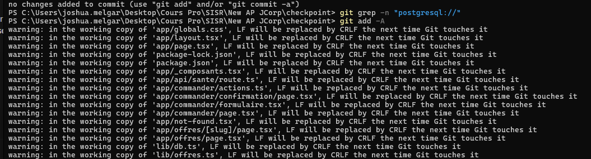

Au démarrage, le site crée ses tables s'il ne les trouve pas (`produits`, `avis`, `demandes`), puis aligne le catalogue sur le fichier `lib/catalogue.ts` du dépôt : un produit ajouté ou modifié dans le code l'est en base au déploiement suivant, un produit retiré du code est supprimé de la base. Les demandes ne sont jamais supprimées.

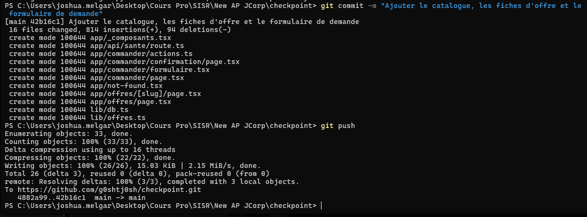

**Résultat observé le 27/11/2026 :** la base contient 19 jeux, 2 VPS, 1 offre de bot Discord et 10 avis de démonstration ; **0 demande**, aucune commande de test n'ayant encore été envoyée (test T05).

## Étape 9 — Déploiement automatique depuis GitHub

L'étape 6 avait laissé une limite : GitHub ne peut pas appeler Dokploy, dont l'adresse `10.2.101.154` est privée. J'ai inversé le sens : c'est **la VM qui interroge GitHub** chaque minute, et qui déclenche Dokploy en local quand un nouveau commit apparaît.

| Élément | Rôle |
| --- | --- |
| `checkpoint-autodeploy.timer` | Lance le service 2 minutes après le démarrage, puis chaque minute |
| `checkpoint-autodeploy.service` | Exécute le script une fois, après le réseau et Docker |
| `/usr/local/bin/checkpoint-autodeploy.sh` | Compare le dernier commit de `main` sur GitHub au dernier déployé ; s'il diffère, appelle le point d'entrée de déploiement de Dokploy |
| `/etc/checkpoint-autodeploy.env` | Jeton Dokploy, dépôt et branche ; propriétaire `root`, droits `600` |
| `/var/lib/checkpoint-autodeploy/dernier-commit` | Dernier commit déployé avec succès |

Les trois fichiers sont versionnés dans [Infrastructure/Dokploy/scripts](../Infrastructure/Dokploy/scripts/) ; le fichier `.env` qui contient le jeton ne l'est pas.

Le script lit la branche avec `git ls-remote`, sans cloner, puis envoie à `http://127.0.0.1:3000/api/deploy/<jeton>` la même requête qu'un webhook GitHub (`X-GitHub-Event: push`). Le commit n'est mémorisé que si Dokploy répond `200` : un échec est retenté à la minute suivante.

```bash
systemctl list-timers checkpoint-autodeploy.timer
journalctl -u checkpoint-autodeploy.service | grep "Nouveau commit"
```

**Résultat observé :** le minuteur est actif ; le journal compte **24 déploiements** déclenchés du 26 au 27 novembre 2026, chacun en ligne 1 à 3 minutes après le `git push`. Sans nouveau commit, le service se termine en une seconde sans rien déployer.

**Écart assumé :** une interrogation chaque minute plutôt qu'un webhook. Le délai d'une minute et une requête légère vers GitHub conviennent à une démonstration ; en production, la VM serait joignable depuis Internet par un proxy et le webhook natif de Dokploy suffirait.

## Étape 10 — Contenu et identité du site

Une fois le déploiement automatique en place, le site a été développé par petits commits, chacun visible en ligne quelques minutes plus tard. La version **1.0.0** comprend :

| Partie | Contenu |
| --- | --- |
| Offres | 17 jeux disponibles et 2 annoncés (GTA 6, SixM), 2 VPS (Linux, Windows), hébergement de bot Discord |
| Pages | Accueil, liste des jeux, fiche de chaque jeu avec configurateur et prix, VPS, bot Discord, commande et confirmation, statut, à propos, blog, lexique, outils, mentions légales, CGV, confidentialité, crédits |
| Statut | Page qui interroge Prometheus (`PROMETHEUS_URL`) à chaque chargement et affiche l'état réel des machines de l'infrastructure |
| Visuels | Images officielles des jeux (éditeurs), illustrations générées avec ChatGPT, logos réels des logiciels ; sources sur la page Crédits |
| Identité | Logo « drapeau-étape », palette noyer et beige, police Geist ; kit complet dans le dossier `brand/` du dépôt |
| Mise en page | Adaptée au téléphone, menus en fenêtres, animations désactivées si le système demande moins de mouvement |

Le prix d'une commande est recalculé côté serveur à partir du catalogue : un prix modifié dans le navigateur n'est pas pris en compte.

**Retrait du 27 novembre 2026 :** les noms de domaine et le VPS Pterodactyl ont été retirés. Le VPS Pterodactyl servait à héberger soi-même plusieurs serveurs de jeux, ce que l'offre de serveurs de jeux couvre déjà ; les noms de domaine sortaient du métier d'hébergeur de jeux. Le retrait du code a supprimé les deux produits de la base au déploiement suivant ; leurs pages renvoient désormais « introuvable ».

## Étape 11 — Paiement simulé et conformité légale

Une revue du site sous l'angle juridique, le 27 novembre 2026, a relevé cinq manques ; tous sont corrigés.

| Manque relevé | Règle | Correction |
| --- | --- | --- |
| La commande s'arrêtait à une « demande », sans paiement | Parcours de vente complet attendu | Étape de paiement ajoutée : carte, Apple Pay ou Google Pay, simulée |
| Bouton final « Envoyer la demande » | Code de la consommation, L221-14 : le bouton doit indiquer l'obligation de payer | Bouton « Commander avec obligation de paiement » |
| Aucune acceptation des CGV, aucune renonciation au délai de rétractation | L221-28 1° : un service exécuté avant la fin des 14 jours exige la demande expresse du client | Deux cases obligatoires, vérifiées par le serveur et horodatées en base |
| Mentions légales, CGV et confidentialité de quelques lignes | LCEN article 6 ; Code de la consommation ; RGPD articles 13 et 14 | Trois pages réécrites (détail ci-dessous) |
| Police chargée depuis Google Fonts | RGPD : l'adresse IP de chaque visiteur part vers les États-Unis sans consentement | Police Geist servie par le site lui-même (`next/font`), plus aucun appel à Google |

**Parcours de commande.** Après la configuration, le client saisit son nom et son adresse, coche les deux cases et valide ; la commande est enregistrée avec l'état `en_attente_paiement`, la date d'acceptation des CGV et la demande d'exécution immédiate. La page de paiement rappelle la configuration et le montant ; le paiement passe la commande à l'état `payee`, avec le moyen choisi et un numéro de facture. Aucun numéro de carte n'est demandé : la page indique qu'en production la saisie se ferait chez un prestataire certifié PCI DSS, avec 3-D Secure, sans que le site voie les données de carte.

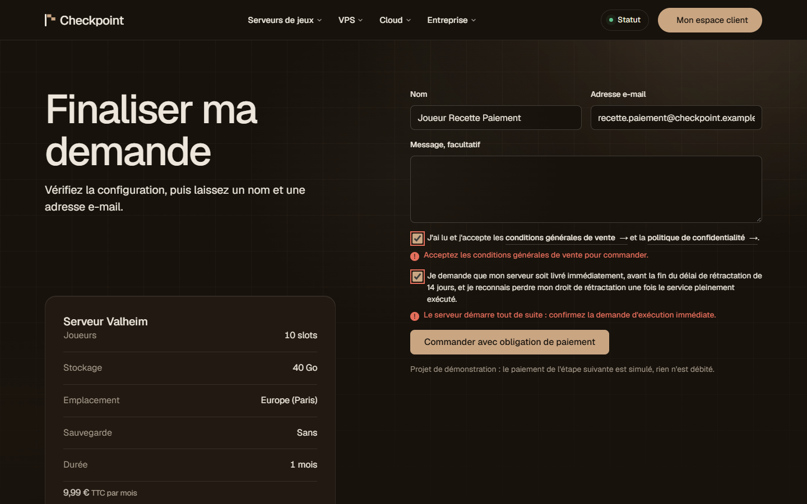

*Après un premier envoi sans les cases : un message d'erreur sous chacune ; une fois cochées, le bouton conforme permet de commander.*

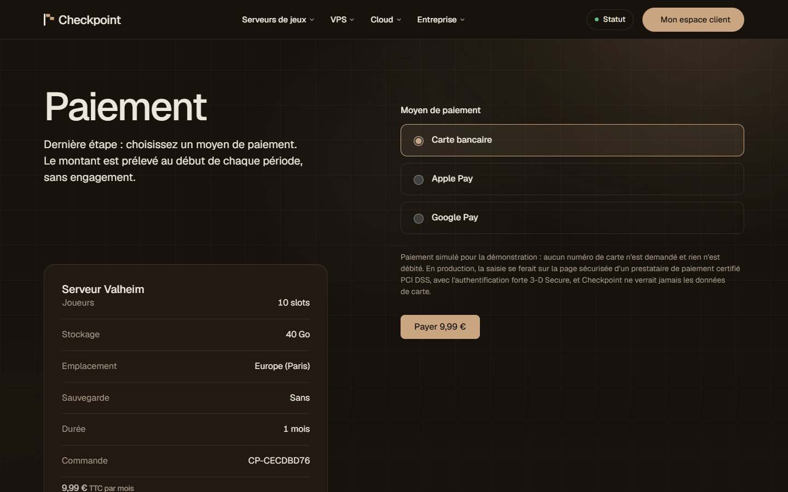

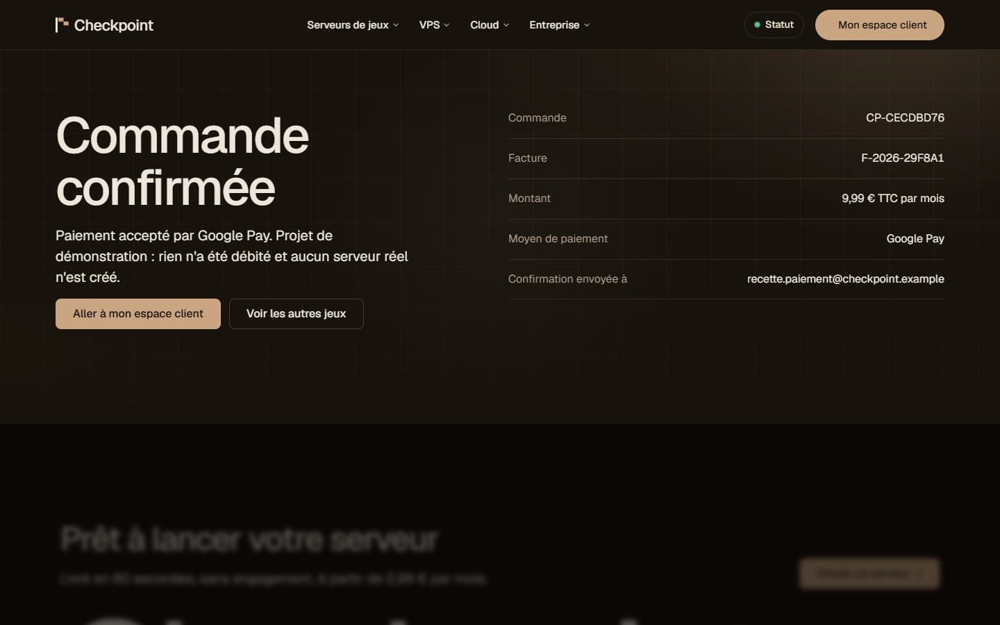

**Pages légales.** Les mentions légales indiquent l'éditeur, le directeur de la publication, le contact, l'hébergeur, la propriété intellectuelle et le droit applicable. Les CGV comptent quatorze articles : prix TTC, étapes de commande, paiement, livraison, rétractation, reconduction tacite, résiliation en ligne (L215-1-1), garantie légale de conformité, réclamations et médiation. La politique de confidentialité précise le responsable du traitement, les finalités et leurs bases légales, les durées de conservation (dont dix ans pour les factures), les droits, la réclamation auprès de la CNIL et l'absence de cookies soumis à consentement. La page Crédits cite désormais les images réellement utilisées.

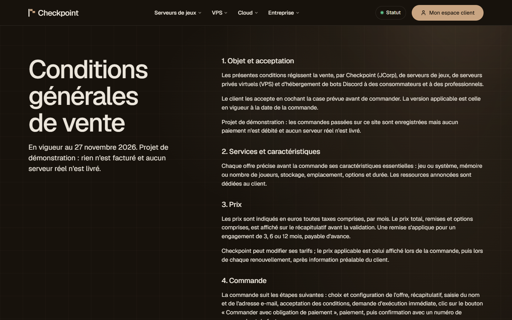

**Écart assumé : une entreprise fictive.** JCorp n'est pas immatriculée : les pages l'écrivent plutôt que d'inventer un numéro SIREN ou RCS qui pourrait appartenir à une vraie société. De même, aucun médiateur de la consommation n'est nommé : la page explique qu'une entreprise réelle indiquerait celui auquel elle adhère.

## Étape 12 — Espace client et panel de serveur

Le bouton « Choisir un serveur » de la barre devient « Mon espace client ». Il ouvre le compte de démonstration d'un client fictif, Alex Martin, propriétaire d'un serveur Minecraft. L'espace client est une application web : la navigation à gauche, la page à droite, une barre de navigation en haut sur téléphone. Le logo Checkpoint, en haut de la navigation, ramène au site public, comme le lien « Retour au site » en bas.

Pour que l'espace client n'ait ni la barre ni le pied de page du site, les pages publiques sont regroupées dans le dossier `app/(site)/` avec leur propre gabarit ; ce groupe ne change aucune adresse.

| Page | Contenu |
| --- | --- |
| Accueil | Serveurs actifs, prochaine facture, tickets ouverts, carte du serveur, activité récente, dernières factures |
| Serveurs | Liste des serveurs, avec accès au panel |
| Factures | Historique, moyen de paiement, prochain prélèvement |
| Support | Tickets et conversations (étape 13) |
| Paramètres | Profil, double authentification, export des données, résiliation en quelques clics |

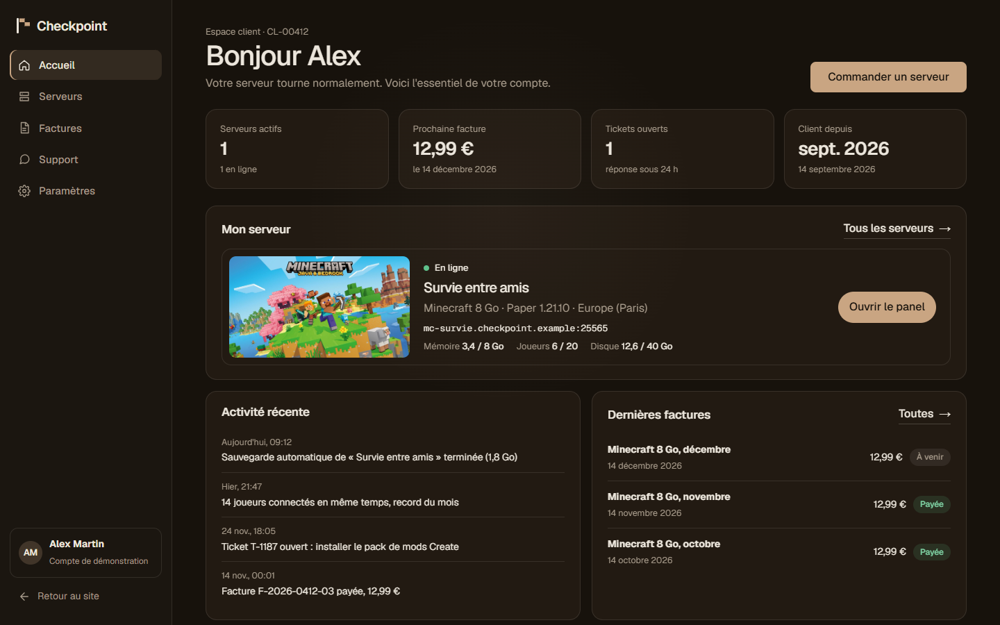

**Panel du serveur.** Comme décidé en début d'AP, Pterodactyl n'est pas utilisé : le panel est développé dans le site, sur le modèle de ce qu'il propose. Il offre les boutons Démarrer, Redémarrer et Arrêter avec leur journal, une console qui répond aux commandes du jeu (`help`, `list`, `say`, `time set`, `op`, `kick`, `save-all`, `stop`), des courbes processeur, mémoire et réseau mises à jour toutes les deux secondes, et les onglets Fichiers, Sauvegardes, Joueurs, Réseau et Paramètres.

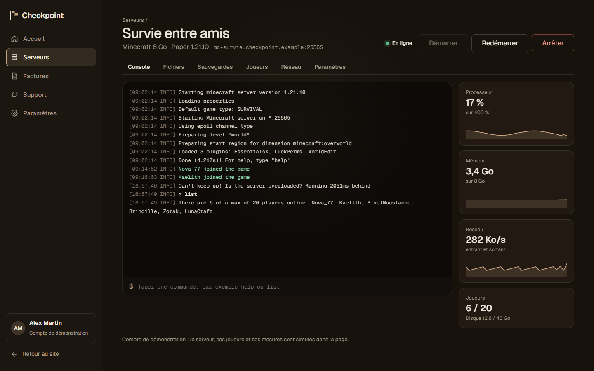

**Limite :** le serveur du panel est simulé dans la page ; il n'est relié à aucun conteneur. Le raccordement au vrai serveur Minecraft déployé par Dokploy est prévu avec les tests T13 à T15.

## Étape 13 — Support traçable

Les tickets sont enregistrés dans PostgreSQL : une table `tickets` pour le sujet et l'état, une table `ticket_messages` pour chaque message, avec son auteur (client, support ou système) et son heure. Rien n'est jamais supprimé.

Chaque ticket s'ouvre sur sa conversation complète. Le client peut répondre, marquer le ticket comme résolu ou le rouvrir ; répondre à un ticket résolu le rouvre automatiquement. Chaque changement d'état laisse une ligne datée dans la conversation : l'historique reste consultable par le client, ce qui garantit la traçabilité des échanges.

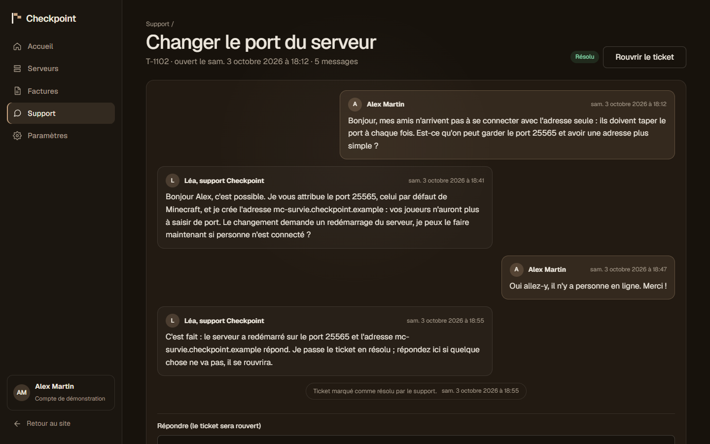

**Résultat observé le 27/11/2026 :** le ticket de test T-1188 a été ouvert, complété, marqué comme résolu puis rouvert par une réponse ; la base contient ses trois messages et les trois lignes d'état dans l'ordre.

### Incident — Build refusé par Next.js

**Symptôme :** après l'envoi du support traçable, la page d'un ticket renvoyait 404. Dokploy indiquait *Application deployed successfully*, mais le journal de build se terminait par `Next.js build worker exited with code: 1`.

**Cause :** deux règles du rendu de Next.js 16. La liste des tickets lisait la base dans un `try` sans avoir d'abord déclaré la page dynamique par `await connection()` ; et la navigation de l'espace client lisait l'adresse courante (`usePathname`) hors d'un bloc `<Suspense>`, ce que Next.js refuse sur une page à paramètre.

**Correction :** `await connection()` placé avant le `try`, comme sur les autres pages du site, et la navigation enveloppée dans `<Suspense>`. Le build est cette fois lancé sur le poste avant l'envoi : il se termine sans erreur.

**Leçon :** un build qui échoue ne coupe pas le site, Dokploy gardant l'ancienne version en service ; mais le message « deployed successfully » du point d'entrée signifie seulement que le déploiement est lancé. La vérification se fait sur la page elle-même, et le build local avant l'envoi évite l'aller-retour.

## Étapes prévues

- [x] Créer le projet et son environnement. *`Checkpoint`, environnement unique `production`.*
- [x] Créer la base avec son stockage persistant. *PostgreSQL 18, aucun port publié.*
- [x] Créer le dépôt et le projet Next.js. *[g0shtj0sh/checkpoint](https://github.com/g0shtj0sh/checkpoint), Next.js 16.4.6, Node 22.*
- [x] Déployer une première version depuis GitHub. *Commit `4882a99`, après correction de la version de Node.*
- [x] Publier le site sous un nom DNS interne. *`checkpoint.ad.jcorp`, testé depuis la VM 701 et depuis le poste d'administration.*
- [x] Relier le site à la base et charger les offres. *Variable `DATABASE_URL` dans Dokploy, catalogue aligné à chaque démarrage.*
- [x] Développer les pages du site. *Version 1.0.0, voir l'étape 10.*
- [x] Déployer automatiquement à chaque commit. *Minuteur systemd sur `JCORP-APP01`, 24 déploiements au 27/11.*
- [x] Ajouter le paiement simulé et mettre les pages légales en conformité. *Étape 11, le 27 novembre 2026.*
- [x] Créer l'espace client, le panel de serveur et le support traçable. *Étapes 12 et 13, le 27 novembre 2026.*
- [ ] Mettre en place le HTTPS avec un certificat adapté au domaine interne.
- [x] Dérouler la recette : commande de test, journaux, retour à une version précédente. *T04 à T10 réussis le 27 novembre 2026, voir le [plan de validation](Plan-de-validation.md#recette-du-27-novembre-2026-t04-à-t10).*
- [ ] Déployer le serveur Minecraft et s'y connecter.
- [ ] Ajouter `JCORP-APP01`, ses conteneurs et le site à la supervision.

## Limites

- Site en HTTP : rien n'est encore chiffré entre le poste et le serveur.
- Un seul environnement, sans préproduction : chaque commit sur `main` part directement en ligne.
- Le déploiement automatique dépend de l'accès de la VM à GitHub ; s'il est coupé, le site reste sur la dernière version déployée.
- Commandes et paiements simulés : rien n'est débité, aucun serveur n'est créé à la commande.
- Espace client de démonstration, sans authentification : un seul compte fictif, accessible à tout visiteur du réseau de laboratoire.

[Retour AP 2](README.md) · [Dokploy](../Infrastructure/Dokploy/Dokploy.md) · [Plan de validation](Plan-de-validation.md)
