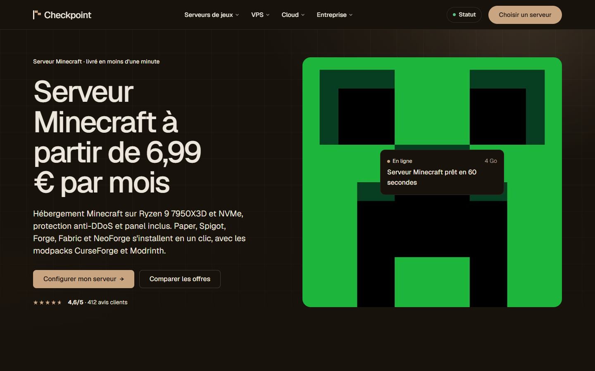
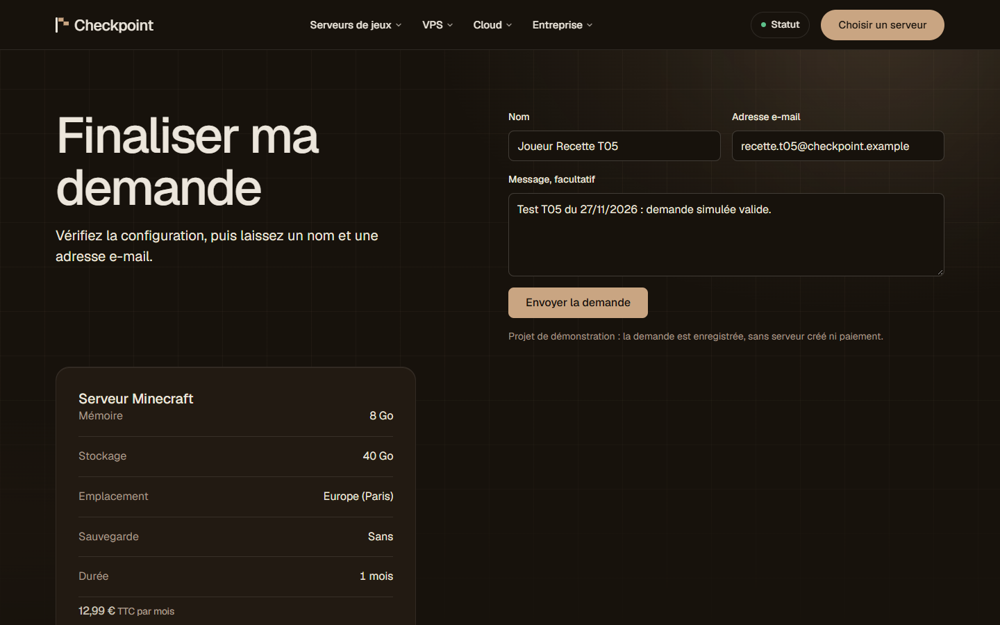
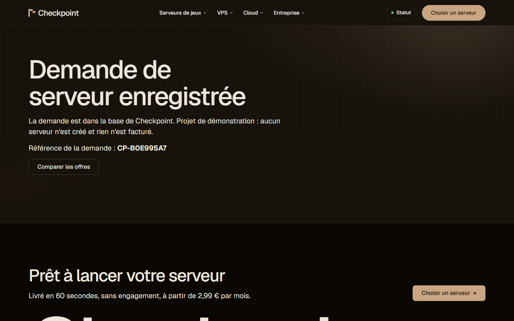
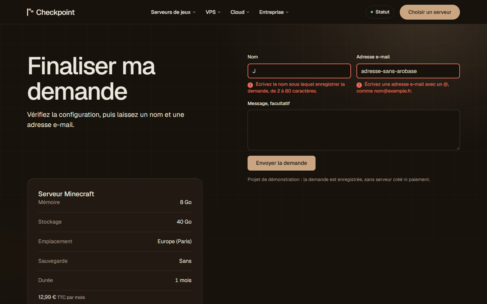
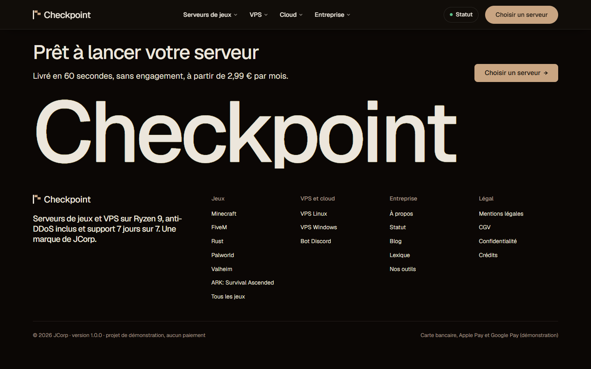

# AP 2 — Plan de validation et preuves

**T01 et T02 réussis le 26 novembre 2026 ; T04 à T10 réussis le 27 novembre 2026 (détail ci-dessous) ; T03 et T11 à T15 restent à faire.**

Avant la recette, consigner les versions Linux, Docker, Dokploy, application et base, le commit testé, l'URL, la date et l'opérateur.

| ID | Contrôle | Résultat attendu | État |
| --- | --- | --- | --- |
| T01 | Déployer depuis le dépôt source | Déploiement réussi, services sains | **Réussi le 26/11/2026** : commit `4882a99`, après l'incident Node 18 ([procédure](Deploiement-Checkpoint.md#étape-6--application-dans-dokploy)) |
| T02 | Ouvrir le site depuis le client | Nom DNS résolu et page accessible | **Réussi le 26/11/2026** : `http://checkpoint.ad.jcorp` depuis la VM 701 |
| T03 | Vérifier HTTPS | Certificat valide et approuvé dans le contexte retenu | À faire |
| T04 | Consulter le catalogue et une offre | Contenu issu de la base, données cohérentes | **Réussi le 27/11/2026** : 19 jeux, 2 VPS, 1 bot en base ; prix identiques sur le site |
| T05 | Envoyer une demande simulée valide | Confirmation et enregistrement en base | **Réussi le 27/11/2026** : référence `CP-B0E995A7`, ligne présente en base |
| T06 | Envoyer un formulaire incomplet | Erreurs compréhensibles, absence d'enregistrement invalide | **Réussi le 27/11/2026** : deux erreurs sous leurs champs, aucune ligne ajoutée |
| T07 | Redéployer l'application | Offres et demande précédente conservées | **Réussi le 27/11/2026** : demande et catalogue intacts après redéploiement |
| T08 | Déployer une modification visuelle depuis GitHub | Nouveau commit identifié et modification visible | **Réussi le 27/11/2026** : commit `b501bd0`, version 1.1.0 en ligne en 2 min 42 s |
| T09 | Consulter les journaux | Requête ou démarrage identifiable, aucun secret visible | **Réussi le 27/11/2026** : démarrage de la 1.1.0 lisible, 0 ligne sensible sur 48 h |
| T10 | Rétablir la version précédente | Ancien rendu retrouvé, site et base toujours fonctionnels | **Réussi le 27/11/2026** : `git revert`, version 1.0.0 en ligne, données intactes |
| T11 | Consulter Grafana | Mesures hôte/conteneurs et contrôle HTTP présents | À faire |
| T12 | Simuler l'arrêt du site | Alerte après la durée configurée puis résolution après relance | À faire |
| T13 | Déployer le serveur Minecraft dans Dokploy | Conteneur sain, port 25565 joignable | À faire |
| T14 | Se connecter au serveur depuis un client Minecraft | Connexion réussie au monde de démonstration | À faire |
| T15 | Observer la mémoire de la VM avec le jeu actif | Marge suffisante ou passage à 6 Go justifié par les mesures | À faire |

T12 porte sur le site de démonstration, pas sur les services AD/DNS/DHCP. T10 utilise une modification compatible avec la base et ne prétend pas tester une restauration de données.

## Recette du 27 novembre 2026 (T04 à T10)

| Contexte | Valeur |
| --- | --- |
| Date et opérateur | 27 novembre 2026, de 14 h 08 à 14 h 28, Joshua Fernandes, avec Claude Code |
| Système et plateforme | Debian 13.8, Docker 29.10.1, Dokploy v0.31.4 |
| Application et base | Next.js 16.4.6 sur Node 22, PostgreSQL 18.7 |
| Commit au départ | `df01f26`, version 1.0.0 |
| URL | `http://checkpoint.ad.jcorp` |

Les pages sont ouvertes par un navigateur Edge sans interface piloté par script depuis le poste d'administration, qui résout `checkpoint.ad.jcorp` par la règle NRPT ; les requêtes en base passent par `psql` dans le conteneur PostgreSQL, en SSH sur `JCORP-APP01`.

### T04 — Catalogue issu de la base

```sql
SELECT categorie, count(*) FROM produits GROUP BY categorie;
SELECT slug, nom, prix_appel, bientot FROM produits WHERE slug IN ('minecraft','rust','gta-6','vps-linux');
```

**Résultat observé :** `bot 1`, `jeu 19`, `vps 2` ; Minecraft `699`, Rust `1599`, VPS Linux `599` (prix en centimes), GTA 6 sans prix et `bientot = t`. Le site affiche les mêmes valeurs : Minecraft à 6,99 €, Rust à 15,99 €, VPS à partir de 5,99 €, 19 cartes de jeux.




### T05 — Demande simulée valide

Depuis la fiche Minecraft, le bouton de commande ouvre `/commander` avec la configuration choisie (8 Go, 40 Go, Paris, sans sauvegarde, au mois). Je remplis un nom et une adresse fictifs, `recette.t05@checkpoint.example`, puis j'envoie.



**Résultat observé :** la page de confirmation affiche la référence **`CP-B0E995A7`** et rappelle qu'aucun serveur n'est créé ni facturé. En base :

```text
reference     | CP-B0E995A7
produit       | jeu-minecraft
configuration | {"duree": "mensuel", "palier": "8", "stockage": "40 Go", "sauvegarde": "Sans", "emplacement": "Europe (Paris)"}
total_mensuel | 1299
```

Le total, 12,99 €, est recalculé par le serveur à partir du catalogue : il ne vient pas de la page.



### T06 — Formulaire incomplet

J'envoie un nom d'une lettre et une adresse sans `@`.

**Résultat observé :** la page reste sur le formulaire ; chaque champ est marqué invalide (`aria-invalid="true"`) avec son message dessous : *Écrivez le nom sous lequel enregistrer la demande, de 2 à 80 caractères.* et *Écrivez une adresse e-mail avec un @, comme nom@exemple.fr.* La base compte toujours **1** demande. La validation est faite sur le serveur : un navigateur modifié ne la contourne pas.



### T08 — Modification visible déployée depuis GitHub

Je passe la version de 1.0.0 à 1.1.0 ; elle s'affiche en pied de page.

```powershell
npm version 1.1.0 --no-git-tag-version
git commit -am "Version 1.1.0"
git push
```

**Résultat observé :** commit `b501bd0` poussé à 14 h 10 min 34 s ; le journal du déploiement automatique indique *Nouveau commit b501bd0… déploiement demandé* à 14 h 10 min 58 s, puis *Réponse de Dokploy : HTTP 200* ; la version 1.1.0 est en ligne à **14 h 13 min 16 s**, soit 2 min 42 s après l'envoi.


### T07 — Données conservées après redéploiement

Le déploiement de T08 a remplacé le conteneur du site. Juste après :

```text
 reference   | produit       | total_mensuel
 CP-B0E995A7 | jeu-minecraft |          1299
 bot 1 · jeu 19 · vps 2
```

**Résultat observé :** la demande de T05 et le catalogue sont intacts : la base vit dans son propre service avec un volume persistant, indépendant du conteneur du site.

### T09 — Journaux

```bash
sudo docker service logs --timestamps --since 10m checkpoint-checkpointsite-g57dks
sudo docker service logs --since 48h checkpoint-checkpointsite-g57dks | grep -ciE "postgres(ql)?://|password|DATABASE_URL="
```

**Résultat observé :** le démarrage est identifiable : `> checkpoint@1.1.0 start`, `▲ Next.js 16.4.6`, `✓ Ready in 379ms`. La recherche de secrets renvoie **0** ligne sur 48 heures. Deux lignes inquiétantes en apparence sont normales : `npm error signal SIGTERM` est l'arrêt de l'ancien conteneur une fois le nouveau prêt, et une tâche marquée *Failed* avec *No such container* est un nettoyage de Docker Swarm après un déploiement, sans effet sur le service. Next.js ne journalise pas chaque requête en production ; le démarrage suffit à identifier la version en service.

### T10 — Retour à la version précédente

```powershell
git revert --no-commit b501bd0
git commit -m "Revenir à la version 1.0.0 (test T10 de retour arrière)"
git push
```

**Résultat observé :** commit `da9aa70` poussé à 14 h 21 min 14 s, version **1.0.0** de nouveau en ligne à 14 h 24 min 02 s ; la fiche Rust répond, la demande `CP-B0E995A7` et les 22 produits sont toujours en base. La version 1.1.0 a ensuite été réappliquée par le commit `c47f73e`, en ligne à 14 h 27 min 59 s.



**Écart assumé :** le retour arrière passe par Git plutôt que par le bouton *Rollback* de Dokploy. Il est tracé dans l'historique du dépôt et suit le même chemin que toute mise en ligne ; le déploiement automatique republierait d'ailleurs le dernier commit de `main` après un retour fait seulement dans Dokploy.

### Incident — Retour arrière mal saisi

**Symptôme :** la première tentative de T10 n'a rien annulé et `git push` a été refusé (*non-fast-forward*).

**Cause :** `git revert` n'accepte pas l'option `-q` ; la commande a échoué, et la commande suivante, `git commit --amend`, a renommé localement le commit de la version 1.1.0 au lieu d'en créer un nouveau. Le dépôt GitHub et le site n'ont pas été touchés.

**Correction :** vérification que le contenu local était identique à celui de GitHub (même arbre `27cda2d`), retour de la branche locale sur `origin/main`, puis `git revert --no-commit` suivi d'un commit normal.

**Leçon :** enchaîner des commandes Git sans contrôler le résultat de chacune peut transformer une erreur sans gravité en réécriture d'historique ; `--amend` ne se lance qu'en connaissant le commit qu'il modifie.

## Contrôles complémentaires du 27 novembre 2026

| Contrôle | Résultat observé |
| --- | --- |
| Parcours de toutes les pages par leurs liens | 70 pages, toutes en `200`, espace client compris |
| Liens « Commander » des 19 offres et des formules | 29 liens, chacun ouvre un récapitulatif avec son prix |
| Commande sans les deux cases | Refusée, un message sous chaque case |
| Commande complète et paiement | Commande `CP-CECDBD76` à l'état `payee`, Google Pay, facture `F-2026-29F8A1`, CGV et exécution immédiate horodatées |
| Retour sur le paiement d'une commande payée | « Commande déjà payée » |
| Référence de commande inventée | « Commande introuvable » |
| Appels à des services tiers | Plus aucun appel à Google Fonts |
| Ticket de support | T-1188 ouvert, complété, résolu puis rouvert ; trois messages et trois lignes d'état en base |

## Résultat à renseigner pour chaque test

- Date, opérateur et versions/commit.
- Étapes exactes et résultat observé.
- Réussite, échec ou blocage, avec référence de capture.
- Incident éventuel, correction puis nouveau résultat.

## Captures à conserver

| Nom proposé | Preuve |
| --- | --- |
| 01-dokploy-projet.png | Projet et services |
| 02-deploiement-reussi.png | Statut du déploiement et version |
| 03-site-https.png | Page et URL HTTPS |
| 04-catalogue-offre.png | Offre fonctionnelle : produite sous `27` et `28` |
| 05-demande-simulee.png | Confirmation du formulaire |
| 06-donnees-persistantes.png | Données de test après redéploiement |
| 07-mise-a-jour.png | Nouvelle version visible |
| 08-logs.png | Journaux utiles |
| 09-retour-version.png | Version rétablie |
| 10-supervision.png | Métriques et disponibilité |
| 11-alerte.png | Alerte déclenchée |
| 12-alerte-resolue.png | Retour à la normale |

Les preuves applicatives iront dans [images](images/README.md). Les paramètres Dokploy et de supervision restent documentés dans leurs dossiers techniques respectifs. Ne joindre des liens d'images dans les procédures qu'une fois les fichiers réellement présents.

[Retour AP 2](README.md)
