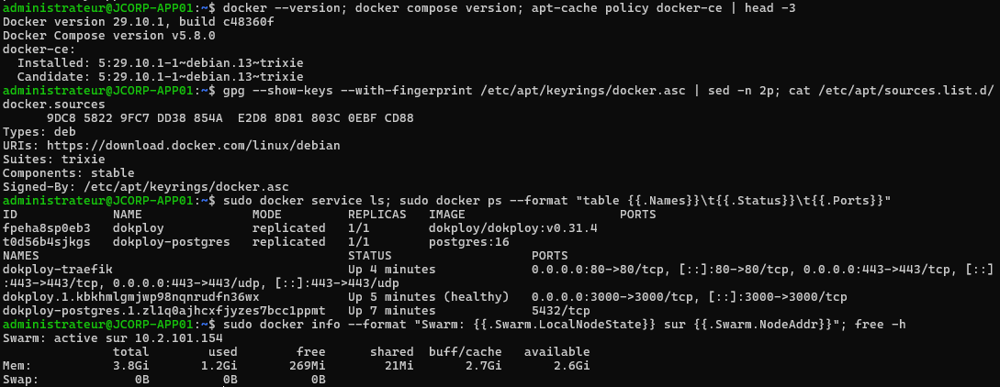
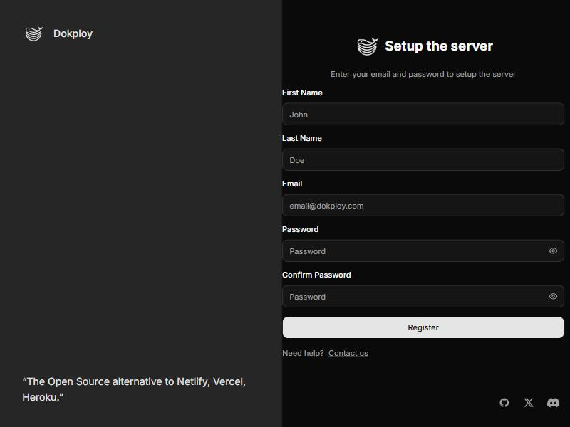
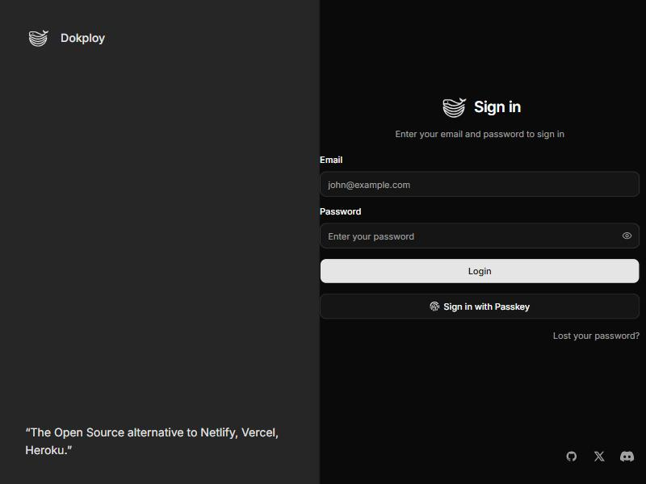

# Dokploy — Plateforme de déploiement

**AP 2 — Docker et Dokploy installés et sains sur `JCORP-APP01` depuis le 26 novembre 2026, compte administrateur créé ; projet, site, base et serveur de jeu restent à déployer.**

## Objectif

Préparer une VM Linux dédiée avec Docker et Dokploy pour héberger **Checkpoint**, le site d'offres de serveurs de jeux, sa base de données et un serveur Minecraft de démonstration. Le [cahier des charges du site](../../AP%202/Site-hebergement-jeux.md) décrit les fonctionnalités ; le [plan de validation](../../AP%202/Plan-de-validation.md) décrit la recette ; les [choix techniques](../../AP%202/README.md#choix-techniques-du-19-novembre-2026) justifient Dokploy.

La VM d'hébergement AP 2 est la seconde des deux VM retenues : **4 vCPU, 4 Gio RAM, 60 Gio disque**, Debian 13 sans interface graphique. Prévoir 6 Gio RAM si les mesures ou les builds l'exigent. Elle existe depuis le 12 novembre 2026 — VMID **706**, nom **`JCORP-APP01`**, IP **`10.2.101.154/24`** — et son déroulé de création est documenté à part ([procédure](../VM%20Linux/Creation-des-VM-Linux.md)). La supervision reste sur la VM AP 1. Voir la [référence de création](../Feuille-de-route.md#2-deux-vm-supplémentaires-retenues).

## Paramètres relevés

| Élément | Valeur |
| --- | --- |
| VM, nom et IP | VM **706**, `JCORP-APP01`, `10.2.101.154/24`, passerelle `10.2.101.1`, DNS `10.2.101.10` |
| Distribution/version Linux | **Debian 13 trixie**, noyau `6.12.118+deb13-amd64`, sans interface graphique |
| Docker | **29.10.1** (`5:29.10.1-1~debian.13~trixie`), Docker Compose **v5.8.0**, dépôt officiel `download.docker.com` |
| Dokploy | **v0.31.4**, en service Docker Swarm, avec PostgreSQL 16 et Traefik **v3.7.19** |
| Swarm | actif, nœud unique, adresse annoncée `10.2.101.154` |
| URL d'administration | `http://10.2.101.154:3000` |
| Ports occupés par la plateforme | 80 et 443 (Traefik), 3000 (interface Dokploy) |
| URL du site et certificat | À définir selon le contexte interne/public ; `checkpoint.ad.jcorp` proposé |
| Dépôt source du site et branche | À créer |
| Technologie de l'application et de la base | Next.js et PostgreSQL |
| Volumes persistants | À définir pour les données |
| Accès à la base | Réseau applicatif interne prévu, sans publication inutile sur le LAN |
| Variables et secrets | Dans la plateforme et les secrets Docker, valeurs absentes du dépôt |
| Date et opérateur | 26 novembre 2026, Joshua Fernandes |

## Étape 1 — État de départ

```bash
hostname; . /etc/os-release; echo "$PRETTY_NAME"; nproc; free -h; df -h /
command -v docker || echo "docker absent"
sudo ss -tlnp
```

**Résultat observé :** `JCORP-APP01`, Debian 13, 4 vCPU, 3,8 Gi de RAM dont 3,5 Gi disponibles, 56 Go libres. Docker est absent et seuls le port 22 (SSH) et les services locaux de résolution écoutent : les ports 80, 443 et 3000 exigés par Dokploy sont libres.

## Étape 2 — Docker depuis le dépôt officiel

Le script d'installation de Dokploy installe Docker lui-même en exécutant `get.docker.com` si Docker est absent. Je préfère installer Docker avant, depuis le **dépôt APT officiel et signé**, comme Grafana en AP 1 : les mises à jour passeront ensuite par `apt` comme le reste du système, et le script de Dokploy détecte Docker et saute cette étape.

```bash
sudo apt-get install -y ca-certificates curl
sudo install -m 0755 -d /etc/apt/keyrings
sudo curl -fsSL https://download.docker.com/linux/debian/gpg -o /etc/apt/keyrings/docker.asc
sudo chmod a+r /etc/apt/keyrings/docker.asc
sudo tee /etc/apt/sources.list.d/docker.sources > /dev/null <<'EOF'
Types: deb
URIs: https://download.docker.com/linux/debian
Suites: trixie
Components: stable
Signed-By: /etc/apt/keyrings/docker.asc
EOF
sudo apt-get update
sudo apt-get install -y docker-ce docker-ce-cli containerd.io docker-buildx-plugin docker-compose-plugin
sudo docker run --rm hello-world
```

L'empreinte de la clé téléchargée, `9DC8 5822 9FC7 DD38 854A E2D8 8D81 803C 0EBF CD88`, correspond à celle que Docker publie : le dépôt ajouté est bien le sien. Le conteneur de test répond `Hello from Docker!`.

## Étape 3 — Dokploy

La méthode documentée est `curl -sSL https://dokploy.com/install.sh | sh`, qui exécute en root un script sans qu'on l'ait lu. J'ai d'abord téléchargé ce script et vérifié ce qu'il fait :

| Étape du script | Action |
| --- | --- |
| Vérifications | exécution en root, système Linux, ports 80, 443 et 3000 libres |
| Docker | installation par `get.docker.com` seulement s'il est absent |
| Swarm | `docker swarm init` sur l'adresse privée de la machine, ou sur l'IP publique obtenue auprès de services externes à défaut |
| Secrets | mot de passe PostgreSQL et secret d'authentification générés aléatoirement et rangés dans les **secrets Docker** |
| Services | PostgreSQL 16 et Dokploy en services Swarm, Traefik en conteneur sur les ports 80 et 443 |

J'ai ensuite copié **ce même fichier** sur la VM et je l'ai exécuté, en imposant l'adresse annoncée du Swarm plutôt que de la laisser deviner :

```bash
sudo ADVERTISE_ADDR=10.2.101.154 sh /tmp/dokploy-install.sh
```

Extrait du journal d'exécution :

```text
[1/9] Resolving Dokploy version
Installing Dokploy version: v0.31.4
[2/9] Checking system requirements
[3/9] Checking Docker
29.10.1 already installed
[4/9] Initializing Docker Swarm
Using advertise address: 10.2.101.154
Swarm initialized: current node (3h648iujzfhlp3iq3kpyth5w2) is now a manager.
    docker swarm join --token [REDACTED] 10.2.101.154:2377
[5/9] Creating the dokploy-network
[6/9] Generating secrets
Generated secure database credentials and auth secret (stored in Docker Secrets)
[7/9] Starting PostgreSQL
postgres:16
[8/9] Starting Dokploy
dokploy/dokploy:v0.31.4
[9/9] Starting Traefik
traefik:v3.7.19
Congratulations, Dokploy is installed!
Please go to http://10.2.101.154:3000
```

Le journal complet n'est pas versionné : il contient le **jeton d'adhésion au Swarm**, qui permettrait à une autre machine de rejoindre le cluster. Il est masqué ci-dessus. Les mots de passe générés, eux, n'apparaissent pas dans le journal.

## Étape 4 — Contrôles

```bash
docker --version; docker compose version; apt-cache policy docker-ce | head -3
gpg --show-keys --with-fingerprint /etc/apt/keyrings/docker.asc | sed -n 2p; cat /etc/apt/sources.list.d/docker.sources
sudo docker service ls; sudo docker ps --format "table {{.Names}}\t{{.Status}}\t{{.Ports}}"
sudo docker info --format "Swarm: {{.Swarm.LocalNodeState}} sur {{.Swarm.NodeAddr}}"; free -h
```



**Résultat observé :**

- Docker 29.10.1 installé depuis le dépôt `download.docker.com`, clé à l'empreinte attendue ;
- services `dokploy` (v0.31.4) et `dokploy-postgres` (16) à **1/1** ; conteneur Dokploy *healthy* ;
- Traefik publie 80 et 443 en TCP, et 443 en UDP pour HTTP/3 ; Dokploy publie 3000 ;
- Swarm actif sur `10.2.101.154` ;
- mémoire : 1,2 Gi utilisée, **2,6 Gi disponibles** avant tout déploiement applicatif. La plateforme seule consomme environ 0,9 Gi.

## Étape 5 — Compte administrateur

À la première ouverture de `http://10.2.101.154:3000`, Dokploy présente le formulaire de création du compte propriétaire du serveur :



J'ai créé ce compte moi-même, avec un mot de passe propre à Dokploy qui n'apparaît ni ici ni sur les captures. La page suivante n'est plus l'inscription mais la connexion : le serveur a bien un propriétaire et le formulaire d'inscription n'est plus accessible à un tiers.



**Point de vigilance :** tant que ce premier compte n'est pas créé, la première personne qui ouvre l'adresse devient propriétaire du serveur. Je l'ai créé immédiatement après l'installation.

## Étapes prévues

- [x] Vérifier les ressources et affecter des paramètres réseau libres. *VMID 706 et IP `10.2.101.154` contrôlés libres puis affectés le 12 novembre 2026.*
- [x] Préparer Linux et les accès d'administration nécessaires. *Debian 13 installée, accès SSH par clé opérationnel. Reste à définir un mot de passe local pour la console.*
- [x] Installer Dokploy selon ses prérequis et relever les versions. *Docker 29.10.1 depuis le dépôt officiel, Dokploy v0.31.4, script lu avant exécution, compte administrateur créé le 26 novembre 2026.*
- [x] Créer le projet et son environnement de démonstration. *Suite dans la [procédure de déploiement de Checkpoint](../../AP%202/Deploiement-Checkpoint.md).*
- [ ] Préparer le dépôt applicatif et sa configuration de déploiement.
- [x] Déployer la base avec son stockage persistant. *PostgreSQL 18, sans port publié.*
- [ ] Déployer le site et vérifier la connexion à la base.
- [ ] Configurer le nom DNS, le routage HTTP et le certificat adapté. *Nom et routage HTTP faits (`checkpoint.ad.jcorp`), certificat à faire.*
- [ ] Tester les fonctions du site depuis le poste client.
- [ ] Déployer une modification identifiable depuis GitHub et observer les logs.
- [ ] Revenir à une version applicative connue et vérifier les fonctions.
- [ ] Déployer le serveur Minecraft de démonstration et s'y connecter.
- [ ] Ajouter le serveur et les conteneurs à la supervision de l'AP 1.

Le retour de version porte d'abord sur une modification visuelle compatible avec la base. Une ancienne image applicative ne restaure pas les données ni une migration de schéma : le test prévu n'utilise pas de migration destructive.

## Limites

- L'interface d'administration est servie en HTTP sur le port 3000 : identifiants transmis en clair sur le VLAN. Elle sera placée derrière un nom et un certificat lors de la configuration HTTPS.
- Le serveur Swarm est un nœud unique : pas de haute disponibilité, la VM est un point unique de défaillance.
- Dokploy est en version 0.x ; une mise à jour peut modifier son comportement. Les mises à jour seront faites depuis l'interface et notées ici.

## Références

- [Dokploy](https://dokploy.com/)
- [Documentation — installation](https://docs.dokploy.com/docs/core/installation)
- [Docker — installation sur Debian](https://docs.docker.com/engine/install/debian/)
- [Logs et métriques](https://docs.dokploy.com/docs/core/logs-and-metrics)

[Retour AP 2](../../AP%202/README.md) · [Infrastructure](../README.md)
