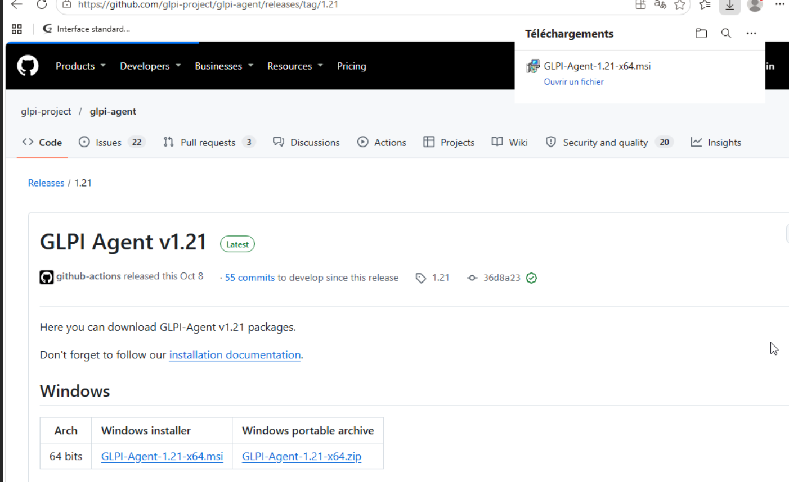
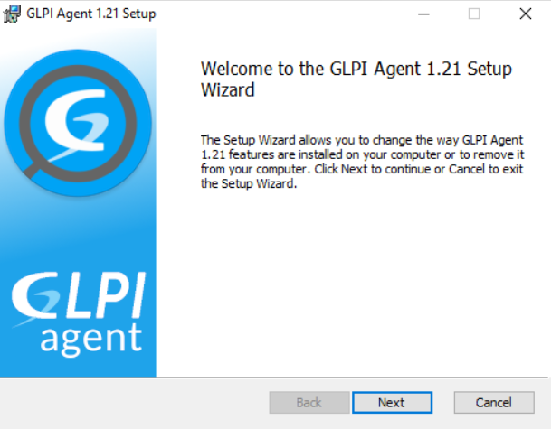
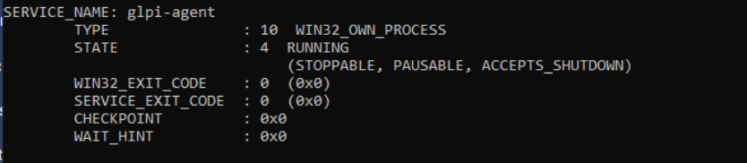
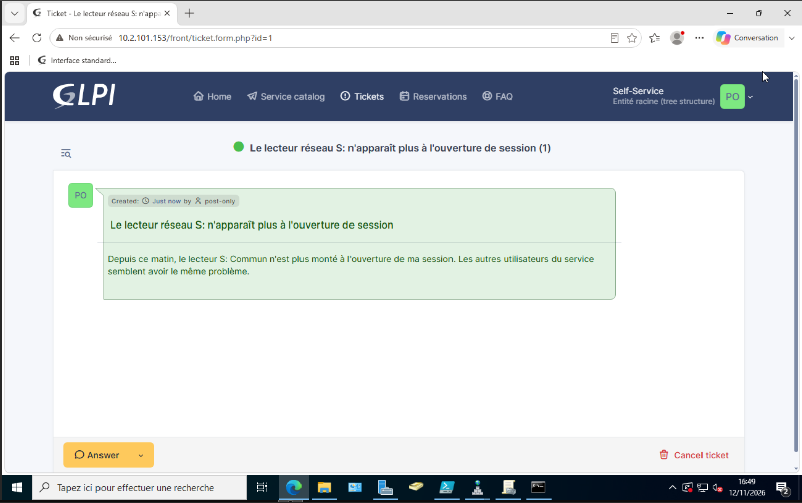
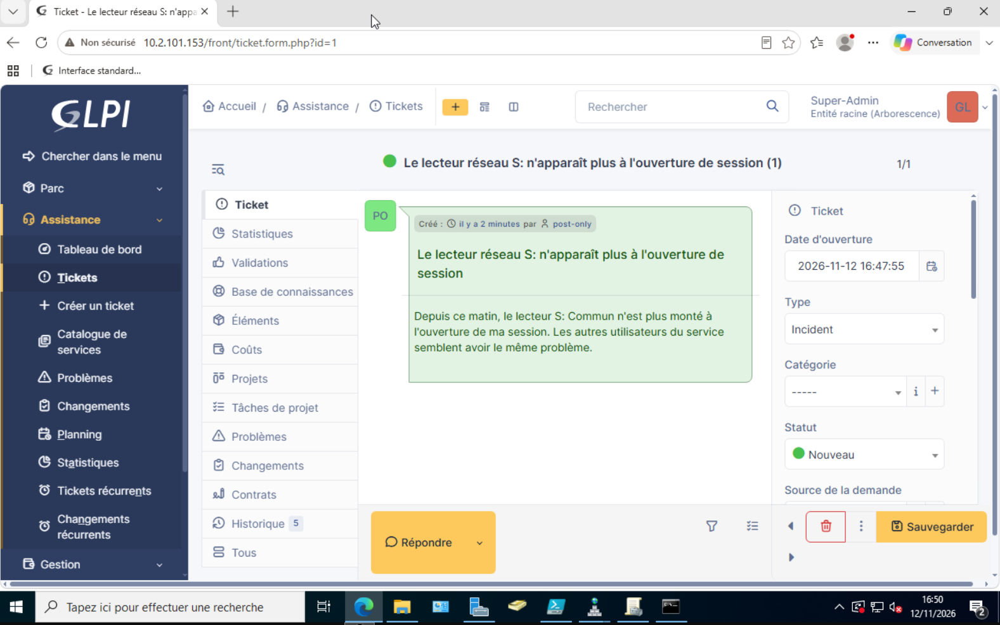
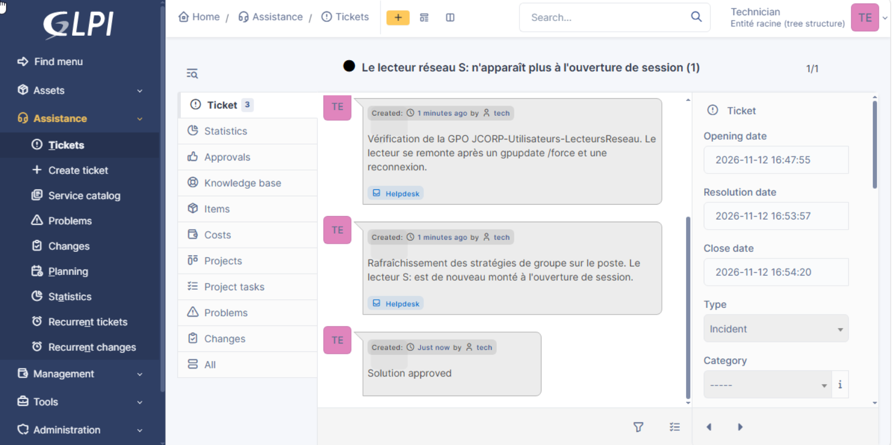
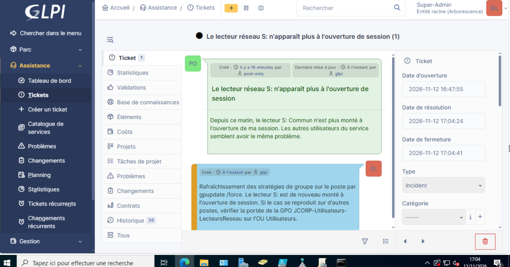
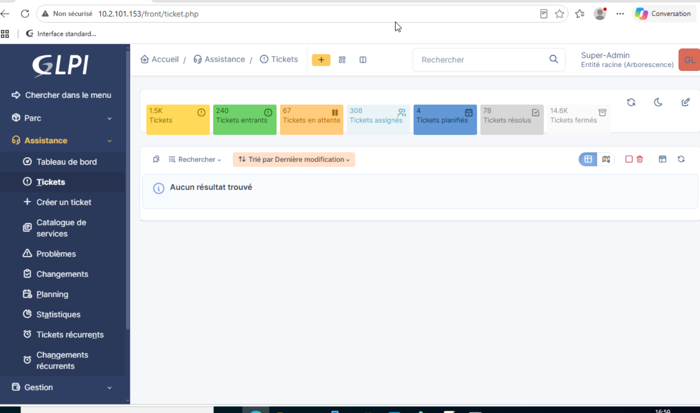

# GLPI — Inventaire et assistance

**AP 1 — Terminé le 12 novembre 2026 : serveur installé, inventaire fonctionnel et cycle de ticket démontré.** GLPI complète le socle AD et NAS avec la gestion du parc et des demandes d'assistance.

## Objectif et périmètre

Inventorier au moins le poste Windows pilote avec GLPI Agent, puis présenter le cycle complet d'un ticket : création par un demandeur, attribution à un technicien, traitement et résolution. L'intégration LDAP à Active Directory est une extension à étudier après ce premier fonctionnement ; elle n'est pas un prérequis du premier test.

GLPI et sa base MariaDB sont regroupés avec Grafana et Prometheus dans la VM de services AP 1 : **2 vCPU, 4 Gio RAM, 40 Gio disque**, Debian 13 sans interface graphique. Cette VM existe depuis le 12 novembre 2026 — VMID **705**, nom **`JCORP-SRV01`**, IP **`10.2.101.153/24`** — et son déroulé de création est documenté à part ([procédure](../VM%20Linux/Creation-des-VM-Linux.md)). GLPI n'est pas installé sur un contrôleur de domaine. Voir la [décision des deux VM](../Feuille-de-route.md#2-deux-vm-supplémentaires-retenues).

## Choix de la version

La compatibilité de la pile a été vérifiée **avant** de retenir la distribution, car une version de PHP trop récente pour la version de GLPI aurait imposé de réinstaller la VM.

| Branche GLPI | PHP minimum | MariaDB minimum |
| --- | --- | --- |
| 10.0.X | 7.4 | 10.2 |
| 11.0.X | 8.2 | 10.6 |

Debian 13 livre PHP 8.4 et MariaDB 11 : la branche 11 est donc compatible.

**GLPI 12.0.2 est sorti le 12 novembre 2026**, le jour même de cette installation, en même temps que la 11.0.13. J'ai retenu la **11.0.13** pour deux raisons : la matrice de prérequis officielle ne documente que les branches 10 et 11, et les notes de version de la 12 ne précisent pas ses exigences, ce qui rend sa compatibilité avec PHP 8.4 non vérifiable depuis une source officielle ; une branche majeure publiée cinq semaines plus tôt n'a par ailleurs pas la maturité attendue pour un travail évalué. La 11.0.13 est la dernière version d'une branche éprouvée.

## Paramètres relevés

| Élément | Valeur |
| --- | --- |
| VM, nom et IP | VM **705**, `JCORP-SRV01`, `10.2.101.153/24`, passerelle `10.2.101.1`, DNS `10.2.101.10` |
| Distribution et version | **Debian 13 trixie**, noyau `6.12.116+deb13-amd64`, sans interface graphique |
| Version GLPI | **11.0.13**, confirmée dans la table `glpi_configs` |
| Version GLPI Agent | **1.21**, installateur Windows 64 bits |
| Serveur web | **Apache 2.4.71** (Debian) |
| PHP | **8.4.27**, module Apache et interface en ligne de commande |
| Base de données | **MariaDB 11.8.6**, base `glpi` en `utf8mb4` / `utf8mb4_unicode_ci` |
| Compte de base | `glpi@localhost`, droits limités à la base `glpi` et à `mysql.time_zone_name` |
| Racine web | `/var/www/glpi/public`, propriétaire `www-data` |
| URL | `http://10.2.101.153/` fonctionnelle ; `glpi.ad.jcorp` prévu, enregistrement DNS **non créé** |
| Certificat | Aucun, service en HTTP seul à ce stade |
| Machine inventoriée | **VM 700 `JCORP-DC01`**, Windows Server 2022, au lieu de la VM 701 initialement prévue |
| Date et opérateur | 12 novembre 2026, Joshua Fernandes |

Le mot de passe du compte de base est généré aléatoirement à l'installation et conservé dans `/root/.glpi-db-pass` sur la VM, en lecture pour `root` seul. Conformément à la méthode documentaire du projet, il n'apparaît ni dans cette procédure ni dans les captures.

## Étape 1 — Serveur web, PHP et base

```bash
sudo apt-get install -y apache2 libapache2-mod-php php php-curl php-gd php-intl \
  php-mysql php-bcmath php-mbstring php-xml php-zip php-bz2 php-ldap php-opcache \
  mariadb-server
```

Les paquets PHP ne sont pas choisis au hasard : ils couvrent exactement les extensions que GLPI 11 déclare obligatoires, plus les extensions facultatives utiles. Le contrôle a été fait extension par extension plutôt qu'en se fiant à la liste des paquets.

**Résultat observé :** les **17 extensions obligatoires** — `dom`, `fileinfo`, `filter`, `libxml`, `simplexml`, `tokenizer`, `xmlreader`, `xmlwriter`, `curl`, `gd`, `intl`, `mysqli`, `session`, `zlib`, `bcmath`, `mbstring`, `openssl` — sont présentes. Les facultatives `bz2`, `Phar`, `zip`, `exif`, `ldap` et `Zend OPcache` également. `ldap` est installée dès maintenant parce qu'elle conditionne l'intégration LDAP à Active Directory envisagée plus tard.

## Étape 2 — Fuseaux horaires de MariaDB

```bash
mariadb-tzinfo-to-sql /usr/share/zoneinfo | mysql mysql
```

**Résultat observé :** 486 fuseaux chargés.

MariaDB ne connaît pas les noms de fuseaux horaires tant que cette table n'est pas peuplée. Sans elle, GLPI signale un prérequis manquant et ne peut pas gérer correctement les dates ; c'est une étape facile à oublier car rien ne la rend visible avant que GLPI ne s'en plaigne.

## Étape 3 — Base et compte applicatif

```sql
CREATE DATABASE glpi CHARACTER SET utf8mb4 COLLATE utf8mb4_unicode_ci;
CREATE USER 'glpi'@'localhost' IDENTIFIED BY '<genere_aleatoirement>';
GRANT ALL PRIVILEGES ON glpi.* TO 'glpi'@'localhost';
GRANT SELECT ON mysql.time_zone_name TO 'glpi'@'localhost';
FLUSH PRIVILEGES;
```

Le compte est restreint à la base `glpi` et à la seule table de fuseaux dont GLPI a besoin : il n'a aucun droit sur le reste du serveur. Le compte `root` de MariaDB conserve son authentification par socket Unix, telle que Debian la configure, ce qui évite d'avoir un mot de passe `root` de base de données à gérer.

## Étape 4 — Déploiement des fichiers

```bash
wget -O glpi-11.0.13.tgz \
  https://github.com/glpi-project/glpi/releases/download/11.0.13/glpi-11.0.13.tgz
tar -xzf glpi-11.0.13.tgz -C /var/www/
chown -R www-data:www-data /var/www/glpi
find /var/www/glpi -type d -exec chmod 750 {} +
find /var/www/glpi -type f -exec chmod 640 {} +
```

**Résultat observé :** archive de 97 560 758 octets, SHA-256 `bbecfa564867d1d93f08b15cd7aac87e4c7f0d4c4855bc1964f68db76f20f738`.

### Un écart de méthode : pas d'empreinte de référence

Pour ClamUI, le projet publiait un fichier `SHA256SUMS` permettant de comparer l'empreinte du paquet téléchargé à celle publiée. **GLPI ne publie aucun fichier d'empreintes** avec son archive : la version 11.0.13 n'expose que le `.tgz`. L'empreinte relevée ci-dessus n'a donc aucune référence à laquelle être comparée, et ne prouve rien par elle-même ; elle ne sert qu'à identifier le fichier utilisé.

Le seul recoupement disponible est la **taille**, qui correspond exactement à celle annoncée par l'interface de programmation de GitHub, et le transport en HTTPS depuis le domaine du projet. C'est faible. L'étape 7 apporte heureusement un contrôle bien plus solide.

Les droits sont volontairement en `750`/`640` et non `755`/`644` : seul `www-data` a besoin de lire ces fichiers, et le compte d'administration n'a aucune raison d'y accéder directement. Conséquence pratique rencontrée : les commandes de GLPI doivent être lancées en passant par `root` puis en redescendant vers `www-data`, un `cd` depuis le compte d'administration étant refusé.

## Étape 5 — Hôte virtuel Apache

```apache
<VirtualHost *:80>
    ServerName glpi.ad.jcorp
    ServerAlias 10.2.101.153

    DocumentRoot /var/www/glpi/public

    <Directory /var/www/glpi/public>
        Require all granted
        RewriteEngine On

        # Transmet l'en-tête d'autorisation à PHP, sans quoi l'API et CalDAV cassent.
        RewriteCond %{HTTP:Authorization} ^(.+)$
        RewriteRule .* - [E=HTTP_AUTHORIZATION:%{HTTP:Authorization}]

        # Tout passe par le routeur de GLPI, sauf les fichiers existants.
        RewriteCond %{REQUEST_FILENAME} !-f
        RewriteRule ^(.*)$ index.php [QSA,L]
    </Directory>

    ErrorLog  ${APACHE_LOG_DIR}/glpi-error.log
    CustomLog ${APACHE_LOG_DIR}/glpi-access.log combined
</VirtualHost>
```

```bash
a2enmod rewrite
a2dissite 000-default
a2ensite glpi
apache2ctl configtest   # Syntax OK
systemctl reload apache2
```

Le point à ne pas rater est la **racine `/var/www/glpi/public`** et non `/var/www/glpi`. Depuis GLPI 10.0.7, seul le sous-dossier `public` doit être exposé ; publier la racine du logiciel rendrait accessibles la configuration et les fichiers internes depuis un navigateur. Le site par défaut de Debian est désactivé pour que rien d'autre ne réponde sur le port 80.

## Étape 6 — Réglages PHP

Fichier `/etc/php/8.4/apache2/conf.d/99-glpi.ini`, recopié pour l'interface en ligne de commande :

```ini
date.timezone = Europe/Paris
memory_limit = 256M
upload_max_filesize = 20M
post_max_size = 20M
max_execution_time = 600
session.cookie_httponly = On
session.cookie_samesite = Lax
```

Les réglages sont placés dans un fichier distinct plutôt que dans `php.ini`, afin qu'ils restent identifiables et survivent à une mise à jour du paquet PHP.

**`session.cookie_secure` est délibérément laissé à `Off`.** La documentation GLPI recommande de l'activer, mais uniquement lorsque le service est accessible en HTTPS seul. L'activer maintenant, alors que le site répond en HTTP, empêcherait le navigateur de renvoyer le cookie de session et rendrait toute connexion impossible. C'est la raison pour laquelle le contrôle de prérequis affiche `IGNORÉ` et non `OK` sur la sécurité des sessions. Cette directive devra être activée en même temps que le certificat.

## Étape 7 — Installation du schéma et contrôles

```bash
cd /var/www/glpi
sudo -u www-data php bin/console database:install \
  --db-host=localhost --db-name=glpi --db-user=glpi --db-password="$PW" \
  --default-language=fr_FR --no-telemetry --no-interaction
```

**Résultat observé :** `Installation done.`, progression jusqu'à 100 %, données et règles par défaut importées, clés de sécurité générées.

`--no-telemetry` refuse l'envoi de statistiques d'usage au service de télémétrie du projet. Le choix est réversible dans la configuration, mais il n'a pas à être pris par défaut : aucune donnée ne part vers un service externe sans décision explicite.

La commande refuse de s'exécuter en `root` et le signale : *« running as root is discouraged, you should run the script as the same user that your web server runs as to avoid file permissions being ruined »*. C'est une protection utile, qui évite de laisser des fichiers appartenant à `root` dans une arborescence censée appartenir à `www-data`.

### Contrôle des prérequis

```bash
sudo -u www-data php bin/console system:check_requirements
```

Tous les contrôles `[REQUIS]` ressortent `OK`, dont les permissions des dossiers de données, celles des fichiers de clés de sécurité et le moteur de stockage des tables. Les contrôles `[SUGGÉRÉ]` sont `OK` à l'exception de la configuration SELinux, non applicable ici, et le contrôle `[SÉCURITÉ]` sur les sessions est `IGNORÉ` pour la raison expliquée à l'étape 6.

### Contrôle d'intégrité du code source

```bash
sudo -u www-data php bin/console diagnostic:check_source_code_integrity
```

**Résultat observé :** *« L'intégrité du code source de GLPI est validée. »*

Ce contrôle compare chaque fichier déployé à sa référence et compense entièrement l'absence de fichier d'empreintes relevée à l'étape 4 : il vérifie l'arborescence complète, là où un SHA-256 ne vérifie qu'une archive. C'est un contrôle plus fort, et il valide aussi que le dépaquetage et les changements de droits n'ont rien abîmé.

### Incident — le durcissement détruit la vérification

La consigne de sécurité après installation est de supprimer le dossier `/var/www/glpi/install`, qui contient le script d'installation web. Je l'ai fait avant de lancer le contrôle d'intégrité, et celui-ci a échoué :

```
Impossible de confirmer l'intégrité du code source GLPI.
Erreur : `/var/www/glpi/install` does not exist in the filesystem.
```

Le contrôle d'intégrité a besoin de ce dossier, précisément parce qu'il fait partie des fichiers de référence. J'ai dû réextraire le dossier depuis l'archive conservée, relancer le contrôle, puis le supprimer définitivement.

**L'ordre correct est donc : installer, vérifier l'intégrité, puis durcir.** L'enchaînement inverse paraît plus prudent — sécuriser au plus tôt — et c'est pourtant lui qui fait perdre la preuve. Une fois le dossier supprimé sans archive conservée, le contrôle devient définitivement impossible.

## Étape 8 — Actions automatiques

GLPI a besoin d'une exécution périodique pour ses tâches de fond : notifications, purges, synchronisations, calculs d'indicateurs. Deux modes existent, l'exécution déclenchée par les visites des utilisateurs, qui ralentit l'affichage des pages, ou une exécution externe. La seconde est retenue.

Le déclenchement passe par un **service et un *timer* systemd** plutôt que par `cron`, pour les mêmes raisons que l'analyse hebdomadaire ClamAV du poste Debian : journalisation dans `journalctl`, état consultable par `systemctl`, et rattrapage des exécutions manquées.

`/etc/systemd/system/glpi-cron.service` :

```ini
[Unit]
Description=Actions automatiques de GLPI
After=mariadb.service
Requires=mariadb.service

[Service]
Type=oneshot
User=www-data
Group=www-data
ExecStart=/usr/bin/php /var/www/glpi/front/cron.php
Nice=10
IOSchedulingClass=idle
```

`/etc/systemd/system/glpi-cron.timer` :

```ini
[Unit]
Description=Déclenchement minute des actions automatiques de GLPI

[Timer]
OnCalendar=*:0/1
Persistent=true
RandomizedDelaySec=15
Unit=glpi-cron.service

[Install]
WantedBy=timers.target
```

```bash
systemctl daemon-reload
systemctl enable --now glpi-cron.timer
```

Les choix de ce couple d'unités :

| Directive | Raison |
| --- | --- |
| `Requires=mariadb.service` | les actions automatiques n'ont aucun sens si la base est arrêtée ; mieux vaut que le service échoue proprement que de produire des erreurs PHP toutes les minutes |
| `User=www-data` | les fichiers créés appartiennent au même compte que ceux du serveur web, sans quoi GLPI finirait avec des fichiers qu'il ne peut plus écrire |
| `Nice=10` et `IOSchedulingClass=idle` | les tâches de fond ne doivent pas concurrencer les requêtes des utilisateurs |
| `RandomizedDelaySec=15` | décale le déclenchement dans la minute, pour ne pas se superposer à d'autres tâches planifiées à la seconde zéro |
| `Persistent=true` | rattrape l'exécution manquée si la VM était arrêtée |

**Résultat observé :** trois déclenchements automatiques consécutifs à 14:56:42, 14:57:35 et 14:58:09, tous terminés en `status=0/SUCCESS`. Les secondes irrégulières sont l'effet attendu de `RandomizedDelaySec`.

Une lecture à ne pas se tromper : pendant l'exécution du service, `systemctl list-timers` affiche une colonne `NEXT` **vide**. Cela ne signifie pas que le *timer* est désarmé, seulement qu'il attend la fin du service en cours. Contrôlé une seconde fois hors exécution, `NEXT` indique bien la minute suivante et le *timer* est `active` et `enabled`.

## Étape 9 — Inventaire par GLPI Agent

### Activation de l'inventaire natif

L'inventaire est **désactivé par défaut** après installation, ce que rien ne signale tant qu'on n'envoie pas de données :

```bash
sudo -u www-data php bin/console config:set --context=inventory enabled_inventory 1
sudo -u www-data php bin/console cache:clear
```

**Résultat observé :** `enabled_inventory` passe de `0` à `1`.

Un contrôle du point de collecte en `GET` renvoie **405 Method Not Allowed**, ce qui est le comportement attendu : il n'accepte que le `POST`. Cette réponse prouve que la route existe et qu'elle est correctement servie par l'hôte virtuel.

### Installation de l'agent

**GLPI Agent 1.21**, installateur Windows 64 bits, récupéré depuis les publications officielles du projet.



L'installation en ligne de commande est documentée ainsi :

```bat
msiexec /i GLPI-Agent-1.21-x64.msi /quiet SERVER="http://10.2.101.153/front/inventory.php" ^
  GLPI_VERSION=11.0.13 TAG=JCorp RUNNOW=1 AGENTMONITOR=1 ADD_FIREWALL_EXCEPTION=1
```

La documentation de l'agent **interdit explicitement PowerShell** comme interpréteur : *« it changes some environment context the installer doesn't handle well »*. L'installation doit passer par `cmd.exe`.

Dans les faits, c'est l'**assistant graphique** qui a été utilisé, le collage dans `cmd.exe` s'étant révélé impossible depuis la console `noVNC` — la console Windows n'accepte pas `Ctrl+V`, seulement le clic droit avec le mode d'édition rapide.



Le service s'installe et démarre :



### Incident — un service actif qui n'envoie rien

`sc query glpi-agent` renvoie `STATE : 4 RUNNING`. Pourtant, après ce démarrage, **aucun inventaire n'arrive** : les tables `glpi_agents` et `glpi_computers` restent vides, et le journal d'Apache ne contient aucune requête provenant du poste.

Un service démarré prouve que l'agent tourne, pas qu'il sait où envoyer ses données. C'est le même type d'écart que celui relevé dans le TP ClamAV avec un service marqué en échec qui était un succès : l'affichage est exact, sa lecture naïve est fausse.

Le journal d'Apache est ici l'outil décisif. Il permet de distinguer trois situations que la base seule ne sépare pas :

| Observation dans le journal | Interprétation |
| --- | --- |
| Aucune requête | l'agent n'a jamais contacté le serveur |
| Requête en erreur `4xx` ou `5xx` | l'agent contacte le serveur mais l'échange échoue |
| Requête `POST` en `200` sans fiche créée | l'échange réussit mais le traitement côté GLPI échoue |

Ici, **aucune requête** : le problème était entièrement côté agent.

### Cause — la ligne de configuration restée commentée

Le fichier `C:\Program Files\GLPI-Agent\etc\agent.cfg` contenait :

```ini
#server = http://10.2.101.153/front/inventory.php
```

L'URL était correcte mais la ligne restait **commentée**, donc ignorée. L'assistant graphique n'avait pas écrit la directive, et la correction manuelle avait conservé le `#` d'origine. Pour l'agent, aucun serveur n'était configuré ; il tournait sans destination.

Le fichier contient par ailleurs trois autres lignes `#server = ...` qui sont des exemples de la documentation, pointant vers `server.domain.com`. Décommenter la mauvaise ferait émettre l'agent vers une adresse inexistante.

**Correction :** retirer le `#`, puis redémarrer le service.

```bat
sc stop glpi-agent
sc start glpi-agent
```

### Déclenchement immédiat

Même correctement configuré, l'agent n'aurait rien envoyé tout de suite. Le paramètre `DELAYTIME` vaut **3600 secondes par défaut**, et la documentation précise que le délai réel est tiré au hasard entre la moitié et la totalité de cette valeur : l'agent attend donc **entre 30 et 60 minutes** avant son premier contact. Attendre sans le savoir aurait fait conclure à tort à un échec.

L'agent embarque un serveur web local dont `127.0.0.1` est une adresse de confiance par défaut. Depuis le navigateur de la machine inventoriée :

```
http://localhost:62354/now
```

**Résultat observé :** la page de l'agent répond `OK` et l'inventaire part immédiatement.

La commande `glpi-agent --force` donnée par la documentation **ne fonctionne pas telle quelle sur Windows** : le fichier `glpi-agent` n'ayant pas d'extension exécutable, `cmd.exe` ne l'exécute pas et le système l'ouvre avec l'application associée, en l'occurrence le Bloc-notes. Le déclenchement par le serveur web local est la méthode fiable.

### Résultat de l'inventaire

```
10.2.101.10 - - [12/Nov/2026:16:17:04 +0100] "POST /front/inventory.php HTTP/1.1" 200 396 "-" "GLPI-Agent_v1.21"
10.2.101.10 - - [12/Nov/2026:16:17:48 +0100] "POST /front/inventory.php HTTP/1.1" 200 396 "-" "GLPI-Agent_v1.21"
10.2.101.10 - - [12/Nov/2026:16:23:50 +0100] "POST /front/inventory.php HTTP/1.1" 200 484 "-" "GLPI-Agent_v1.21"
```

| Élément | Valeur remontée |
| --- | --- |
| Agent | `JCORP-DC01-2026-11-12-15-33-41`, version 1.21 |
| Machine | `JCORP-DC01` |
| Système | Microsoft Windows Server 2022 Standard Evaluation, version 21H2 |
| Matériel | 1 processeur, 1 bloc mémoire, 1 disque |
| Logiciels | 45 |
| Port réseau | `Ethernet`, MAC `bc:24:11:72:15:a0` |
| Adresses IP | `10.2.101.10` et une adresse de lien-local IPv6 |

### Recoupement indépendant de la collecte

La fiche créée ne prouve pas à elle seule que les données sont justes. La MAC remontée par l'agent, `bc:24:11:72:15:a0`, est **exactement celle de l'interface `net0` de la VM 700** telle que Proxmox la déclare :

```
net0: e1000=BC:24:11:72:15:A0,bridge=vmbr2,firewall=1,tag=700
```

Deux chemins indépendants — la collecte faite par l'agent dans le système invité, et la configuration de l'hyperviseur — donnent la même valeur. C'est ce recoupement qui permet d'affirmer que l'inventaire est cohérent, et non la simple présence d'une fiche.

### Écart — la machine inventoriée n'est pas celle prévue

L'objectif de l'AP 1 désignait la **VM 701 `User1-JCorp-Windows`** comme poste pilote. La machine effectivement inventoriée est le **contrôleur de domaine `JCORP-DC01`**, VM 700 : c'est depuis celui-ci que l'agent a été installé, ce que confirme le système remonté, Windows Server et non Windows 11.

Après constat, le choix retenu est de **conserver le contrôleur de domaine comme machine inventoriée** plutôt que de refaire l'opération sur la VM 701. La chaîne d'inventaire est démontrée de bout en bout, sur une machine réelle du parc, et inventorier un serveur a sa propre valeur. L'écart est consigné ici plutôt que corrigé : le contrôle de recette porte donc sur `JCORP-DC01` et non sur le poste prévu.

### Point ouvert — pas d'authentification des agents

La directive `auth_required` vaut `none` : **n'importe quelle machine du VLAN 700 peut déposer un inventaire** sans s'authentifier, et donc créer ou modifier des fiches dans l'inventaire. C'est le réglage par défaut de GLPI. Il est acceptable sur un réseau de laboratoire fermé, mais devrait être remplacé par une authentification basique ou OAuth 2 dans un contexte réel. Le réglage se trouve dans le même contexte de configuration `inventory`.

Le **tag n'a pas été appliqué** : `TAG=JCorp` figurait dans la commande documentée, mais l'installation ayant été menée par l'assistant graphique, le champ est resté vide et l'agent est enregistré avec un tag `NULL`.

## Étape 10 — Cycle de vie d'un ticket

La démonstration porte sur un incident plausible de l'infrastructure plutôt que sur un ticket de test vide : la disparition du lecteur réseau `S:` déployé par la GPO `JCORP-Utilisateurs-LecteursReseau`. Le ticket relie ainsi l'outil d'assistance au socle Active Directory du projet.

### Création par le demandeur

Le compte **`post-only`** porte le profil *Self-Service* : son interface ne montre ni le menu d'administration ni le parc, seulement la création et le suivi de ses propres demandes. C'est la vue d'un utilisateur ordinaire.



### Attribution par l'administrateur



### Traitement et première tentative de résolution



### Incident — un ticket résolu sans solution

Le premier passage a produit un ticket en statut `Clos`, avec une date de résolution, deux suivis décrivant le travail et un troisième suivi intitulé « Solution approved ». Visuellement, le cycle semblait complet.

Le contrôle en base a montré le contraire : la table **`glpi_itilsolutions` était vide**. Le ticket avait été passé en `Résolu` par simple changement de statut, et le « Solution approved » n'était qu'un suivi de plus.

La distinction n'est pas formelle. Dans GLPI, le **suivi** est un message enfermé dans son ticket, tandis que la **solution** est un objet à part entière, qui peut être validé, réutilisé sur un autre ticket et versé à la base de connaissances. Un ticket clos sans solution est un incident traité dont l'organisation n'a rien appris.

Le second écart portait sur les acteurs. L'historique montre qu'à 16:51:32 le compte `tech` a été ajouté simultanément comme **demandeur, attributaire et observateur**, et que `post-only` figurait comme demandeur et observateur :

```
16:51:32  User  15  4   →  tech (4)     ← demandeur
16:51:32  User  15  5   →  tech (4)     ← attribué à
16:51:32  User  15  66  →  tech (4)     ← observateur
```

Un technicien demandeur de son propre ticket ne démontre pas un cycle d'assistance.

### Correction

Le ticket a été rouvert, les rôles surnuméraires retirés, et la résolution reprise en passant par **Répondre → Solution** au lieu du changement de statut.



### Résultat vérifié en base

| Élément | Valeur |
| --- | --- |
| Ticket | n° 1, type Incident, statut `Clos` |
| Ouverture | 12 novembre 2026, 16:47:55, par `post-only` |
| Demandeur | `post-only`, et lui seul |
| Attribué à | `tech`, et lui seul |
| Solution | `glpi_itilsolutions` id 1, statut « approuvée », 17:04:24 |
| Résolution | 17:04:24 |
| Clôture | 17:04:41 |
| Historique système | 36 entrées |

### Limites de cette démonstration

**Les deux suivis ont été perdus lors de la correction.** La table `glpi_itilfollowups` est vide : la trace du travail intermédiaire — vérification de la GPO, puis rafraîchissement des stratégies — n'existe plus que dans l'historique système. Le contenu du diagnostic a toutefois été repris dans le texte de la solution, qui le conserve.

**La solution est signée `glpi` et non `tech`.** Elle a été saisie depuis le compte super-administrateur lors de la correction. Dans un processus réel, c'est le technicien attributaire qui rédige la solution de son ticket.

### Le tableau de bord n'affiche pas les données du parc

En cherchant le ticket clos, la liste s'est affichée vide — comportement normal, le filtre par défaut masque les tickets clos. Mais le tableau de bord situé au-dessus annonçait des chiffres sans rapport avec l'installation :



| Indicateur | Tableau de bord | Base de données |
| --- | --- | --- |
| Tickets | 1 500 | **1** |
| Tickets fermés | 14 600 | **1** |
| Tickets assignés | 308 | **0** |
| Tickets en attente | 67 | **0** |

La base contient **un seul ticket**, aucun supprimé, un seul ordinateur et cinq comptes. Les valeurs affichées ne proviennent donc pas de l'installation : ce sont des données de démonstration du tableau de bord livré par défaut. L'origine exacte n'a pas été investiguée, mais le constat est établi par comptage direct.

C'est le même piège que l'interface ClamUI annonçant un système « protégé » après avoir analysé zéro fichier, relevé dans le TP antivirus : **un indicateur peut être affiché correctement et ne rien mesurer de réel**. Avant de présenter un tableau de bord comme une mesure du parc, il faut avoir vérifié qu'il interroge bien les données de l'installation.

## Recette

| Contrôle | Résultat attendu | Résultat observé | Conforme |
| --- | --- | --- | --- |
| Services | Apache et MariaDB actifs | `active` tous les deux | Oui |
| Extensions PHP obligatoires | les 17 présentes | les 17 présentes | Oui |
| Fuseaux horaires MariaDB | table peuplée | 486 fuseaux | Oui |
| Prérequis GLPI | aucun `[REQUIS]` en échec | tous `OK` | Oui |
| Intégrité du code | arborescence conforme à la référence | « intégrité validée » | Oui |
| Schéma installé | installation terminée sans erreur | `Installation done.` | Oui |
| Version déployée | GLPI 11.0.13 | `11.0.13` dans `glpi_configs` | Oui |
| Réponse HTTP en local | page d'authentification | `200`, `<title>Authentification - GLPI</title>` | Oui |
| Réponse HTTP depuis le réseau | page joignable hors de la machine | `200` en 0,12 s depuis le VLAN 700 | Oui |
| Langue | interface en français | titre de page en français | Oui |
| Dossier `install/` | absent après installation | absent | Oui |
| Racine web | `public` seule exposée | `DocumentRoot /var/www/glpi/public` | Oui |
| Réglages PHP appliqués | fuseau, limites et sessions | `Europe/Paris`, `256M`, `20M`, `httponly=On`, `samesite=Lax` | Oui |
| Durcissement des sessions | `cookie_secure` actif | `Off`, décision assumée sans HTTPS | Écart documenté |
| Actions automatiques | déclenchement périodique réussi | 3 exécutions en `0/SUCCESS`, *timer* `active` | Oui |
| Mots de passe par défaut | comptes livrés sécurisés | changés le 12 novembre 2026 | Oui |
| Inventaire natif | activé côté serveur | `enabled_inventory` à `1` | Oui |
| Point de collecte | route servie, méthodes restreintes | `405` sur `GET`, `200` sur `POST` | Oui |
| Agent installé | service actif sur la machine cible | `STATE : 4 RUNNING`, version 1.21 | Oui |
| Remontée d'inventaire | requêtes acceptées par le serveur | 4 `POST` en `200` | Oui |
| Fiche créée | machine visible dans l'inventaire | `JCORP-DC01`, créée et datée | Oui |
| Données cohérentes | système, matériel et logiciels crédibles | Windows Server 2022 21H2, 1 CPU, 1 disque, 45 logiciels | Oui |
| Recoupement de la collecte | données conformes à une source indépendante | MAC identique à la configuration Proxmox de la VM | Oui |
| Machine inventoriée | VM 701 `User1-JCorp-Windows` | `JCORP-DC01`, VM 700 | **Écart assumé** |
| Tag de l'agent | `JCorp` | `NULL` | Non |
| Authentification des agents | dépôt d'inventaire contrôlé | `auth_required` à `none` | Écart documenté |
| Accès depuis un poste client | page atteinte depuis un poste du VLAN | atteinte depuis `JCORP-DC01` | Partiel |
| Création d'un ticket | ticket déposé par un compte demandeur | n° 1 créé par `post-only` à 16:47:55 | Oui |
| Attribution | technicien désigné sur le ticket | `tech` en « Attribué à » | Oui |
| Rôles des acteurs | un rôle par compte | `post-only` demandeur, `tech` attributaire | Oui, après correction |
| Solution formalisée | solution enregistrée et approuvée | `glpi_itilsolutions` id 1, statut approuvé | Oui, après correction |
| Résolution et clôture | dates enregistrées | 17:04:24 et 17:04:41, statut `Clos` | Oui |
| Trace du traitement | suivis visibles dans le ticket | suivis perdus à la correction, 36 entrées d'historique système | Partiel |
| Auteur de la solution | le technicien attributaire | `glpi`, super-administrateur | Non |
| Tableau de bord | indicateurs reflétant le parc | valeurs de démonstration sans rapport avec la base | **Non conforme** |

## Comptes par défaut — traité le 12 novembre 2026

GLPI livre cinq comptes, tous **actifs** après installation, dont quatre avec des mots de passe publiés dans la documentation du projet :

| Compte | Rôle | Mot de passe |
| --- | --- | --- |
| `glpi` | administrateur | par défaut, publié dans la documentation |
| `tech` | technicien | par défaut, publié dans la documentation |
| `normal` | utilisateur | par défaut, publié dans la documentation |
| `post-only` | demandeur | par défaut, publié dans la documentation |
| `glpi-system` | compte interne | sans connexion interactive |

Le service étant joignable par l'ensemble du VLAN 700, ces identifiants constituaient **la principale faiblesse de l'installation à sa livraison**. Les quatre mots de passe ont été changés depuis l'interface web le 12 novembre 2026, avant toute autre étape. Les comptes `post-only` et `tech` sont conservés actifs : ils serviront de demandeur et de technicien pour la démonstration du cycle de ticket.

Conformément à la méthode documentaire du projet, les nouveaux mots de passe ne figurent ni ici ni dans les captures.

Le fait que ces comptes soient livrés actifs avec des identifiants publics est consigné plutôt que passé sous silence : c'est une caractéristique de GLPI qu'un administrateur doit connaître, et le délai entre la fin de l'installation et le changement des mots de passe est une fenêtre d'exposition réelle. Sur un réseau ouvert, le changement devrait précéder toute mise en service.

## Étapes restantes

- [x] Vérifier les prérequis et préparer la VM.
- [x] Installer la base, les dépendances et GLPI selon la documentation de la version choisie.
- [x] Mettre en place les actions automatiques.
- [x] Changer les mots de passe des quatre comptes par défaut.
- [x] Activer l'inventaire natif, désactivé à l'installation.
- [x] Installer et configurer GLPI Agent, relever sa version. *GLPI Agent 1.21.*
- [x] Déclencher un inventaire et vérifier le nom, le système et les caractéristiques remontées. *Réalisé sur `JCORP-DC01` et non sur la VM 701, écart assumé.*
- [x] Créer un ticket de démonstration avec un compte demandeur.
- [x] Attribuer, traiter et résoudre ce ticket, puis le clore.
- [ ] Appliquer le tag `JCorp` à l'agent, resté vide.
- [ ] Remplacer le tableau de bord par défaut par un tableau interrogeant réellement le parc.
- [ ] Créer l'enregistrement DNS `glpi.ad.jcorp` sur `JCORP-DC01` et vérifier l'accès par ce nom.
- [ ] Restreindre le dépôt d'inventaire, aujourd'hui sans authentification.

## Limites

**Le service est en HTTP seul.** Aucun certificat n'est en place, les identifiants circulent donc en clair sur le VLAN 700. Acceptable sur un réseau de laboratoire fermé, à corriger avant tout usage réel, et lié à la question du certificat laissée ouverte dans la [feuille de route](../Feuille-de-route.md#3-décisions-à-prendre-avant-installation).

**L'enregistrement DNS n'existe pas.** L'hôte virtuel attend `glpi.ad.jcorp`, mais seule l'adresse IP permet d'atteindre le service aujourd'hui. L'enregistrement reste à créer sur le contrôleur de domaine.

**Aucune sauvegarde n'est en place.** Ni la base ni les fichiers de GLPI ne sont sauvegardés, conformément au périmètre du projet qui exclut le chantier global de sauvegarde et restauration. C'est une limite à connaître : une perte de la VM 705 entraînerait la perte de l'inventaire et des tickets.

**L'authentification reste locale.** L'extension `ldap` de PHP est installée, mais l'intégration à Active Directory n'est pas configurée : les comptes GLPI n'ont aucun lien avec le domaine `ad.jcorp`.

**Aucune capture n'accompagne cette procédure**, l'installation ayant été menée entièrement en ligne de commande. Les preuves sont les sorties reproduites ci-dessus. Les captures de l'interface web seront ajoutées dans [images](images/README.md) à partir de l'étape du poste client.

## Références

- [Prérequis GLPI](https://glpi-install.readthedocs.io/en/latest/prerequisites.html)
- [Documentation d'installation GLPI](https://glpi-install.readthedocs.io/)
- [Documentation GLPI Agent](https://glpi-agent.readthedocs.io/)
- [Versions publiées du projet](https://github.com/glpi-project/glpi/releases)

[Retour AP 1](../../AP%201/README.md) · [Infrastructure](../README.md) · [Création des VM](../VM%20Linux/Creation-des-VM-Linux.md)
