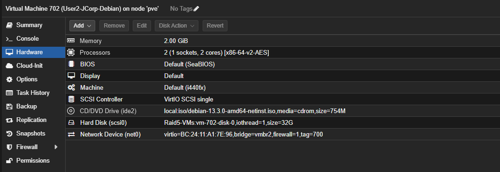
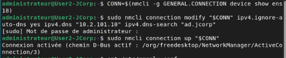
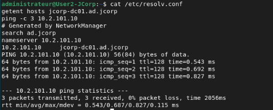

# Postes utilisateurs - JCorp

Je regroupe ici la mise en place de mes postes utilisateurs Debian et Windows 11. Je complète cette documentation au fur et à mesure des configurations et des tests.

| Poste | VMID | Nom dans Proxmox | Avancement |
| --- | --- | --- | --- |
| Debian | 702 | `User2-JCorp-Debian` | Réseau et résolution DNS validés, jonction au domaine à suivre |
| Windows 11 | 701 | `User1-JCorp-Windows` | Système installé, jonction au domaine à suivre |

## 1. Poste Debian

J'ai créé la VM **702**, nommée **`User2-JCorp-Debian`**, sur le nœud Proxmox `pve`, puis installé Debian. La capture ci-dessous présente son matériel et confirme que sa carte réseau utilise le pont `vmbr2` avec le **VLAN 700**.



### Caractéristiques de la VM

| Élément | Configuration |
| --- | --- |
| Mémoire vive | 2 Gio |
| Processeur | 2 vCPU, 1 socket et 2 cœurs ; type `x86-64-v2-AES` |
| BIOS | SeaBIOS |
| Type de machine | `i440fx` |
| Contrôleur SCSI | VirtIO SCSI single |
| Disque système | 32 Gio, `scsi0`, stockage `Raid5-VMs`, IO thread activé |
| ISO montée | `debian-13.3.0-amd64-netinst.iso`, sur le stockage `local` |
| Carte réseau | VirtIO, `net0` |
| Pont réseau et VLAN | `vmbr2`, tag `700` |
| Pare-feu Proxmox sur la carte | Activé |
| Adresse MAC | `BC:24:11:A1:7E:96` |

### Configurer le DNS du domaine

Mon poste Debian utilise l'adresse `10.2.101.11/24`. J'ai conservé l'adressage automatique et configuré NetworkManager pour utiliser le DNS de mon contrôleur de domaine, `10.2.101.10`, avec le suffixe de recherche `ad.jcorp`.

```bash
CONN=$(nmcli -g GENERAL.CONNECTION device show ens18)
sudo nmcli connection modify "$CONN" ipv4.ignore-auto-dns yes ipv4.dns "10.2.101.10" ipv4.dns-search "ad.jcorp"
sudo nmcli connection up "$CONN"
```

L'option `ipv4.ignore-auto-dns yes` empêche les DNS reçus par DHCP de remplacer celui que j'ai choisi. La connexion est ensuite réactivée pour appliquer la configuration.



### Vérifier la résolution et l'accès au contrôleur

J'ai contrôlé le DNS utilisé, la résolution du nom du serveur et la communication avec son adresse IP :

```bash
cat /etc/resolv.conf
getent hosts jcorp-dc01.ad.jcorp
ping -c 3 10.2.101.10
```

Le fichier `/etc/resolv.conf` contient `search ad.jcorp` et `nameserver 10.2.101.10`. Le nom `jcorp-dc01.ad.jcorp` est résolu en `10.2.101.10`. Les trois requêtes ping reçoivent une réponse, avec **0 % de perte**. Le poste peut donc résoudre le nom de mon contrôleur de domaine et le joindre sur le réseau.



### Suite de la configuration

La prochaine étape est la jonction de Debian au domaine `ad.jcorp`, puis un test de connexion avec un compte utilisateur du domaine.

## 2. Poste Windows 11

J'ai créé la VM **701**, nommée **`User1-JCorp-Windows`** dans Proxmox. L'installation de Windows 11 est terminée. J'ajouterai ses caractéristiques et les captures de configuration au fil de sa mise en place.

La suite comprendra la jonction au domaine `ad.jcorp`, le placement du poste dans l'OU `Postes`, puis les tests de connexion et d'application des GPO.

[Retour à l'infrastructure](../README.md)
