# Postes utilisateurs - JCorp

Je regroupe ici la mise en place de mes postes utilisateurs Debian et Windows 11. Je complète cette documentation au fur et à mesure des configurations et des tests.

| Poste | VMID | Nom dans Proxmox | Avancement |
| --- | --- | --- | --- |
| Debian | 702 | `User2-JCorp-Debian` | Jonction AD, identité et connexion graphique validées |
| Windows 11 | 701 | `User1-JCorp-Windows` | Joint au domaine ; connexion AD et lecteur S: validés |

## 1. Poste Debian

J'ai créé la VM **702**, nommée **`User2-JCorp-Debian`**, sur le nœud Proxmox `pve`, puis installé Debian. La capture ci-dessous présente son matériel et confirme que sa carte réseau utilise le pont `vmbr2` avec le **VLAN 700**.


### Caractéristiques de la VM

| Élément | Configuration |
| --- | --- |
| Mémoire vive | 2 Gio |
| Processeur | 2 vCPU, 1 socket et 2 cœurs ; type `x86-64-v2-AES` |
| BIOS | SeaBIOS |
| Type de machine | `i440fx` |
| Contrôleur SCSI | VirtIO SCSI single |
| Disque système | 32 Gio, `scsi0`, stockage `Raid5-VMs`, IO thread activé |
| ISO montée | `debian-13.3.0-amd64-netinst.iso`, sur le stockage `local` |
| Carte réseau | VirtIO, `net0` |
| Pont réseau et VLAN | `vmbr2`, tag `700` |
| Pare-feu Proxmox sur la carte | Activé |
| Adresse MAC | `BC:24:11:A1:7E:96` |

### Configurer le DNS du domaine

Mon poste Debian utilise l'adresse `10.2.101.11/24`. J'ai conservé l'adressage automatique et configuré NetworkManager pour utiliser le DNS de mon contrôleur de domaine, `10.2.101.10`, avec le suffixe de recherche `ad.jcorp`.

```bash
CONN=$(nmcli -g GENERAL.CONNECTION device show ens18)
sudo nmcli connection modify "$CONN" ipv4.ignore-auto-dns yes ipv4.dns "10.2.101.10" ipv4.dns-search "ad.jcorp"
sudo nmcli connection up "$CONN"
```

L'option `ipv4.ignore-auto-dns yes` empêche les DNS reçus par DHCP de remplacer celui que j'ai choisi. La connexion est ensuite réactivée pour appliquer la configuration.


### Vérifier la résolution et l'accès au contrôleur

J'ai contrôlé le DNS utilisé, la résolution du nom du serveur et la communication avec son adresse IP :

```bash
cat /etc/resolv.conf
getent hosts jcorp-dc01.ad.jcorp
ping -c 3 10.2.101.10
```

Le fichier `/etc/resolv.conf` contient `search ad.jcorp` et `nameserver 10.2.101.10`. Le nom `jcorp-dc01.ad.jcorp` est résolu en `10.2.101.10`. Les trois requêtes ping reçoivent une réponse, avec **0 % de perte**. Le poste peut donc résoudre le nom de mon contrôleur de domaine et le joindre sur le réseau.


### Corriger la résolution DNS externe

Le 29 octobre 2026, les noms AD se résolvaient mais les téléchargements APT restaient bloqués. Depuis Debian, le DNS `10.2.101.10` ne répondait pas à une requête pour `deb.debian.org`, alors que la passerelle `10.2.101.1` répondait.

Dans le Gestionnaire DNS de `JCORP-DC01`, les propriétés du serveur, onglet **Redirecteurs**, contenaient trois adresses IPv6 `fec0:0:0:ffff::1`, `::2` et `::3`. Je les ai remplacées par `10.2.101.1`, validée par la console, puis appliqué la modification. Le client conserve uniquement le DNS AD `10.2.101.10` : c'est le serveur AD qui transmet les demandes externes.

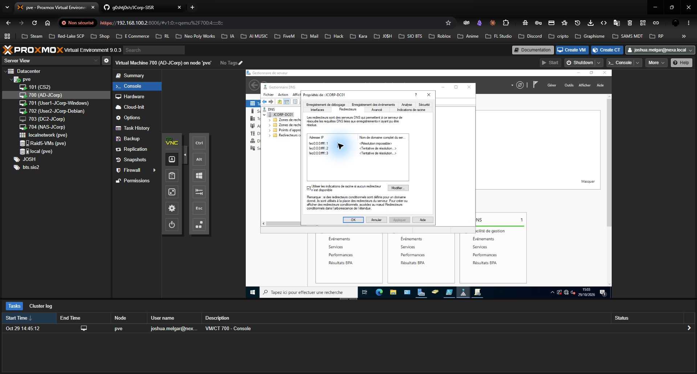

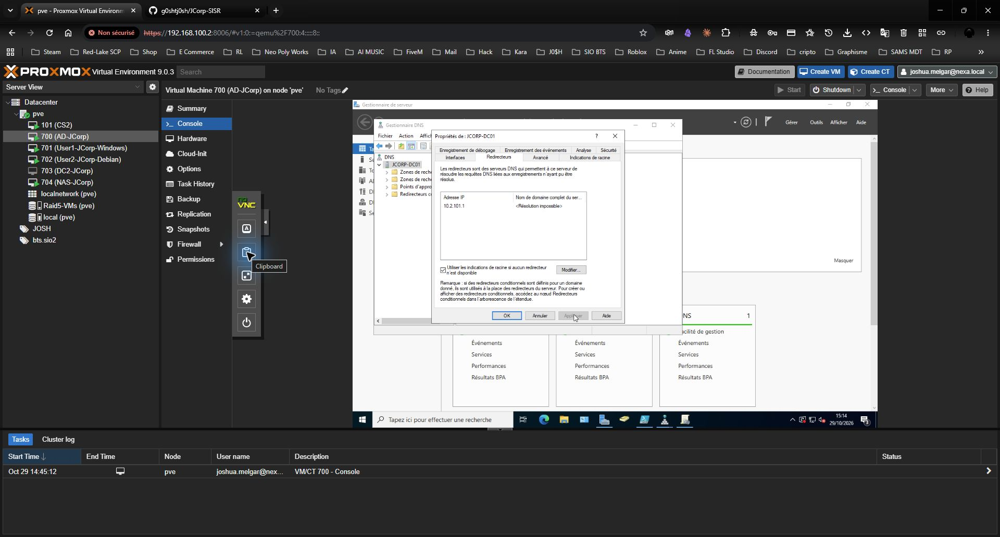

La mention « Résolution impossible » dans la colonne du nom du redirecteur ne donne pas son nom inverse ; le contrôle fonctionnel suivant confirme que les demandes externes aboutissent.

```bash
cat /etc/resolv.conf
getent ahostsv4 deb.debian.org
getent hosts jcorp-dc01.ad.jcorp
timedatectl
```

Le nom externe et `jcorp-dc01.ad.jcorp` sont résolus. L'horloge indique `System clock synchronized: yes` et `NTP service: active`.

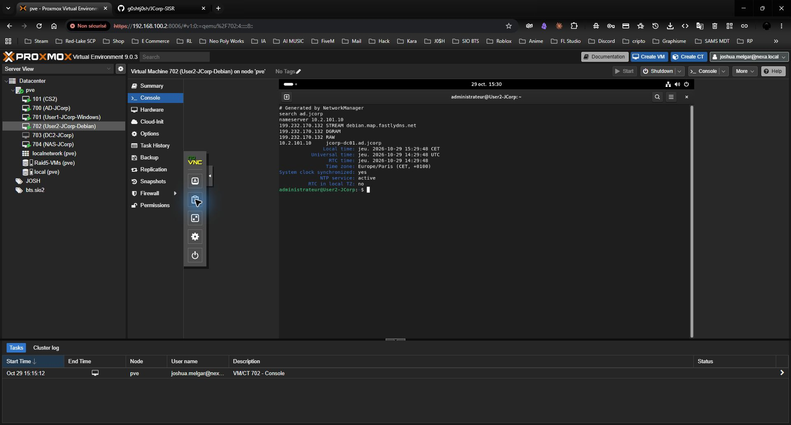

La première tentative d'installation, conservée ci-dessous, restait bloquée sur les téléchargements. Cette capture historique ne constituait pas une preuve de réussite.

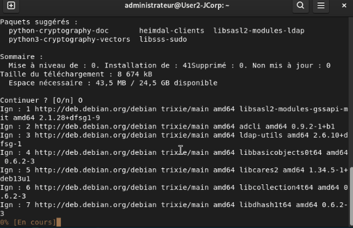

### Installer les outils et découvrir le domaine

```bash
sudo apt-get update
sudo apt-get install -y realmd sssd-ad sssd-tools adcli libnss-sss libpam-sss samba-common-bin
dpkg -s realmd
/usr/sbin/realm discover ad.jcorp
```

L'installation s'est terminée et le statut de `realmd` est `install ok installed`. Dans cette session Debian, `realm` n'était pas dans le PATH du compte local ; j'utilise donc `/usr/sbin/realm`. La découverte identifie `AD.JCORP`, `server-software: active-directory`, `client-software: sssd` et, avant jonction, `configured: no`.

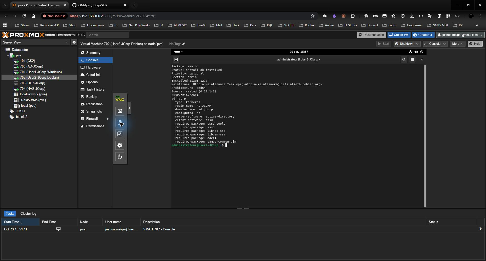

### Joindre Debian dans l'OU Postes

```bash
sudo /usr/sbin/realm join --verbose --user=Administrateur --computer-ou="OU=Postes,DC=ad,DC=jcorp" ad.jcorp
```

Le mot de passe AD est saisi uniquement à l'invite interactive. La commande crée `CN=USER2-JCORP,OU=Postes,DC=ad,DC=jcorp`, configure le fichier keytab et SSSD, puis affiche **Successfully enrolled machine in realm**. Le nom pleinement qualifié utilisé est `User2-JCorp.ad.jcorp`.

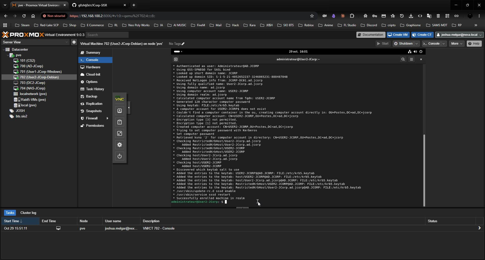

### Activer le dossier personnel et contrôler l'intégration

```bash
sudo pam-auth-update --enable mkhomedir
/usr/sbin/realm list
id jfernandes@ad.jcorp
getent passwd jfernandes@ad.jcorp
sudo adcli testjoin
systemctl is-active sssd
grep pam_mkhomedir /etc/pam.d/common-session
```

Résultats observés :

- `configured: kerberos-member`, `login-formats: %U@ad.jcorp` et `login-policy: allow-realm-logins`.
- Joshua Fernandes est reconnu sous `jfernandes@ad.jcorp`, UID `1278801205`, avec les groupes du domaine et `gg_direction`.
- Son dossier personnel prévu est `/home/jfernandes@ad.jcorp` et son shell `/bin/bash`.
- `adcli testjoin` affiche **Successfully validated join to domain ad.jcorp**.
- SSSD est `active` et `pam_mkhomedir.so` figure dans la configuration PAM.

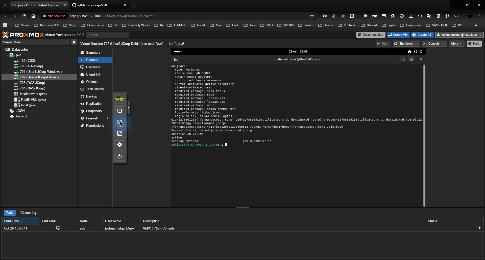

### Valider la connexion graphique AD

Après déconnexion du compte local, je sélectionne « Absent de la liste ? » / « Autre utilisateur », saisis `jfernandes@ad.jcorp`, puis son mot de passe AD. Joshua confirme que le bureau s'ouvre correctement. Je relève ensuite l'identité et le dossier personnel dans cette session :

```bash
whoami
id
printf '%s\n' "$HOME"
pwd
loginctl session-status --no-pager
```

Le contrôle réalisé dans le bureau ouvert confirme `whoami = jfernandes@ad.jcorp`, ses groupes AD et `$HOME = /home/jfernandes@ad.jcorp`, également affiché par `pwd`. `loginctl` montre une session `active`, de type `wayland`, avec le service `gdm-password` et `Remote: no`. La connexion graphique AD et la création du dossier personnel sont ainsi validées.

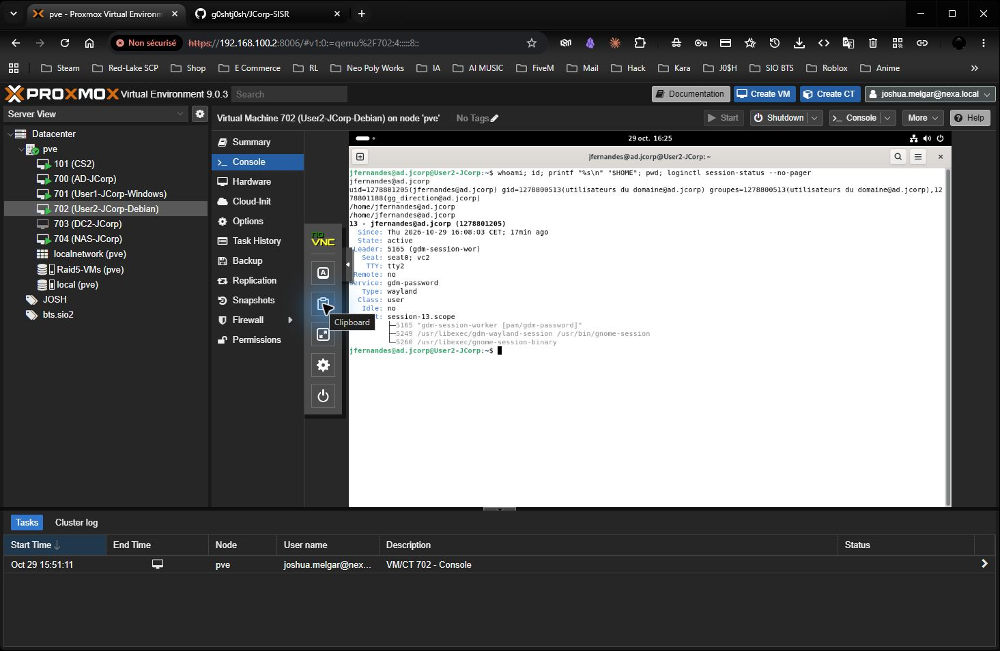

## 2. Poste Windows 11

J'ai créé la VM **701**, nommée **`User1-JCorp-Windows`** dans Proxmox. L'installation de Windows 11 est terminée. J'ajouterai ses caractéristiques et les captures de configuration au fil de sa mise en place.

### Premier démarrage de Windows 11

Pendant la configuration initiale, j'ai choisi **Configurer pour le travail ou l'école** pour préparer mon poste à un usage dans l'entreprise.

Sur l'écran de connexion professionnelle, j'ai ouvert les **options de connexion**, puis choisi **Joindre un domaine à la place**. J'ai ensuite créé le compte local demandé et terminé les écrans de configuration pour accéder au bureau Windows.

Ce choix prépare l'installation avec un compte local : le poste n'est pas encore membre de `ad.jcorp`. La jonction au domaine se fera ensuite depuis les paramètres Windows, après le contrôle du réseau et du DNS.

### Ouvrir l'assistant de jonction au domaine local

Depuis le bureau Windows, j'ai ouvert **Paramètres > Comptes > Accès professionnel ou scolaire**, puis cliqué sur **Connecter**.

Dans la fenêtre « Configurer un compte professionnel ou scolaire », j'ai choisi le lien **Joindre cet appareil à un domaine Active Directory local**, situé dans les actions alternatives en bas de la fenêtre.

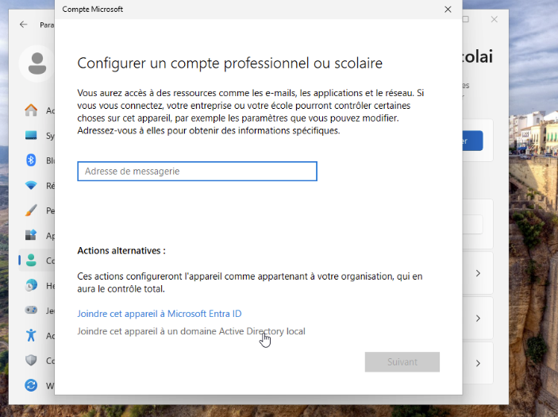

### Renseigner le domaine et le compte autorisé

J'ai saisi **`ad.jcorp`** dans le champ « Nom du domaine », puis cliqué sur **Suivant**. Windows affiche alors la fenêtre « Sécurité Windows » pour demander un compte autorisé à joindre le poste au domaine.

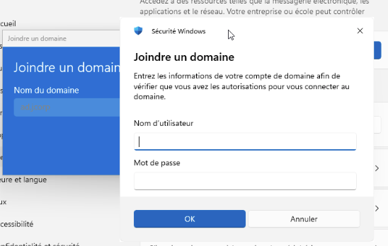

Dans « Nom d'utilisateur », je renseigne **`JCORP\Administrateur`**, puis je saisis le mot de passe de ce compte AD et valide avec **OK**. Il s'agit du compte administrateur du domaine, distinct du compte local créé sur le poste Windows.

### Choisir le compte utilisateur du poste

Après la saisie des identifiants du domaine, l'assistant affiche **Ajouter un compte**. Cet écran permet de choisir un compte AD existant et de lui attribuer un type de compte sur ce poste.

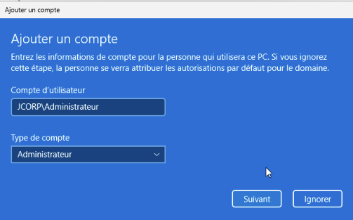

Dans cette capture, le compte affiché est **`JCORP\Administrateur`** et le type sélectionné est **Administrateur**. Ce choix concerne les droits locaux sur le poste Windows ; il ne crée pas un nouvel utilisateur dans Active Directory.

Je peux cliquer sur **Suivant** pour retenir ce choix ou sur **Ignorer** pour passer cette étape. Pour un poste utilisé au quotidien par un salarié, je choisirai son compte nominatif avec le type **Utilisateur standard**.

Le poste Windows est désormais joint au domaine. Une session de Joshua Fernandes et l'accès au lecteur S: ont été validés ; les captures du lecteur et de sa GPO figurent dans la [documentation TrueNAS](../TrueNAS/TrueNAS.md#déployer-le-lecteur-par-gpo). Les écrans ci-dessus conservent les étapes historiques de la configuration.

[Retour à l'infrastructure](../README.md)
