# Supervision — Grafana et Prometheus

**AP 1 — Réalisé le 19 novembre 2026 : Prometheus, Node Exporter et Grafana sur `JCORP-SRV01`, Windows Exporter sur `JCORP-DC01`, tableau de bord et alerte vérifiés par une panne simulée. Reste hors AP 1 : canal de notification et extension AP 2.** La supervision sera ensuite étendue aux services de l'AP 2.

Grafana et Prometheus partagent la VM de services AP 1 avec GLPI et MariaDB : VM **705**, **`JCORP-SRV01`**, **`10.2.101.153/24`**, **2 vCPU, 4 Gio RAM, 40 Gio disque**, créée le 12 novembre 2026 ([procédure](../VM%20Linux/Creation-des-VM-Linux.md)). L'arrêt de cette VM coupe GLPI et la supervision ; ce compromis est accepté pour le laboratoire. Voir la [décision des deux VM](../Feuille-de-route.md#2-deux-vm-supplémentaires-retenues).

## Architecture prévue

- **Prometheus** collecte et conserve les métriques.
- **Node Exporter** expose les métriques du serveur Linux pilote.
- **Windows Exporter** expose les métriques du poste ou serveur Windows pilote.
- **Grafana** consulte Prometheus, affiche les tableaux de bord et évalue les alertes retenues.
- **AP 2 :** ajout de métriques des conteneurs (par exemple cAdvisor ou intégration Dokploy compatible) et d'un contrôle HTTP avec Blackbox Exporter pour le site.

Prometheus fonctionne en mode *pull* : il interroge à intervalle régulier l'adresse `/metrics` de chaque cible, stocke les valeurs horodatées dans sa propre base de séries temporelles et évalue les règles d'alerte. Les exporters se contentent d'exposer l'état de leur machine. La VM de supervision reste distincte de la VM Dokploy. Les notifications intégrées à Dokploy ne sont pas présentées comme inexistantes : Grafana apporte une vue transversale.

## Paramètres relevés

| Élément | Valeur |
| --- | --- |
| VM, nom et IP | VM **705**, `JCORP-SRV01`, `10.2.101.153/24`, passerelle `10.2.101.1`, DNS `10.2.101.10` |
| Distribution | **Debian 13 trixie**, noyau `6.12.116+deb13-amd64` |
| Prometheus | **2.53.3** (`2.53.3+ds1-2`), paquet Debian, port `9090` |
| Node Exporter | **1.9.0** (`1.9.0-1+b4`), paquet Debian, port `9100` |
| Grafana | **13.3.1**, dépôt officiel Grafana Labs, port `3000` ; source Prometheus `http://localhost:9090` par défaut |
| Windows Exporter | À installer et relever |
| URL et certificat | `http://10.2.101.153:9090` pour Prometheus ; HTTP seul, noms DNS non créés |
| Cible Linux | `JCORP-SRV01` elle-même, par Node Exporter |
| Cible Windows | `JCORP-DC01` (`10.2.101.10`), Windows Exporter 0.31.3, port 9182 |
| Rétention des métriques | **15 jours, plafonnée à 5 Go**, dans `/etc/default/prometheus` |
| Canal de notification | À définir ; aucun envoi externe configuré à ce stade |
| Date et opérateur | 19 novembre 2026, Joshua Fernandes |

## Étape 0 — Accès d'administration et place disponible

### Accès SSH depuis le poste d'administration

La première connexion depuis le poste utilisé ce jour a échoué :

```
administrateur@10.2.101.153: Permission denied (publickey).
```

Ce refus est la conséquence directe d'une limite consignée lors de la [création des VM](../VM%20Linux/Creation-des-VM-Linux.md#limites-et-points-ouverts) : aucun mot de passe n'est défini, l'accès repose uniquement sur la clé SSH injectée par cloud-init, et cette clé est celle du poste qui a servi à la création, pas de celui-ci. Le serveur et le compte existent bien ; seule la clé est inconnue.

Une paire de clés `ed25519` a été générée sur le poste d'administration, puis la clé **publique** a été ajoutée dans les deux VM depuis le Shell web de l'hôte Proxmox, par l'agent invité. Ce canal ne dépend ni du réseau de la VM ni d'un mot de passe :

```bash
qm guest exec 705 -- bash -c "echo '<cle_publique>' >> /home/administrateur/.ssh/authorized_keys"
qm guest exec 706 -- bash -c "echo '<cle_publique>' >> /home/administrateur/.ssh/authorized_keys"
```

**Résultat observé :** `"exitcode" : 0` sur les deux VM, puis connexion SSH réussie sur `JCORP-SRV01`. La clé est ajoutée à la suite des clés existantes, sans les remplacer.

C'est la deuxième fois que l'agent invité sert de porte de secours ; il confirme a posteriori l'intérêt de l'avoir installé malgré l'incident relevé à la création.

### Incident — les VM 705 et 706 semblaient absentes de Proxmox

Au début de la séance, les VM 705 et 706 n'apparaissaient pas dans la vue habituelle de l'interface Proxmox, ce qui laissait croire qu'elles n'avaient jamais été créées et que la documentation précédente était fausse.

La vérification a montré l'inverse : GLPI répondait sur `10.2.101.153`, et la VM 705 était bien présente dans la vue serveur, avec exactement la configuration documentée — 4 Gio, 2 cœurs `host`, disque de 40 Gio en `iothread`/`discard`/`ssd`, VLAN 700 et MAC `BC:24:11:13:8A:A5`. Les deux VM n'avaient simplement **pas été ajoutées au pool de ressources `JOSH`**, qui regroupe les VM JCorp sur l'hyperviseur partagé. Elles ont été ajoutées au pool depuis *Pool* → *Members* → *Add* → *Virtual Machine*.

Un pool ne se choisit à la création que dans l'assistant ; une VM créée en ligne de commande avec `qm create` sans option `--pool` n'y est pas rattachée. La commande équivalente aurait été :

```bash
pveum pool modify JOSH --vms 705,706
```

### Ressources disponibles

```bash
free -h; df -h /
```

| Élément | Relevé avec GLPI en service |
| --- | --- |
| Mémoire | 3,8 Gi au total, 912 Mi utilisés, **2,9 Gi disponibles**, pas de swap |
| Disque racine | 40 G, 2,3 G utilisés, **36 G disponibles**, 6 % |

Prometheus et Grafana tiennent largement dans cette marge. L'absence de swap est à garder en tête : si la mémoire venait à manquer, le noyau terminerait un processus plutôt que de ralentir.

## Étape 1 — Prometheus et Node Exporter

```bash
sudo apt-get update
sudo apt-get install -y prometheus prometheus-node-exporter
```

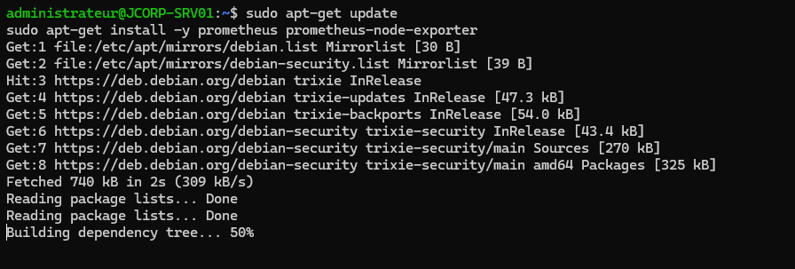

J'ai retenu les **paquets Debian** plutôt que les binaires publiés par le projet Prometheus :

| | Paquets Debian | Binaires du projet |
| --- | --- | --- |
| Authenticité | signatures APT vérifiées automatiquement | empreinte à contrôler à la main |
| Service systemd et compte dédié | fournis | à écrire soi-même |
| Mises à jour de sécurité | avec le reste du système | manuelles |
| Version | 2.53.3, branche maintenue à long terme | plus récente |

Une version légèrement en retrait n'a aucune conséquence pour superviser quelques machines ; une procédure plus simple et des mises à jour suivies en ont une.

### Contrôles

```bash
prometheus --version | head -1; prometheus-node-exporter --version 2>&1 | head -1
curl -s localhost:9090/-/healthy; echo; curl -s localhost:9100/metrics | head -3
```

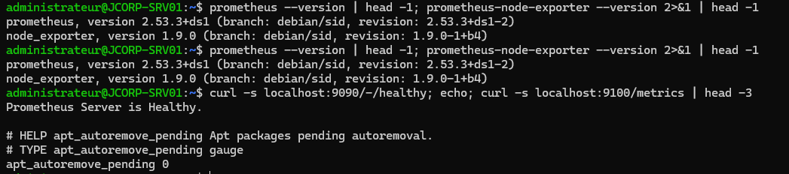

**Résultat observé :**

- `prometheus, version 2.53.3+ds1` et `node_exporter, version 1.9.0` ;
- `Prometheus Server is Healthy.` sur le point de contrôle de santé ;
- le Node Exporter répond sur le port `9100` et publie ses métriques au format texte de Prometheus (`# HELP`, `# TYPE`, puis la valeur).

Ces contrôles prouvent que les deux services fonctionnent. Ils ne prouvent pas encore que Prometheus **collecte** le Node Exporter : c'est la page des cibles qui le montrera.

## Étape 2 — Rétention des métriques

Par défaut, Prometheus conserve ses données 15 jours **sans limite de taille**. Sur une VM de 40 Gio partagée avec GLPI et sa base, une croissance non bornée finirait par remplir le disque et arrêter les trois services à la fois. Les options de démarrage du paquet Debian se règlent dans `/etc/default/prometheus` :

```
ARGS="--storage.tsdb.retention.time=15d --storage.tsdb.retention.size=5GB"
```

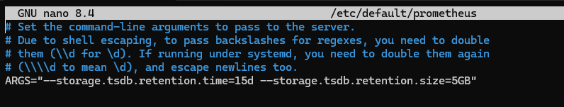

Les deux limites se cumulent : la plus contraignante l'emporte. Quinze jours suffisent pour comparer une journée à la précédente et documenter une alerte ; 5 Go représentent moins d'un septième de l'espace libre relevé à l'étape 0, et laissent la marge nécessaire à GLPI et MariaDB.

```bash
sudo systemctl restart prometheus && systemctl is-active prometheus
grep -A3 "job_name" /etc/prometheus/prometheus.yml
```

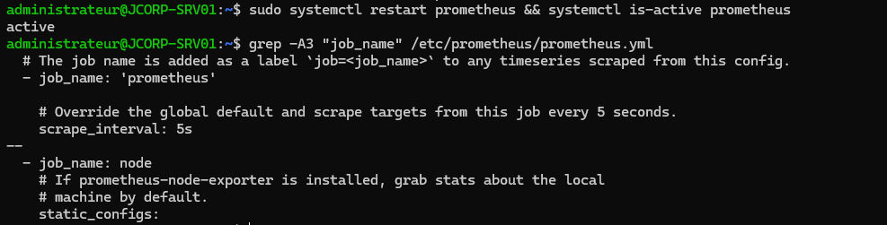

**Résultat observé :** le service redémarre et reste `active`, ce qui montre que les nouveaux arguments sont acceptés. La configuration livrée par Debian déclare déjà deux tâches de collecte :

| Tâche | Cible | Rôle |
| --- | --- | --- |
| `prometheus` | Prometheus lui-même, toutes les 5 secondes | surveiller le collecteur |
| `node` | le Node Exporter local, `localhost:9100` | métriques Linux de `JCORP-SRV01` |

La cible Linux est donc déclarée sans aucune modification de `prometheus.yml`. La cible Windows, en revanche, devra y être ajoutée.

### Vérification de la rétention appliquée

Un service `active` juste après un redémarrage ne prouve pas que les options sont prises en compte. La valeur effective se lit dans l'API de Prometheus :

```bash
curl -s localhost:9090/api/v1/status/flags | grep -o '"storage.tsdb.retention[^,]*'
```

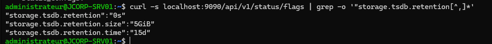

**Résultat observé :** `retention.time` à `15d` et `retention.size` à `5GiB`. Deux lectures à ne pas mal interpréter :

- `5GB` saisi devient `5GiB` : Prometheus compte en unités binaires, la limite réelle est donc de 5 × 1024³ octets ;
- `storage.tsdb.retention` à `0s` est l'**ancienne** option, dépréciée au profit de `retention.time`. Sa valeur nulle signifie « non utilisée », pas « aucune rétention ».

### Incident — l'interface web de Prometheus est absente

L'ouverture de `http://10.2.101.153:9090/targets` n'affiche pas la page des cibles mais un avertissement du paquet Debian :

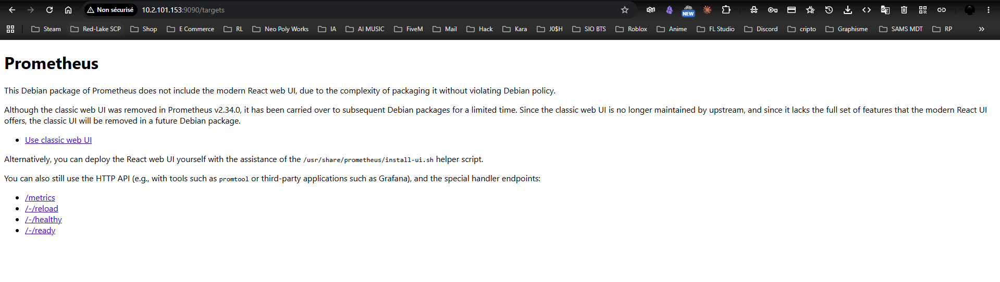

Le paquet **n'embarque pas l'interface web moderne** de Prometheus, écrite en React, que Debian ne parvient pas à empaqueter dans le respect de ses règles. Il conserve à titre transitoire l'**ancienne interface**, abandonnée par le projet depuis la version 2.34.0 et appelée à disparaître d'une future version du paquet.

C'est le revers du choix des paquets Debian fait à l'étape 1. Il ne remet pas ce choix en cause : la collecte, le stockage, l'API et les alertes sont complets, et l'affichage est confié à Grafana. Deux solutions existent pour consulter les cibles :

| Solution | Effet | Retenue |
| --- | --- | --- |
| Interface classique, lien *Use classic web UI* | disponible immédiatement, sans rien installer | **Oui**, pour les contrôles |
| Script `/usr/share/prometheus/install-ui.sh` | télécharge l'interface moderne depuis Internet, hors des dépôts signés | Non |

Le script réintroduirait un téléchargement non couvert par les signatures APT, précisément ce que le choix des paquets Debian voulait éviter, pour un confort d'affichage que Grafana apporte déjà.

## Étape 3 — Collecte de la cible Linux

Page des cibles de l'interface classique : `http://10.2.101.153:9090/classic/targets`, consultée depuis le poste d'administration.

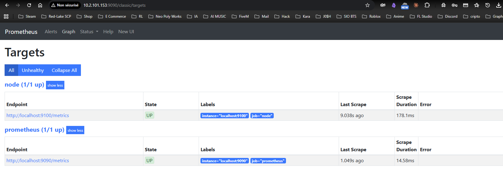

| Tâche | Point de collecte | État | Dernière collecte | Durée |
| --- | --- | --- | --- | --- |
| `node` | `http://localhost:9100/metrics` | **UP** | il y a 9 s | 178 ms |
| `prometheus` | `http://localhost:9090/metrics` | **UP** | il y a 1 s | 15 ms |

La colonne *Error* est vide pour les deux. C'est cette page, et non les contrôles de l'étape 1, qui prouve la **collecte** : Prometheus interroge effectivement le Node Exporter et en reçoit des données. La page est aussi atteinte depuis le poste d'administration, ce qui montre que le port `9090` est joignable depuis le réseau et pas seulement en local.

Les cibles sont nommées `localhost` parce que Prometheus et le Node Exporter tournent sur la même VM. Le libellé est exact mais peu parlant dans un tableau de bord ; il pourra être renommé en `JCORP-SRV01` lorsque la cible Windows sera ajoutée.

## Étape 4 — Grafana

Grafana n'est pas distribué dans les dépôts Debian. Il est installé depuis le **dépôt APT officiel de Grafana Labs**, dont la clé de signature est ajoutée explicitement : les paquets restent vérifiés par APT et suivent les mises à jour du système, ce qui conserve la logique retenue pour Prometheus.

```bash
sudo apt-get install -y gnupg
```

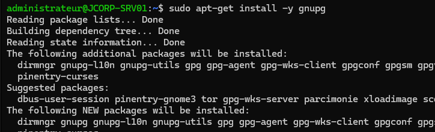

`gnupg` n'est pas présent sur l'image cloud Debian ; il sert uniquement à convertir la clé publiée par Grafana au format attendu par APT.

```bash
sudo mkdir -p /etc/apt/keyrings
wget -q -O - https://apt.grafana.com/gpg.key | gpg --dearmor | sudo tee /etc/apt/keyrings/grafana.gpg > /dev/null
echo "deb [signed-by=/etc/apt/keyrings/grafana.gpg] https://apt.grafana.com stable main" | sudo tee /etc/apt/sources.list.d/grafana.list
sudo apt-get update && sudo apt-get install -y grafana
```

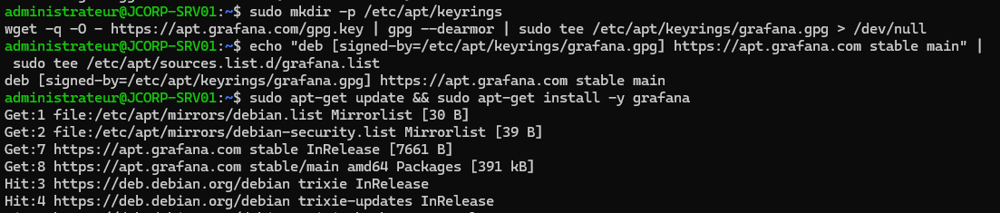

L'option `signed-by` limite la confiance accordée à cette clé **au seul dépôt Grafana** : elle ne peut pas servir à valider un paquet prétendant venir d'un autre dépôt. C'est la méthode recommandée depuis l'abandon de `apt-key`, qui ajoutait les clés à un trousseau global.

**Résultat observé :** `apt-get update` récupère l'index `https://apt.grafana.com stable InRelease` sans erreur de signature, ce qui confirme que la clé est valide pour ce dépôt.

```bash
sudo systemctl enable --now grafana-server
grafana-server -v; systemctl is-active grafana-server; free -h
```

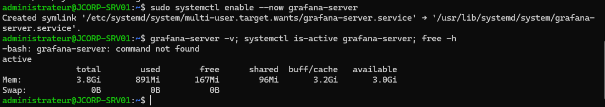

**Résultat observé :** le service est activé au démarrage et `active`. La mémoire disponible reste à **3,0 Gi**, Grafana compris.

La commande `grafana-server -v` renvoie *command not found*, et `grafana -v` également : le paquet place ses binaires dans `/usr/share/grafana/bin`, hors du chemin d'exécution. La version est donc lue dans la base des paquets :

```bash
dpkg -l grafana | tail -1
```

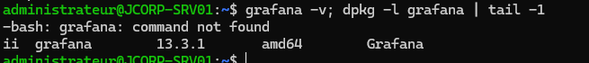

**Résultat observé :** `grafana 13.3.1 amd64`. Lire la version dans `dpkg` est d'ailleurs plus fiable que d'interroger le binaire : c'est le paquet réellement installé que le système mettra à jour.

### Premier accès

L'interface répond sur `http://10.2.101.153:3000` depuis le poste d'administration.

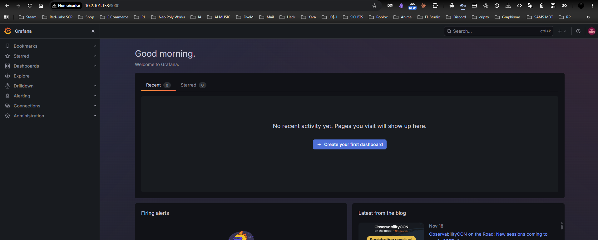

Grafana est livré avec le compte `admin` et le mot de passe `admin`, publics. Il impose leur changement à la première connexion ; le nouveau mot de passe ne figure ni dans cette procédure ni dans les captures. Comme pour les comptes par défaut de GLPI, c'est une fenêtre d'exposition à connaître : entre le démarrage du service et ce changement, n'importe quel poste du VLAN 700 pouvait se connecter en administrateur.

## Étape 5 — Prometheus comme source de données

*Connections* → *Data sources* → *Add data source* → *Prometheus*, avec l'adresse `http://localhost:9090`, puis *Save & test*.

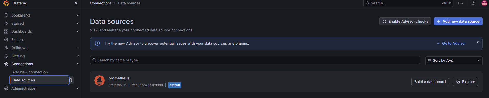

**Résultat observé :** la source `prometheus` est enregistrée, pointe sur `http://localhost:9090` et devient la source **par défaut** de Grafana.

L'adresse `localhost` est un choix et non une facilité : Grafana et Prometheus partageant la même VM, la requête ne quitte pas la machine. Grafana n'a donc pas besoin que Prometheus soit joignable depuis le réseau. Le port `9090` reste aujourd'hui ouvert au VLAN 700, ce qui a permis de consulter la page des cibles depuis le poste d'administration ; il pourrait être restreint à la VM elle-même sans rien casser côté Grafana.

La capture montre la source enregistrée, pas le message de réussite du test de connexion. La preuve que Grafana interroge effectivement Prometheus est apportée par le tableau de bord de l'étape suivante, qui affiche des valeurs réelles.

## Étape 6 — Tableau de bord

Plutôt que de construire chaque panneau, j'importe le tableau communautaire **Node Exporter Full** (ID `1860` sur grafana.com) : *Dashboards* → *New* → *Import*, ID `1860`, *Load*, puis source `prometheus` et *Import*. La VM a pu joindre grafana.com, l'import par ID a donc fonctionné sans passer par le fichier JSON.

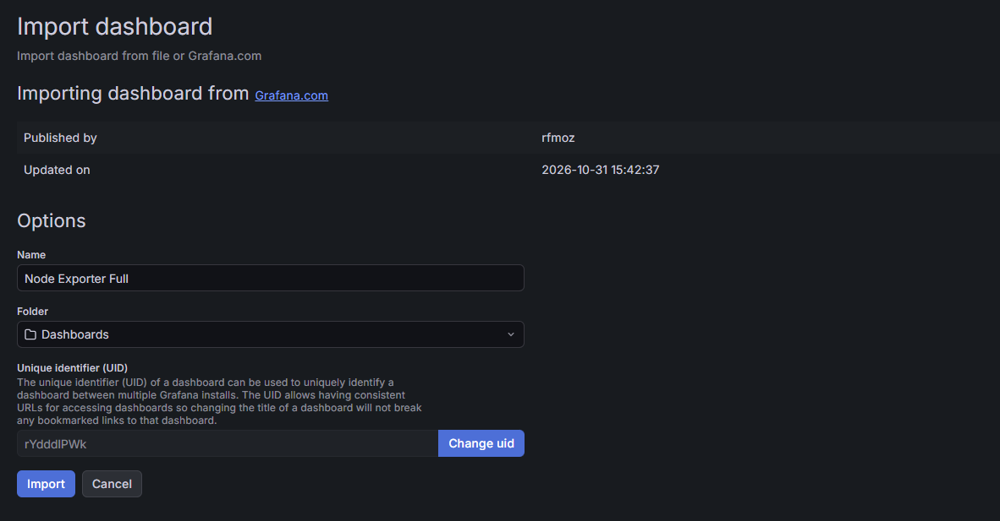

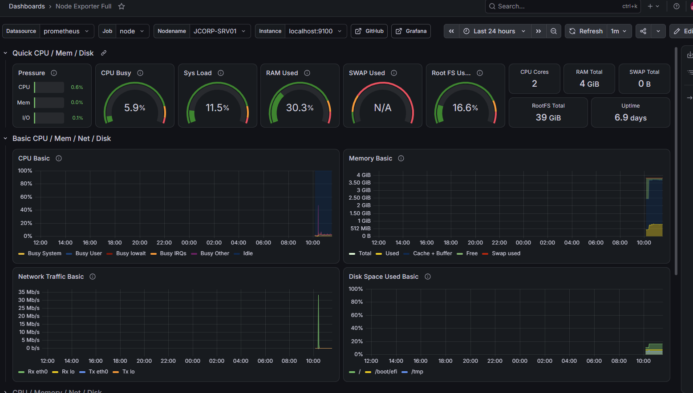

**Résultat observé :** le tableau s'ouvre sur la source `prometheus`, la tâche `node`, l'hôte `JCORP-SRV01` et l'instance `localhost:9100`, sur les dernières 24 heures :

| Indicateur | Valeur lue |
| --- | --- |
| CPU occupé | 5,9 % (2 cœurs) |
| RAM utilisée | 30,3 % de 4 GiB |
| Partition racine | 16,6 % de 39 GiB |
| Swap | N/A, aucun swap configuré (0 B) |
| Disponibilité | 6,9 jours de fonctionnement |

Les valeurs concordent avec les relevés de l'étape 0 (environ 4 Gi de RAM, 40 G de disque, pas de swap). Les courbes ne commencent qu'en fin de période : c'est normal, Prometheus ne collecte que depuis son installation le jour même. L'uptime de 6,9 jours, lui, vient du système et non de Prometheus.

La jauge *SWAP Used* affiche `N/A` : ce n'est pas une panne, la VM n'a simplement pas de swap.

Ce tableau prouve que Grafana interroge réellement Prometheus, ce que la capture de l'étape 5 ne montrait pas.

## Étape 7 — Windows Exporter sur JCORP-DC01

Je retiens `JCORP-DC01` comme cible Windows : c'est le serveur critique (AD, DNS, DHCP), donc le plus utile à superviser. Pour la future simulation de panne, j'arrêterai uniquement le service `windows_exporter`, jamais le contrôleur de domaine.

Dans PowerShell en administrateur :

```powershell
Invoke-WebRequest -Uri "https://github.com/prometheus-community/windows_exporter/releases/download/v0.31.3/windows_exporter-0.31.3-amd64.msi" -OutFile "$env:TEMP\windows_exporter.msi"
msiexec /i "$env:TEMP\windows_exporter.msi" ENABLED_COLLECTORS="cpu,cs,logical_disk,memory,net,os,service,system" /qn
Get-Service windows_exporter; Invoke-WebRequest http://localhost:9182/metrics -UseBasicParsing
```

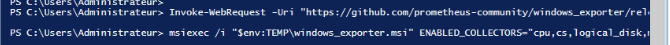

### Incident — Service Windows Exporter arrêté

**Symptôme :** le service est installé mais `Stopped`, et le port `9182` refuse la connexion.

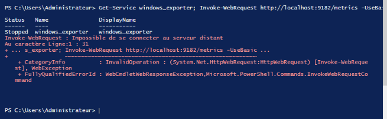

Un démarrage manuel échoue également :

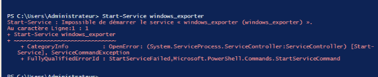

**Cause :** le journal *Application* l'indique clairement : `unknown collector cs`. Le collecteur `cs` figurait dans ma liste mais n'existe plus dans cette version ; ses informations sont reprises par d'autres collecteurs. Le service refuse de démarrer plutôt que d'ignorer le collecteur inconnu.

```powershell
Get-WinEvent -LogName Application -MaxEvents 10 | Where-Object ProviderName -like "*windows_exporter*" | Format-List TimeCreated, Message
```

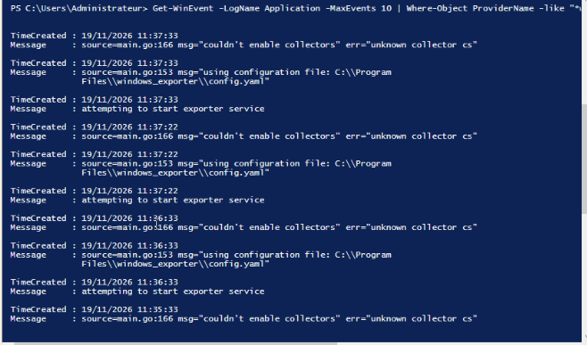

**Correction :** désinstallation puis réinstallation sans `cs`.

```powershell
msiexec /x "$env:TEMP\windows_exporter.msi" /qn
msiexec /i "$env:TEMP\windows_exporter.msi" ENABLED_COLLECTORS="cpu,logical_disk,memory,net,os,service,system" /qn
Start-Sleep 5; Get-Service windows_exporter; (Invoke-WebRequest http://localhost:9182/metrics -UseBasicParsing).StatusCode
```

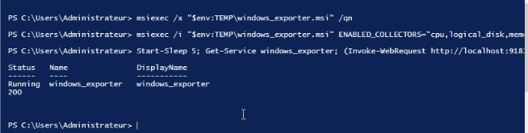

**Résultat observé :** service `Running`, la page `/metrics` répond `200`.

**Leçon :** la liste des collecteurs dépend de la version installée ; avant de la recopier d'un tutoriel, la vérifier dans la documentation de la version, et lire le journal d'événements plutôt que de réinstaller à l'aveugle.

## Étape 8 — Déclaration de JCORP-DC01 dans Prometheus

Sur `JCORP-DC01`, j'ouvre le port `9182` **uniquement** pour `JCORP-SRV01` : le contrôleur de domaine n'expose pas ses métriques au reste du VLAN.

```powershell
New-NetFirewallRule -DisplayName "Windows Exporter (Prometheus)" -Direction Inbound -Protocol TCP -LocalPort 9182 -RemoteAddress 10.2.101.153 -Action Allow
```

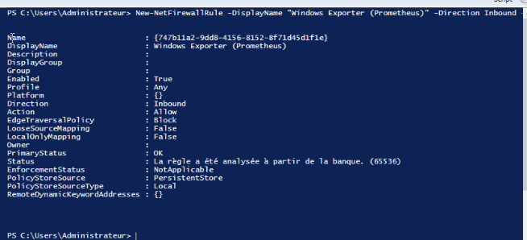

Depuis `JCORP-SRV01`, je vérifie que le port est joignable avant de toucher à Prometheus :

```bash
curl -s -o /dev/null -w "%{http_code}
" http://10.2.101.10:9182/metrics
```

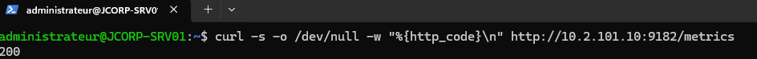

J'ajoute ensuite la tâche `windows` dans `/etc/prometheus/prometheus.yml`, avec un libellé `instance` lisible plutôt que l'adresse IP :

```yaml
  - job_name: windows
    static_configs:
      - targets: ['10.2.101.10:9182']
        labels:
          instance: JCORP-DC01
```

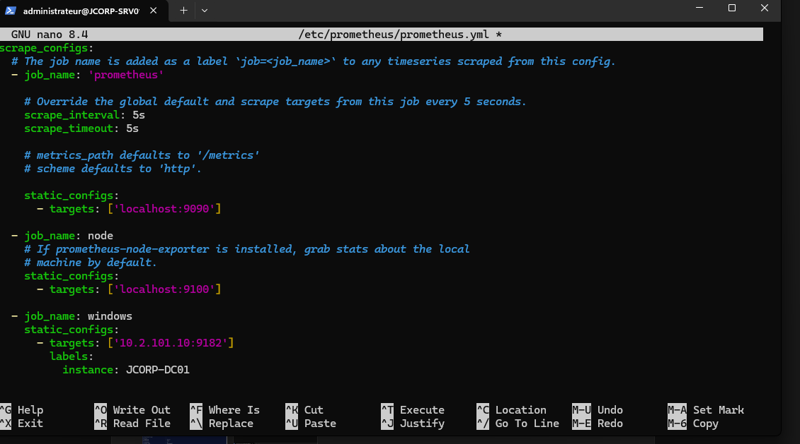

```bash
promtool check config /etc/prometheus/prometheus.yml && sudo systemctl restart prometheus && systemctl is-active prometheus
```

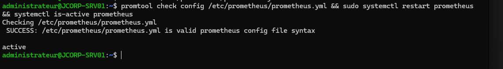

`promtool` valide la syntaxe **avant** le redémarrage : une erreur dans le fichier aurait arrêté la commande sans couper la supervision existante.

Juste après le redémarrage, la cible apparaissait en `UNKNOWN`, « Last Scrape : Never » : ce n'est pas une erreur, la première collecte n'avait pas encore eu lieu (intervalle par défaut de 15 s). Après rechargement :

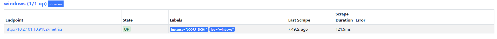

**Résultat observé :** `windows (1/1 up)`, instance `JCORP-DC01`, dernière collecte il y a 7 s, en 121,9 ms, sans erreur.

## Étape 9 — Règle d'alerte

La règle surveille la métrique `up` de la tâche `windows` : Prometheus la met à `1` quand la collecte réussit, à `0` quand la cible ne répond plus. *Alerting* → *Alert rules* → *New alert rule* :

| Paramètre | Valeur | Raison |
| --- | --- | --- |
| Nom | `JCORP-DC01 injoignable` | explicite pour l'exploitant |
| Requête | `up{job="windows"}` | disponibilité de la collecte sur le DC01 |
| Condition | *Is below* `1` | toute valeur sous 1 signifie une collecte échouée |
| Dossier / groupe | `JCorp` / `supervision` | règles du projet regroupées |
| Intervalle d'évaluation | 30 s | détection rapide sans charger Prometheus |
| Période d'attente | 1 min | ignore un raté isolé, alerte sur une panne durable |

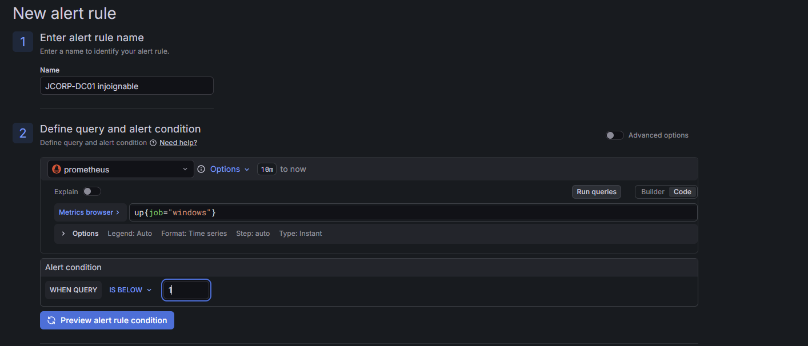

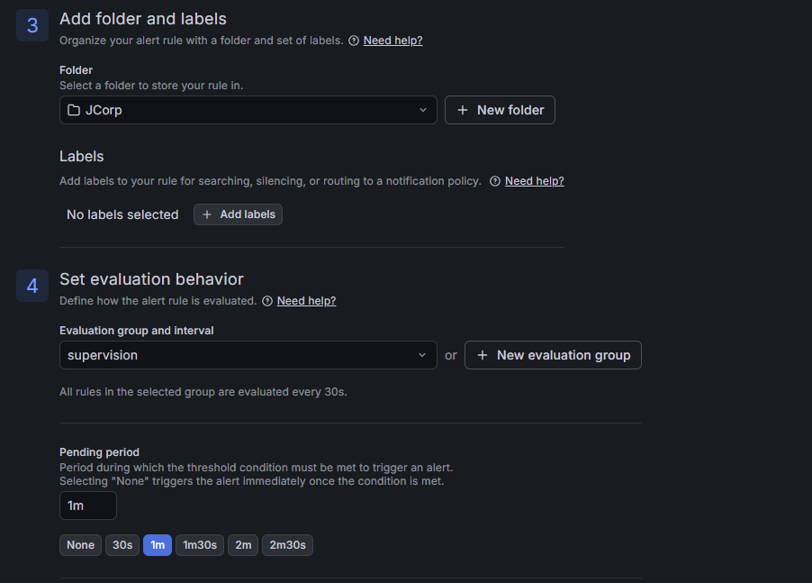

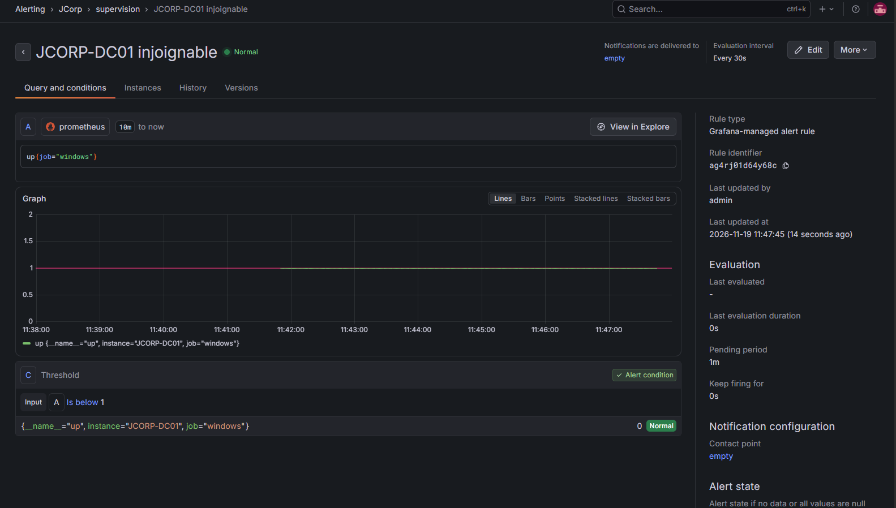

**Résultat observé :** la règle est enregistrée à l'état **Normal**. Le graphique montre `up` à `1` pour l'instance `JCORP-DC01` et la condition renvoie `0` (non remplie).

**Écart assumé :** le point de contact est vide (*Notifications are delivered to empty*). L'alerte est donc visible dans Grafana, mais aucune notification n'est envoyée. Configurer un canal (courriel, Discord…) supposerait un serveur d'envoi ou un service externe ; ce n'est pas exigé pour démontrer la détection, et c'est noté comme amélioration.

## Étape 10 — Simulation d'une panne et rétablissement

Pour ne pas perturber l'annuaire, je n'arrête **ni** le contrôleur de domaine **ni** les services AD, DNS ou DHCP : seul le service `windows_exporter` est arrêté. Vu de Prometheus, l'effet est le même qu'une machine injoignable : la collecte échoue et `up` passe à `0`.

```powershell
Stop-Service windows_exporter; Get-Service windows_exporter
```

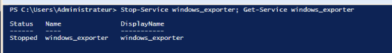

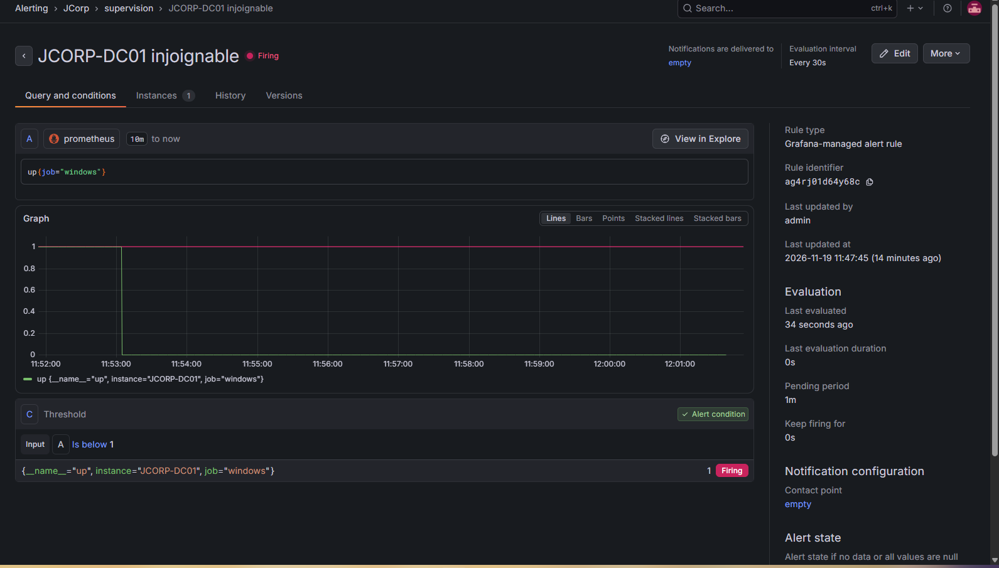

**Résultat observé :** `up{job="windows"}` tombe de `1` à `0` vers 11:53 ; après la période d'attente d'une minute, la règle passe en **Firing**, avec une instance concernée, `JCORP-DC01`. Sur le graphique, la ligne horizontale restée à `1` est le seuil, pas la mesure.

Rétablissement :

```powershell
Start-Service windows_exporter; Get-Service windows_exporter
```

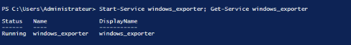

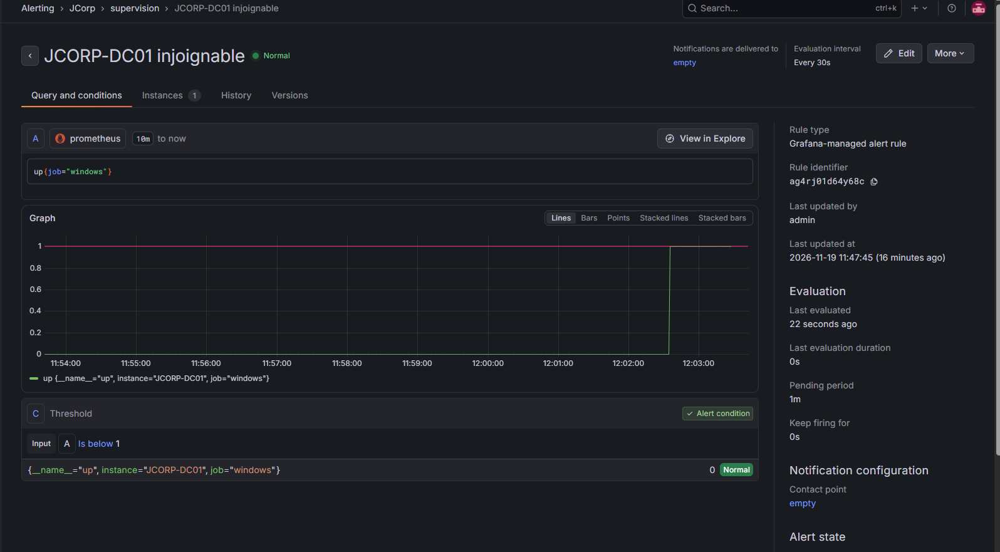

**Résultat observé :** `up` remonte à `1` vers 12:02:40 ; à l'évaluation suivante, la règle revient à l'état **Normal** sans intervention dans Grafana. La panne simulée a duré une dizaine de minutes ; l'AD, le DNS et le DHCP n'ont pas été interrompus.

L'état intermédiaire *Pending* n'a pas été capturé : il dure une minute au plus et n'apporte pas de preuve supplémentaire, la règle ne pouvant atteindre *Firing* qu'en passant par lui.

### Incident mineur — Règle de pare-feu créée deux fois

En relançant par erreur la commande de l'étape 8, j'ai créé une seconde règle identique (identifiant différent). Elle ne changeait rien au filtrage mais rendait la configuration ambiguë. Correction : suppression du doublon par son identifiant avec `Remove-NetFirewallRule -Name`, puis contrôle qu'une seule règle *Windows Exporter (Prometheus)* subsiste. Leçon : avant de relancer une commande de création, vérifier si l'objet existe déjà.

## Étapes prévues

- [x] Préparer la VM et vérifier l'accès et la place disponible. *Accès par clé rétabli, 2,9 Gi de RAM et 36 G de disque disponibles.*
- [x] Installer Prometheus et le collecteur Linux. *Prometheus 2.53.3 et Node Exporter 1.9.0, paquets Debian.*
- [x] Régler la rétention. *15 jours, 5 Go au plus.*
- [x] Constater la cible Linux en état UP. *`node` et `prometheus` UP, sans erreur.*
- [x] Installer Grafana et changer le mot de passe par défaut. *Dépôt officiel, service actif, interface joignable.*
- [x] Ajouter Prometheus comme source de données. *`http://localhost:9090`, source par défaut.*
- [x] Installer Windows Exporter sur la cible Windows et la déclarer dans Prometheus. *`JCORP-DC01`, port 9182 réservé à `JCORP-SRV01`, cible UP.*
- [x] Créer ou importer un tableau de bord adapté : CPU, RAM, disque et disponibilité. *Node Exporter Full (1860) importé, valeurs réelles affichées.*
- [x] Définir une règle d'alerte, son seuil et sa durée ; les documenter. *`up{job="windows"} < 1` pendant 1 min, évaluée toutes les 30 s.*
- [x] Simuler une indisponibilité sans arrêter un service AD/DNS/DHCP essentiel. *Arrêt du seul service `windows_exporter`.*
- [x] Constater l'alerte puis sa résolution après rétablissement. *Firing puis Normal, sans intervention dans Grafana.*
- [ ] Si un canal est configuré, vérifier la réception de la notification. *Aucun point de contact pour l'instant : écart assumé.*
- [ ] En AP 2, ajouter Dokploy, les conteneurs et le contrôle HTTP du site.

## Recette

| Contrôle | Résultat attendu | Résultat observé | Conforme |
| --- | --- | --- | --- |
| Accès d'administration | connexion SSH depuis le poste d'administration | réussie après ajout de la clé par l'agent invité | Oui |
| Ressources disponibles | marge suffisante avec GLPI en service | 2,9 Gi RAM, 36 G disque | Oui |
| Paquets installés | Prometheus et Node Exporter | 2.53.3 et 1.9.0 | Oui |
| Santé de Prometheus | point de contrôle sain | `Prometheus Server is Healthy.` | Oui |
| Exposition Linux | métriques publiées sur `9100` | lignes `# HELP` / `# TYPE` | Oui |
| Rétention bornée | durée et taille limitées, lues dans l'API | `15d` et `5GiB` | Oui |
| Interface web | page des cibles consultable | interface moderne absente du paquet, interface classique utilisée | Écart documenté |
| Collecte Linux | cible `node` UP, sans erreur | UP, collecte en 178 ms | Oui |
| Collecte Windows | cible Windows UP | `JCORP-DC01` UP, collecte en 121,9 ms | Oui |
| Grafana installé | service actif, interface joignable depuis le réseau | `active`, accueil atteint sur `:3000` | Oui |
| Compte par défaut | mot de passe `admin` changé | changé à la première connexion | Oui |
| Source de données | Prometheus enregistré dans Grafana | `prometheus`, `localhost:9090`, par défaut | Oui |
| Visualisation | métriques réelles et période visible dans Grafana | CPU 5,9 %, RAM 30,3 %, disque 16,6 %, uptime 6,9 j, sur 24 h | Oui |
| Détection | alerte déclenchée après la durée définie | `up` à 0, règle en Firing après 1 min d'attente | Oui |
| Rétablissement | alerte résolue après retour à la normale | `up` à 1, règle revenue à Normal | Oui |
| Extension AP 2 | hôte, conteneurs et site observables | — | À faire |

Voir le [guide des captures](images/README.md).

## Références

- [Grafana et Prometheus](https://grafana.com/docs/grafana/latest/datasources/prometheus/)
- [Prometheus](https://prometheus.io/docs/introduction/overview/)
- [Node Exporter](https://github.com/prometheus/node_exporter)
- [Windows Exporter](https://github.com/prometheus-community/windows_exporter)
- [Blackbox Exporter](https://github.com/prometheus/blackbox_exporter)
- [Logs et métriques Dokploy](https://docs.dokploy.com/docs/core/logs-and-metrics)

[Retour AP 1](../../AP%201/README.md) · [Infrastructure](../README.md)
