# TrueNAS - JCorp

Je mets en place un serveur TrueNAS pour le stockage et les partages de mon infrastructure JCorp. Cette documentation présente l'installation, le stockage et la jonction du NAS à Active Directory. Je la complète au fur et à mesure de la configuration.

## 1. Créer la machine virtuelle

J'ai créé la VM **704**, nommée **`NAS-JCorp`**, sur le nœud Proxmox **`pve`**. L'ISO montée est celle de **TrueNAS Community Edition 25.10.1**.


| Élément | Configuration visible |
| --- | --- |
| VMID et nom Proxmox | `704`, `NAS-JCorp` |
| Mémoire vive | 10 Gio, ballooning désactivé |
| Processeur | 2 vCPU, 1 socket et 2 cœurs, type `x86-64-v2-AES` |
| BIOS | SeaBIOS |
| Type de machine | `i440fx` |
| Contrôleur SCSI | VirtIO SCSI single |
| Disque système | 32 Gio, `scsi0`, stockage `Raid5-VMs`, IO thread activé |
| ISO | TrueNAS CE 25.10.1 sur le stockage `local` |
| Carte réseau | VirtIO, `net0`, pont `vmbr2`, tag VLAN `700` |
| Pare-feu Proxmox sur la carte | Activé |

La capture présente uniquement le disque système de 32 Gio. J'ai ensuite ajouté un seul disque de données de 64 Gio, présenté dans l'étape dédiée au stockage. J'ai configuré le tag VLAN **700** sur la carte réseau afin de placer le NAS dans le même réseau que les autres VM JCorp.

## 2. Démarrer sur l'ISO

J'ai démarré la VM depuis l'ISO TrueNAS. Dans le menu **TrueNAS 25.10.1 Console Setup**, je choisis **Install/Upgrade**, puis valide avec **OK** pour lancer l'assistant d'installation.


L'installation s'effectue dans cette console, sans bureau graphique à installer dans la VM.

## 3. Choisir le disque système

L'écran **Choose Destination Media** présente le disque **`sda`**, identifié comme **QEMU HARDDISK**, d'une capacité de **32 Gio**. C'est le disque prévu pour installer TrueNAS.


Je sélectionne le disque avec la **barre d'espace**, puis je valide avec **OK**. La case est encore vide sur cette capture, prise avant la sélection.

La vue rapprochée ci-dessous montre ce même disque de 32 Gio dans l'écran de sélection :


Le disque choisi sera effacé lors de l'installation et réservé au système TrueNAS. Il ne servira pas de disque de données pour les partages.

## 4. Choisir le compte d'administration

L'écran **Web UI Authentication Method** propose de définir le compte d'administration pendant l'installation ou de reporter cette configuration à l'interface web.


Je conserve l'option **1 - Administrative user (`truenas_admin`)**, puis je valide avec **OK**. L'étape suivante demande de définir et de confirmer le mot de passe de ce compte. J'utiliserai ensuite `truenas_admin` pour me connecter à l'interface d'administration TrueNAS.

Ce compte est propre au NAS : il est distinct du compte `JCORP\Administrateur` de mon Active Directory.

## 5. Installer le système sur le disque

Après avoir défini et confirmé le mot de passe de `truenas_admin`, j'ai validé les choix de l'installateur pour lancer l'installation sur le disque système de 32 Gio.


La console affiche les opérations suivantes :

1. **Formatting disk sda** : préparation et formatage du disque système sélectionné.
2. **Creating boot pool** : création du pool ZFS réservé au démarrage de TrueNAS.
3. **Creating dataset** : création du dataset utilisé par le système.
4. **Extracting** : extraction des fichiers de TrueNAS sur le disque.

Je laisse l'installation se terminer sans éteindre la VM. Sur cette capture, l'extraction est encore en cours ; le pool de démarrage est distinct du futur pool de données destiné aux partages.

## 6. Terminer l'installation et retirer l'ISO

L'installateur affiche **Installation Succeeded** et confirme que TrueNAS a été installé sur **`sda`**. Il demande de redémarrer et de retirer le support d'installation.

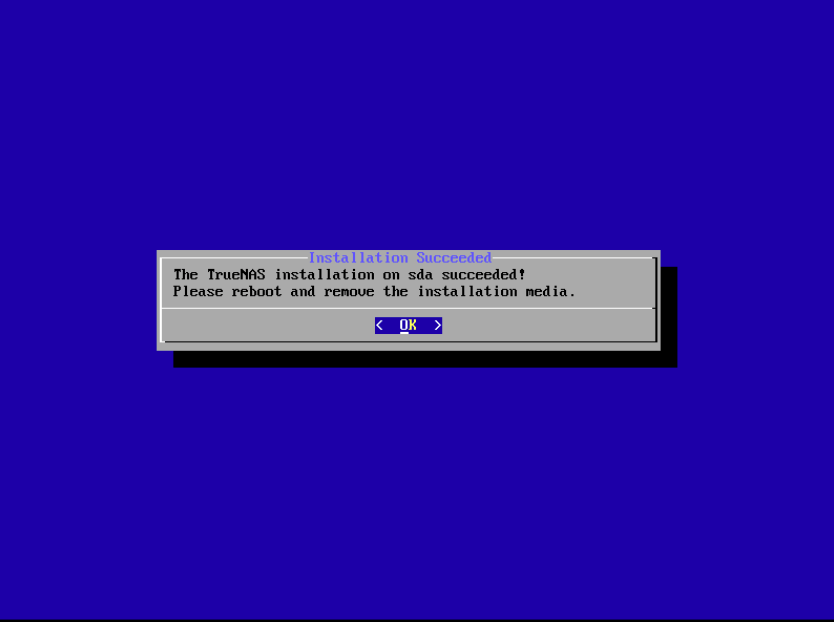

Je valide avec **OK** pour revenir au menu de l'installateur. Pour démarrer sur le système installé, la procédure est la suivante :

1. Choisir **Shutdown System** dans le menu de l'installateur et attendre l'arrêt de la VM.
2. Dans Proxmox, ouvrir **VM 704 > Hardware > CD/DVD Drive > Edit**.
3. Sélectionner **Do not use any media**, puis valider.
4. Redémarrer la VM avec **Start**. Si nécessaire, vérifier dans **Options > Boot Order** que le disque `scsi0` est activé pour le démarrage.

TrueNAS doit ensuite démarrer depuis le disque système de 32 Gio, sans relancer l'installateur.

## 7. Configurer l'adresse IP fixe

Après le démarrage de TrueNAS, j'ai ouvert **Configure network interfaces** depuis le menu console. Sur l'interface **`ens18`**, j'ai désactivé l'adressage IPv4 par DHCP et renseigné l'alias **`10.2.101.152/24`**, puis enregistré et appliqué la modification.

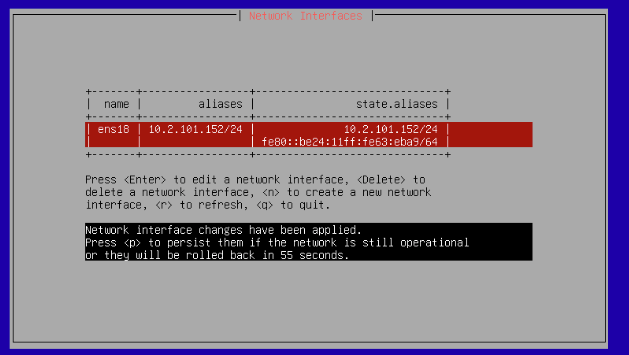

La capture montre `10.2.101.152/24` dans les colonnes **aliases** et **state.aliases**. Le message précise que les changements sont appliqués temporairement et seront annulés à la fin du délai sans confirmation. Pour les conserver, j'appuie sur **`p`** (*persist*), puis sur **`q`** pour revenir au menu principal.

| Paramètre de l'interface | Valeur |
| --- | --- |
| Interface | `ens18` |
| Adresse IPv4 | `10.2.101.152` |
| Préfixe / masque | `/24` / `255.255.255.0` |

Cette adresse est hors du pool DHCP actuel, de `10.2.101.11` à `10.2.101.150`.

## 8. Renseigner les paramètres réseau globaux

Depuis le menu console, j'ai ouvert **Configure network settings** pour définir le nom du NAS, son domaine de recherche, la passerelle et le serveur DNS.

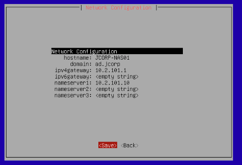

| Champ | Valeur renseignée |
| --- | --- |
| `hostname` | `JCORP-NAS01` |
| `domain` | `ad.jcorp` |
| `ipv4gateway` | `10.2.101.1` |
| `ipv6gateway` | Vide |
| `nameserver1` | `10.2.101.10` |
| `nameserver2` et `nameserver3` | Vides |

Je valide ces paramètres avec **Save**. Le DNS pointe vers mon contrôleur de domaine pour permettre la résolution des noms JCorp. Renseigner `ad.jcorp` ici définit le domaine réseau du NAS ; cela ne réalise pas encore sa jonction à Active Directory.

## 9. Ajouter le disque de données

Pour mon projet, j'ai retenu **un seul disque de données de 64 Gio**, séparé du disque système de 32 Gio. Dans Proxmox, j'ai ouvert **VM 704 > Hardware > Add > Hard Disk**, choisi le bus **SCSI**, le stockage **`Raid5-VMs`** et une taille de **64 Gio**.

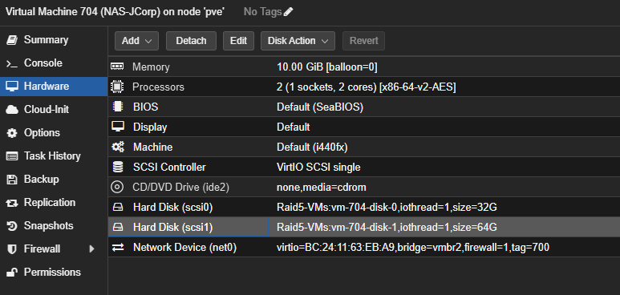

| Disque | Taille | Utilisation |
| --- | --- | --- |
| `scsi0` | 32 Gio | Système TrueNAS et pool de démarrage |
| `scsi1` | 64 Gio | Données et futurs partages |

La capture montre également que le lecteur CD/DVD ne contient plus de média et que la carte réseau utilise toujours le pont `vmbr2` avec le VLAN **700**.

Le pool de données utilise ce seul disque, en **Stripe**. Cette configuration ne fournit pas de redondance ZFS : la perte du disque de données peut entraîner la perte du pool. Je prévois donc les sauvegardes séparément.

## 10. Préparer le pool JCORP-DATA

Dans l'interface web TrueNAS, j'ai ouvert **Storage > Create Pool** et renseigné le nom **`JCORP-DATA`**. Dans la partie **Data**, j'ai retenu **Stripe** avec le seul disque de données de **64 Gio**, puis consulté le récapitulatif.

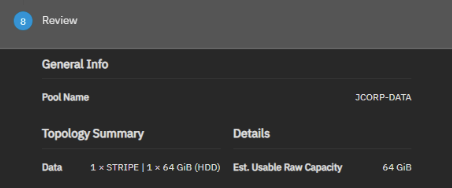

Le récapitulatif indique **1 x STRIPE | 1 x 64 GiB (HDD)** et une capacité brute estimée de **64 Gio**. Il s'agit de la configuration prévue avant création, pas encore d'un pool utilisable.

### Blocage : numéros de série des disques virtuels

Lors de la tentative de création, TrueNAS affiche l'erreur **Disks have duplicate serial numbers: None (sda, sdb)**.

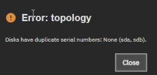

Les disques virtuels système et données sont signalés sans numéro de série distinct. J'ai corrigé ce blocage en attribuant des numéros de série uniques dans Proxmox, VM arrêtée, puis redémarré TrueNAS avant de relancer la création du pool. Cette correction est distincte du choix Stripe : le pool reste prévu sur le seul disque de données de 64 Gio.

## 11. Attribuer des numéros de série uniques

J'ai arrêté la VM **704**, puis ouvert le **Shell du nœud `pve`** dans Proxmox. La commande suivante m'a permis de contrôler les paramètres des disques :

```bash
qm config 704
```

J'ai ensuite ajouté un numéro de série différent à chaque disque en conservant ses paramètres :

```bash
qm set 704 --scsi0 'Raid5-VMs:vm-704-disk-0,iothread=1,size=32G,serial=JCORP-BOOT01'
qm set 704 --scsi1 'Raid5-VMs:vm-704-disk-1,iothread=1,size=64G,serial=JCORP-DATA01'
```

Ces commandes modifient l'identification présentée à la VM ; elles ne recréent pas les disques. J'ai redémarré TrueNAS, puis relancé la création du pool avec le seul disque de données de 64 Gio.

## 12. Vérifier la création du pool

Le tableau de bord **Storage** affiche le message **Pool created successfully** et le pool **`JCORP-DATA`**.

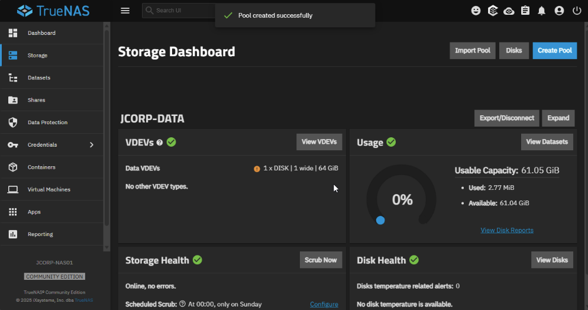

| Élément | Résultat affiché |
| --- | --- |
| Nom du pool | `JCORP-DATA` |
| Configuration | Un disque de données de 64 Gio |
| Capacité utilisable | 61,05 Gio |
| Espace disponible sur la capture | 61,04 Gio |
| État du stockage | En ligne, aucune erreur |

La capacité utilisable est inférieure aux 64 Gio bruts du disque en raison de l'espace réservé et des métadonnées du stockage. Le pool est maintenant prêt pour la création des datasets et des partages. Il reste sans redondance ZFS, conformément au choix d'un seul disque.

## 13. Corriger la résolution DNS inverse

La jonction à Active Directory échouait avec un délai DNS : **The resolution lifetime expired**, sur le serveur `10.2.101.10`, port UDP 53.

Les tests depuis le NAS répondaient correctement pour les enregistrements SOA, LDAP et Kerberos du domaine ainsi que pour l'adresse du contrôleur de domaine. J'ai ensuite observé les échanges pendant une tentative de jonction :

```bash
sudo timeout 60 tcpdump -ni any -nn -vv 'host 10.2.101.10 and port 53'
```

La capture montrait des recherches inverses PTR pour `10.2.101.10` et `10.2.101.152`, avec des réponses **SERVFAIL** et des requêtes répétées. Dans le gestionnaire DNS de **JCORP-DC01**, aucune zone de recherche inversée n'était configurée.

### Créer la zone inverse sur le contrôleur de domaine

Dans **Gestionnaire de serveur > Outils > DNS**, j'ai développé **JCORP-DC01**, sélectionné **Zones de recherche inversée**, puis ouvert **Action > Nouvelle zone**.

J'ai retenu les paramètres suivants :

| Paramètre | Valeur |
| --- | --- |
| Type | Zone principale intégrée à Active Directory |
| Réplication | Serveurs DNS des contrôleurs de domaine de `ad.jcorp` |
| Recherche inverse | IPv4 |
| ID réseau | `10.2.101` |
| Zone créée | `101.2.10.in-addr.arpa` |
| Mises à jour dynamiques | Sécurisées uniquement |

J'ai ajouté un pointeur PTR pour le contrôleur de domaine. Pour le NAS, j'ai créé un hôte dans la zone directe `ad.jcorp`, en cochant **Créer un pointeur d'enregistrement PTR associé**.

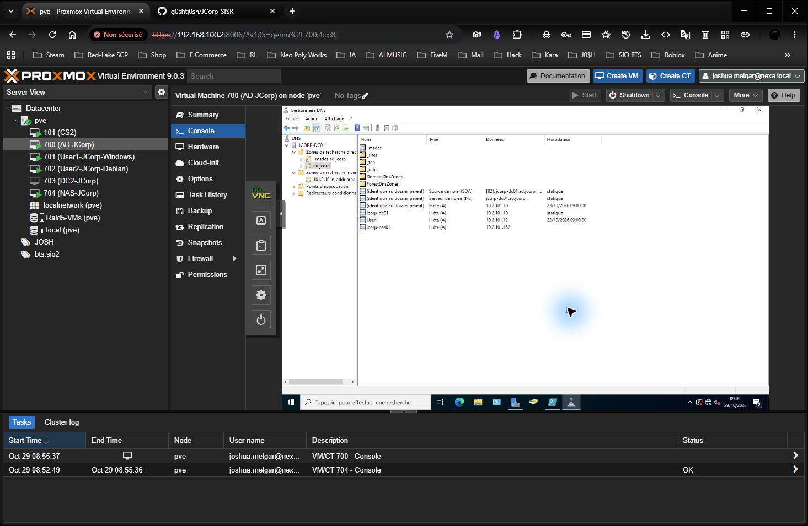

| Type | Adresse ou nom | Cible |
| --- | --- | --- |
| A | `jcorp-nas01.ad.jcorp` | `10.2.101.152` |
| PTR | `10.2.101.10` | `jcorp-dc01.ad.jcorp` |
| PTR | `10.2.101.152` | `jcorp-nas01.ad.jcorp` |

Après actualisation du gestionnaire DNS, les deux pointeurs apparaissent dans la zone inverse.

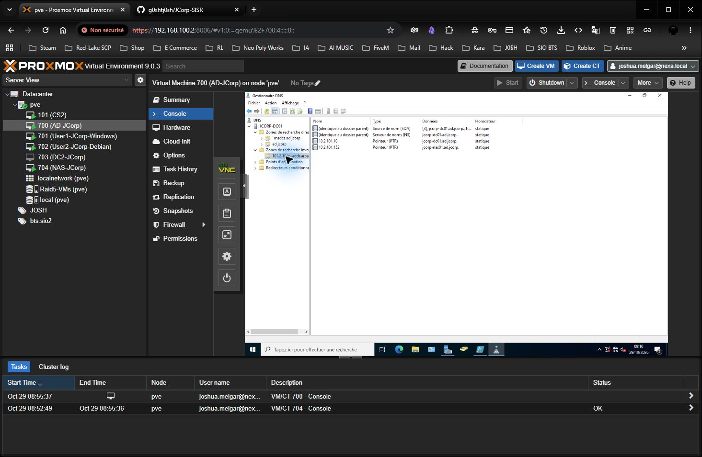

Pour contrôler les réponses depuis le Shell Linux du NAS, les commandes sont :

```bash
dig @10.2.101.10 -x 10.2.101.10 +time=2 +tries=1
dig @10.2.101.10 -x 10.2.101.152 +time=2 +tries=1
```

Le résultat attendu est `NOERROR` avec le nom correspondant dans la réponse. La capture suivante valide la jonction après la correction ; ces deux commandes de contrôle ne sont pas présentées comme des résultats capturés.

### Utiliser le presse-papiers noVNC

Pour saisir du texte dans la VM Windows, j'ai ouvert la barre noVNC puis **Clipboard**, renseigné le texte dans la zone prévue, fermé le panneau et utilisé **Ctrl+V** dans le champ de la VM. La présence de l'icône Clipboard ne signifie pas qu'un collage direct depuis le navigateur sera transmis automatiquement.

## 14. Joindre TrueNAS au domaine ad.jcorp

Dans **Credentials > Directory Services > Configure Directory Services**, j'ai renseigné la configuration suivante :

| Champ | Valeur |
| --- | --- |
| Configuration Type | Active Directory |
| Enable Service | Activé |
| Enable Account Cache | Activé |
| Enable DNS Updates | Activé |
| Timeout | 10 secondes |
| Kerberos Realm | Vide, déterminé lors de la configuration |
| Credential Type | Kerberos User |
| Username | `Administrateur` |
| Password | Mot de passe du compte de domaine, non reproduit dans la documentation |
| TrueNAS Hostname | `JCORP-NAS01` |
| Domain Name | `ad.jcorp` |
| Site Name | Vide |
| Computer Account OU | `OU=Serveurs,DC=ad,DC=jcorp` |
| Use Default Domain | Désactivé |
| Enable Trusted Domains | Désactivé |
| Use TrueNAS Server IDMAP Defaults | Activé |

Après validation avec **Save**, la jonction fonctionne. La page **Directory Services** affiche le domaine **AD.JCORP**, le statut **HEALTHY** et le cache des comptes **Enabled**.

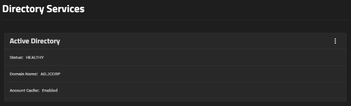

La correction de la zone inverse et des enregistrements DNS a précédé cette tentative réussie. Le NAS est maintenant joint au domaine. La section suivante présente le partage Commun et les premiers tests d'accès.

## 15. Créer l'espace commun des utilisateurs du domaine

J'ai retenu un partage **Commun**, accessible à tous les utilisateurs du domaine, plutôt que des partages séparés par service pour cette étape du projet.

Dans **Datasets**, j'ai sélectionné **JCORP-DATA**, puis utilisé **Add Dataset** avec le nom **Commun** et le preset **SMB**.

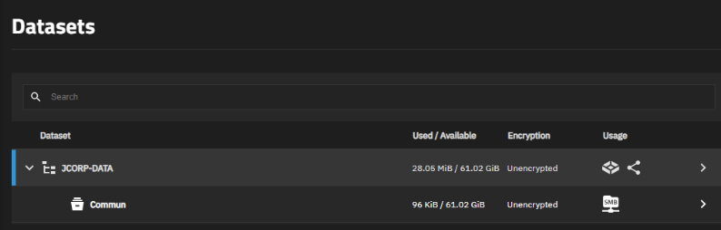

La capture confirme la présence de `JCORP-DATA/Commun`, son usage SMB et environ **61,02 Gio disponibles**. Cet espace disponible appartient au pool : le dataset ne dispose pas d'un disque supplémentaire de cette taille.

| Élément | Valeur |
| --- | --- |
| Pool parent | `JCORP-DATA` |
| Dataset | `Commun` |
| Chemin du dataset | `/mnt/JCORP-DATA/Commun` |
| Usage affiché | SMB |
| Population prévue | Tous les utilisateurs du domaine JCorp |
| Permission vérifiée pour les utilisateurs | Modification : lecture, création, modification et suppression des fichiers |
| Administration vérifiée | Contrôle total pour les administrateurs |

### Vérifier et enregistrer les permissions du dataset

Dans l'éditeur ACL du dataset `/mnt/JCORP-DATA/Commun`, j'ai vérifié les entrées déjà créées par le preset SMB. Le groupe **JCORP\\utilisateurs du domaine** est présent avec **Allow**, **Modify** et **Inherit**. Le groupe **JCORP\\admins du domaine** dispose de **Full Control**. J'ai conservé les entrées existantes du propriétaire et des groupes locaux, puis enregistré avec **Save Access Control List**.

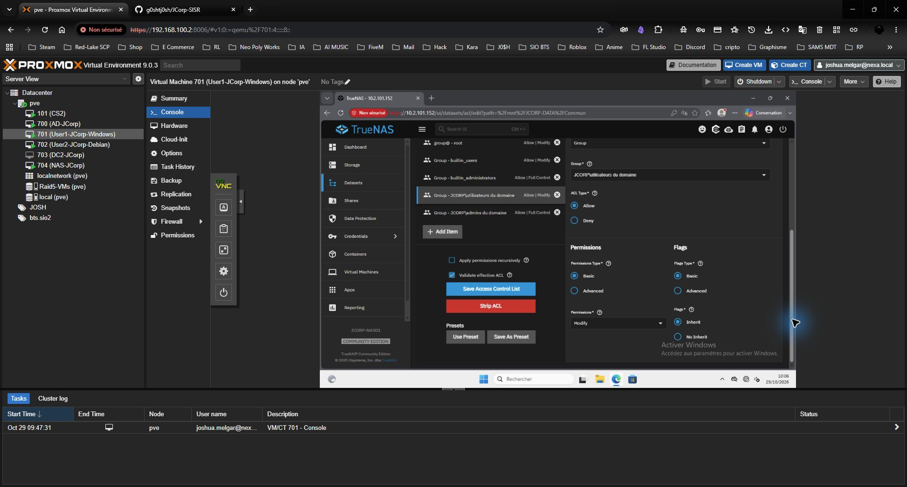

L'application récursive n'est pas cochée : le dataset était vide au moment de cette vérification. Les nouveaux éléments héritent des permissions du dossier parent.

Le niveau Modify permet aux utilisateurs de lire, créer, modifier et supprimer les fichiers de cet espace commun, y compris ceux des autres utilisateurs. Il ne leur donne pas le contrôle des ACL.

### Vérifier le partage SMB

Le partage **Commun** existe déjà dans **Shares > Windows (SMB) Shares**. Son chemin est `/mnt/JCORP-DATA/Commun`, son bouton **Enabled** est activé et le service SMB affiche **RUNNING**. Je n'ai pas créé de deuxième partage.

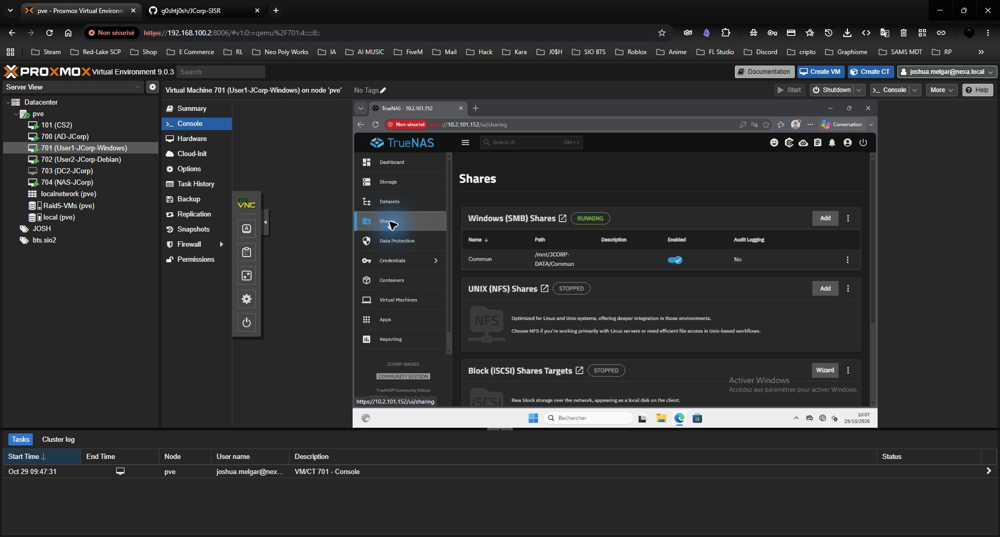

L'ACL de partage présente l'entrée par défaut `everyone@`, **FULL**, **ALLOWED**. Cette autorisation de partage ne dépasse pas les droits accordés par les ACL du système de fichiers : le groupe des utilisateurs du domaine reste limité à Modify sur le dataset. Les contrôles complémentaires du NAS sont confirmés comme terminés par Joshua ; ils n'ont pas été réexécutés pendant le contrôle DHCP.

### Tester depuis le poste Windows du domaine

Depuis l'explorateur du poste **User1-JCorp-Windows**, j'ai ouvert :

```text
\\JCORP-NAS01.ad.jcorp\Commun
```

Le dossier s'est ouvert sans demande supplémentaire d'identifiants. J'ai créé un dossier de test nommé `t` : il apparaît dans le partage sans erreur d'autorisation.

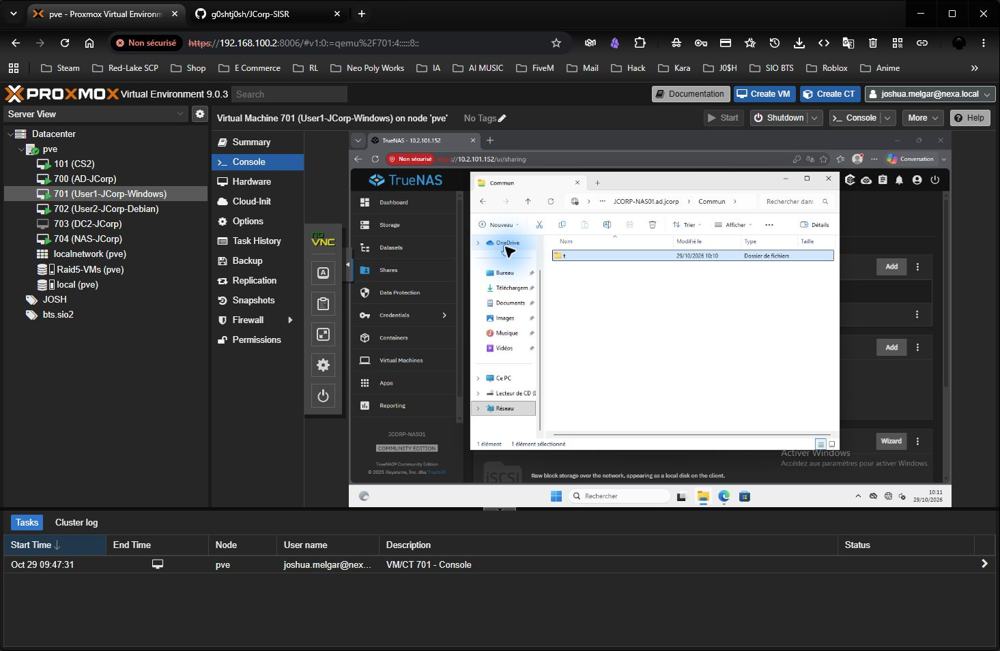

Ce test valide l'ouverture, la liste du dossier et la création d'un sous-dossier avec la session Windows en cours. Le dossier de test est conservé. Joshua confirme ensuite avoir terminé les contrôles complémentaires du NAS. Les captures de cette section restent celles des vérifications effectuées pendant la configuration.

### Déployer le lecteur par GPO

Après le premier test SMB, j'ai créé la GPO **JCORP-Utilisateurs-LecteursReseau** depuis l'OU **Utilisateurs**, avec l'option **Créer un objet GPO dans ce domaine, et le lier ici**. Son lien est activé et son filtrage conserve **Utilisateurs authentifiés**, sans filtre WMI. Elle concerne les utilisateurs de cette OU et de ses sous-OU, sous réserve de l'héritage des stratégies.

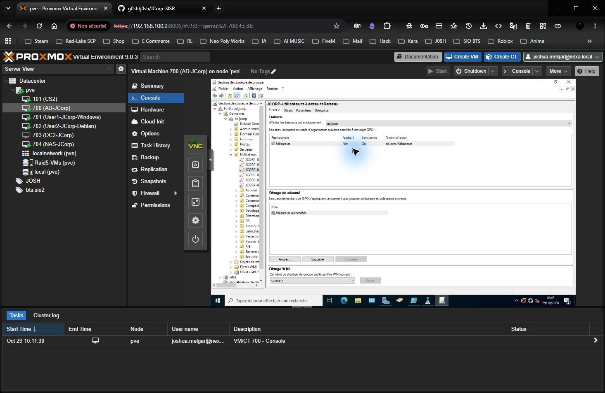

Dans **Modifier > Configuration utilisateur > Préférences > Paramètres Windows > Mappages de lecteurs**, j'ai choisi **Nouveau > Lecteur mappé** puis enregistré ces paramètres :

| Paramètre enregistré | Valeur |
| --- | --- |
| Action | Mettre à jour |
| Emplacement | `\\JCORP-NAS01.ad.jcorp\Commun` |
| Libellé personnalisé | Vide, le partage conserve son nom Commun |
| Lettre | `S:` |
| Reconnecter | Activé |
| Comptes utilisés | Session du domaine, sans identifiants enregistrés dans la GPO |

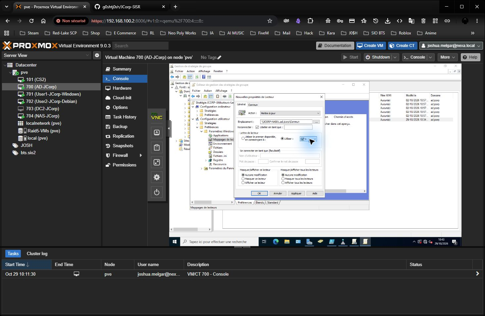

Après validation avec **OK**, le lecteur **S:** apparaît dans la liste des mappages de la GPO.

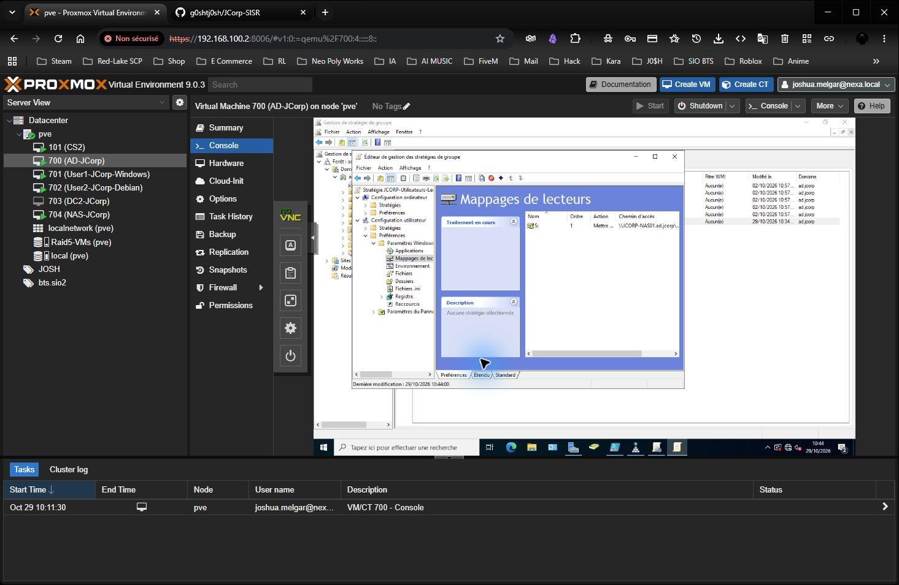

Tous les utilisateurs visés doivent être placés dans l'OU où cette GPO utilisateur s'applique, ou dans ses sous-OU, et posséder les droits de lecture et d'application de la GPO. Un utilisateur situé hors de cette portée ne recevra pas le lecteur même s'il peut ouvrir le partage manuellement.

Les ACL TrueNAS assurent les droits sur les fichiers ; la GPO sert à connecter automatiquement le lecteur. Cette GPO Windows ne monte pas le partage sur les postes Debian.

Les permissions du dataset, l'activation du partage SMB et le premier test d'ouverture et de création sont validés. La GPO et son mappage S: sont créés et enregistrés. Après un simple déverrouillage, S: n'était pas encore affiché. J'ai ensuite fermé puis rouvert la session de Joshua Fernandes (JCORP\\jfernandes) sur la VM 701. Le lecteur **Commun (S:)** apparaît automatiquement dans **Ce PC > Emplacements réseau**.

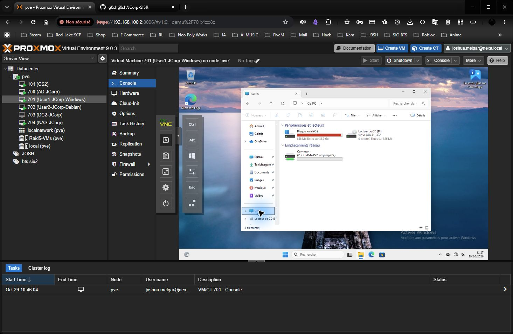

J'ai ouvert le lecteur par double-clic : le dossier de test `t`, créé précédemment sur le NAS, est visible sans demande supplémentaire d'identifiants. Le mappage et son ouverture sont donc validés sur ce poste et cette session.

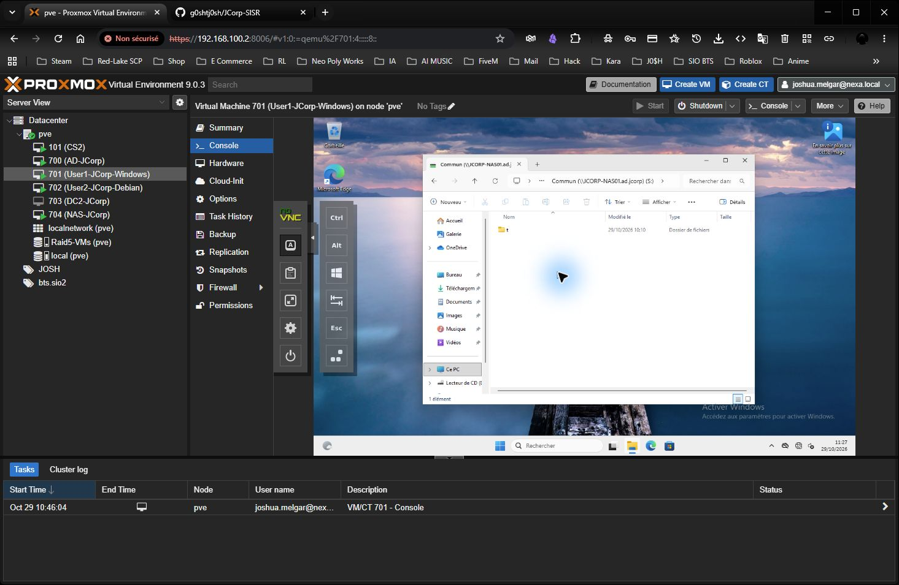

Le NAS est retenu comme terminé pour le périmètre du projet : les captures valident le partage et le lecteur réseau ; Joshua confirme les contrôles complémentaires.

[Retour à l'infrastructure](../README.md)
