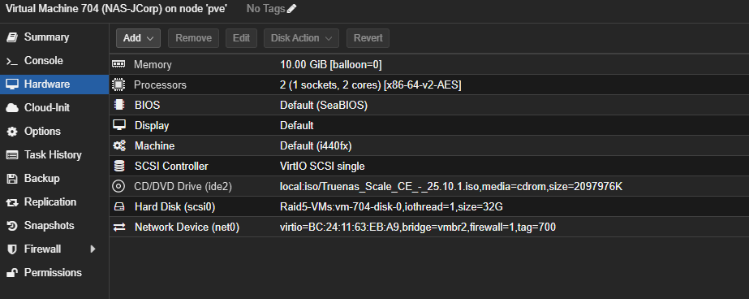
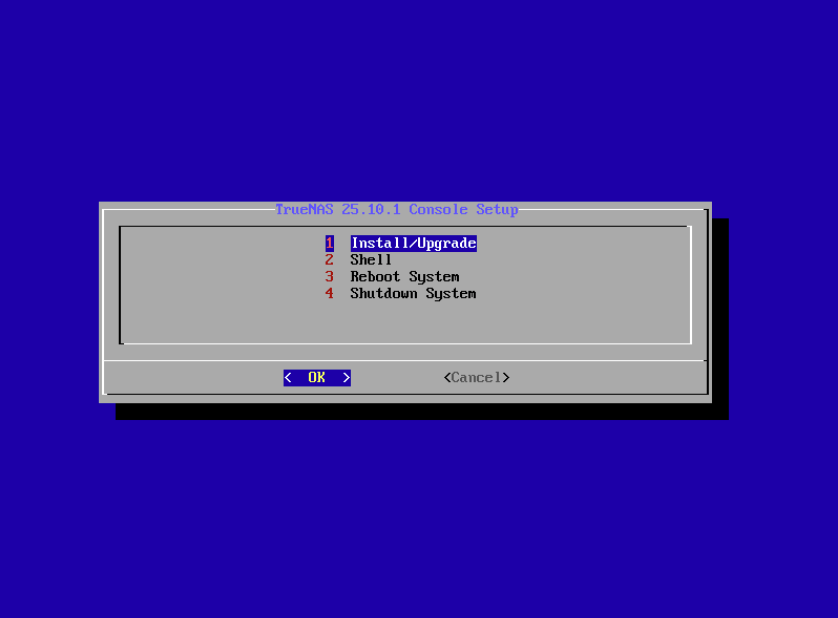
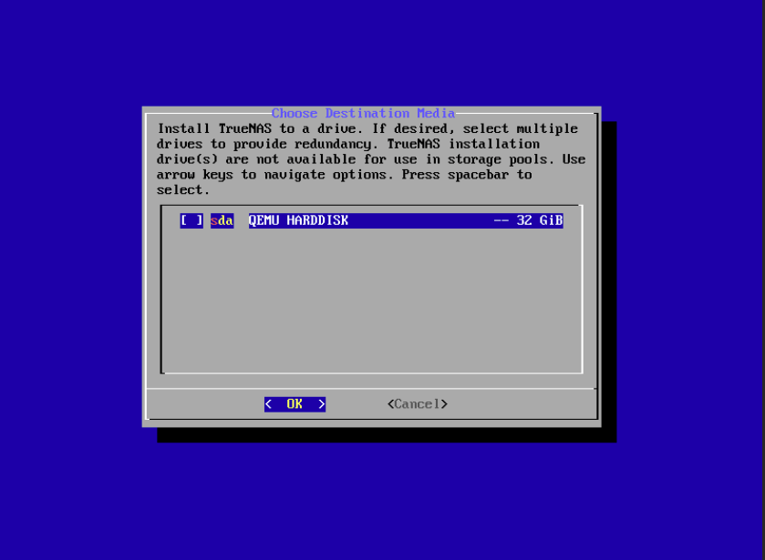
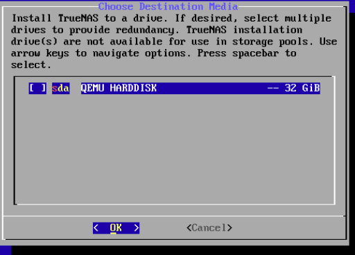
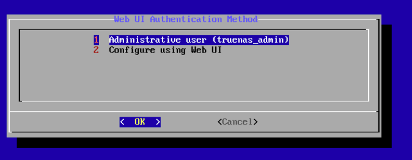

# TrueNAS - JCorp

Je mets en place un serveur TrueNAS pour le stockage et les partages de mon infrastructure JCorp. Cette documentation présente la création de la VM et les premières étapes de l'installation. Je la complète au fur et à mesure de la configuration.

## 1. Créer la machine virtuelle

J'ai créé la VM **704**, nommée **`NAS-JCorp`**, sur le nœud Proxmox **`pve`**. L'ISO montée est celle de **TrueNAS Community Edition 25.10.1**.

| Élément | Configuration visible |
| --- | --- |
| VMID et nom Proxmox | `704`, `NAS-JCorp` |
| Mémoire vive | 10 Gio, ballooning désactivé |
| Processeur | 2 vCPU, 1 socket et 2 cœurs, type `x86-64-v2-AES` |
| BIOS | SeaBIOS |
| Type de machine | `i440fx` |
| Contrôleur SCSI | VirtIO SCSI single |
| Disque système | 32 Gio, `scsi0`, stockage `Raid5-VMs`, IO thread activé |
| ISO | TrueNAS CE 25.10.1 sur le stockage `local` |
| Carte réseau | VirtIO, `net0`, pont `vmbr2`, tag VLAN `700` |
| Pare-feu Proxmox sur la carte | Activé |

La capture présente uniquement le disque système de 32 Gio. Les deux disques de données de 64 Gio seront ajoutés séparément pour préparer le pool de stockage. J'ai configuré le tag VLAN **700** sur la carte réseau afin de placer le NAS dans le même réseau que les autres VM JCorp.

## 2. Démarrer sur l'ISO

J'ai démarré la VM depuis l'ISO TrueNAS. Dans le menu **TrueNAS 25.10.1 Console Setup**, je choisis **Install/Upgrade**, puis valide avec **OK** pour lancer l'assistant d'installation.

L'installation s'effectue dans cette console, sans bureau graphique à installer dans la VM.

## 3. Choisir le disque système

L'écran **Choose Destination Media** présente le disque **`sda`**, identifié comme **QEMU HARDDISK**, d'une capacité de **32 Gio**. C'est le disque prévu pour installer TrueNAS.

Je sélectionne le disque avec la **barre d'espace**, puis je valide avec **OK**. La case est encore vide sur cette capture, prise avant la sélection.

La vue rapprochée ci-dessous montre ce même disque de 32 Gio dans l'écran de sélection :

Le disque choisi sera effacé lors de l'installation et réservé au système TrueNAS. Il ne servira pas de disque de données pour les partages.

## 4. Choisir le compte d'administration

L'écran **Web UI Authentication Method** propose de définir le compte d'administration pendant l'installation ou de reporter cette configuration à l'interface web.

Je conserve l'option **1 - Administrative user (`truenas_admin`)**, puis je valide avec **OK**. L'étape suivante demande de définir et de confirmer le mot de passe de ce compte. J'utiliserai ensuite `truenas_admin` pour me connecter à l'interface d'administration TrueNAS.

Ce compte est propre au NAS : il est distinct du compte `JCORP\Administrateur` de mon Active Directory.

## 5. Installer le système sur le disque

Après avoir défini et confirmé le mot de passe de `truenas_admin`, j'ai validé les choix de l'installateur pour lancer l'installation sur le disque système de 32 Gio.

La console affiche les opérations suivantes :

1. **Formatting disk sda** : préparation et formatage du disque système sélectionné.
2. **Creating boot pool** : création du pool ZFS réservé au démarrage de TrueNAS.
3. **Creating dataset** : création du dataset utilisé par le système.
4. **Extracting** : extraction des fichiers de TrueNAS sur le disque.

Je laisse l'installation se terminer sans éteindre la VM. Sur cette capture, l'extraction est encore en cours ; le pool de démarrage est distinct du futur pool de données destiné aux partages.

## Suite de la configuration

Après le message de réussite de l'installation, je retirerai l'ISO du lecteur virtuel pour démarrer sur le disque système. Je configurerai ensuite le réseau, les deux disques de données et leur pool, avant l'intégration à `ad.jcorp` et la création des partages.

[Retour à l'infrastructure](../README.md)
